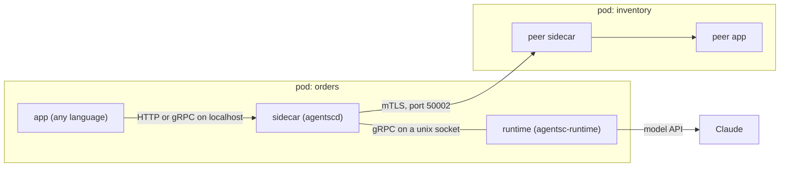

# agent-sidecar

[](https://github.com/f8fvwgzc/agent-sidecar/actions/workflows/ci.yml)
[](LICENSE)
[](https://f8fvwgzc.github.io/agent-sidecar/)


**Governed AI agents that run as a sidecar next to your service. The agent is a sidecar of the service, not a service of its own.**

agent-sidecar brings AgentSecOps to LLM agents: identity, policy, budgets, guardrails and audit, owned by the platform instead of by each app. Agents run on Claude, or on a built-in mock model for offline tests.

**Naming.** `agentsc` is the short name of agent-sidecar, used in all code: the sidecar is `agentscd`, the CLI is `agentsc`, the CA is `embassy`, the runtime is `agentsc-runtime`, charters use `apiVersion: agentsc.io/v1alpha1`, and identities look like `spiffe://agentsc/ns/<ns>/svc/<svc>`.

## What you get

- **Any language, no SDK.** Your app calls its sidecar on localhost: HTTP on `127.0.0.1:3500` or gRPC on `127.0.0.1:50001`.
- **One YAML charter per service.** Every tool call an agent makes is checked against it, including calls to other services. Model calls are bounded by its budgets.
- **mTLS identity per service.** Each service gets `spiffe://agentsc/ns/<ns>/svc/<svc>`. The called sidecar decides which peers and which of their agents may call.
- **Budgets and guardrails.** Tokens per model call, invocations per minute, cost per day, steps per run, input size, regex deny rules on input and output, and PII redaction of the agent's output.
- **Prompt injection contained by design.** Taint rules track what each run has read. After untrusted text (a ticket, a web page), the run can't call a tool that writes. After sensitive data, it can't call out to the internet. [How it works](docs/design/taint-policy.md).
- **One JSONL audit line per action.** The sidecar writes them to stdout (or to a file with `audit.sink: file`). Read them with `kubectl logs` or `agentsc logs`.



## Quick start

You need Rust (`cargo`), `protoc`, `uv`, Go, `python3` and `curl`. No Kubernetes and no API key.

```bash
git clone https://github.com/f8fvwgzc/agent-sidecar.git && cd agent-sidecar
make local-demo
```

The script starts two example apps (Go `orders`, FastAPI `inventory`), each with its own sidecar and real mTLS certificates.
It makes three calls (allowed across services, denied admin call, blocked by a guardrail) and prints the audit trail.
Without `ANTHROPIC_API_KEY` the runtime uses a mock model. Export the key first to use Claude.
The full v0.2 platform (control plane, console, managed sidecars) runs without Docker with `CHECK_ONLY=0 make platform-demo`; the console is then at http://localhost:38088.
With Docker, `make compose-up` runs the same stack plus an OpenTelemetry collector and Jaeger (set `AGENTSC_CONSOLE_PORT`, `AGENTSC_ORDERS_PORT` or `AGENTSC_JAEGER_PORT` if 8080, 8081 or 16686 are taken).
On minikube (also needs Docker, minikube and `kubectl`), run `make minikube-up build deploy demo`.

## Call an agent

Your app sends one HTTP request to its own sidecar:

```bash
curl -s localhost:3500/v1/agents/stock-analyst/invoke \
  -H 'content-type: application/json' \
  -d '{"input": "How many WIDGET-1 are in stock?"}'
```

The JSON response has `status`, `output`, `usage`, `steps`, `request_id` and `trace_id`.
A denied invocation returns 403. A budget limit (calls per minute, cost per day, or agent-call depth) returns 429. An unknown agent returns 404.
A runtime or model error returns 502. Hitting `max_steps` or `max_tokens_per_call` also returns 502, with `status: error`.
A tool call that is denied inside the run does not fail the request. It appears in `steps` with `decision: deny`.

## A charter

```yaml
apiVersion: agentsc.io/v1alpha1
kind: Charter
service: { name: inventory, namespace: shop, app_port: 8000 }
agents:
  - name: stock-analyst
    type: agent
    model: claude-opus-5-5            # or "mock"
    system: You answer questions about stock levels.
    tools:
      - name: get_stock
        description: Get stock for one SKU.
        type: service
        service: inventory            # its own app
        method: GET
        path: /stock/{sku}
    budgets: { max_tokens_per_call: 1024, max_calls_per_minute: 60, max_cost_usd_per_day: 2.0, max_steps: 4 }
guardrails: { pii_redact: true }
authz:
  default: deny
  callers:  [{ identity: local, agents: ["*"] }]
  services: [{ name: self-stock, identity: local, agent: stock-analyst, service: inventory, allow: ["GET /stock/*"] }]
audit: { sink: stdout }
```

Check a charter with `cargo run -p agentsc-cli -- charter validate <file>`.

## Docs

| Page | What it covers |
| ---- | -------------- |
| [Architecture](docs/architecture.md) | How it works: components, ports, request flow, identity, authz order. |
| [Getting started](docs/getting-started.md) | Run it on your machine and on minikube, step by step. |
| [Creating agents](docs/guides/creating-agents.md) | Write a charter, define agents and tools, call them from your app. |
| [Microservices](docs/guides/microservices.md) | Adopt it across many services, for a startup or an enterprise. |
| [Monolith and monorepo](docs/guides/monolith-and-monorepo.md) | One service with many agents, and a monorepo layout. |
| [Operations](docs/operations.md) | Audit logs, the CLI, troubleshooting, production checklist, limitations. |
| [Decision records](docs/adr/README.md) | Why HTTP/3 for the console, the response caches and the SQLite store are built the way they are. |
| [CONTRACT.md](CONTRACT.md) | Full reference: wire protocol, charter, authz order, audit record. |

## Status

This is a `v1alpha1` MVP. It is **not production-ready**. The most important limits:

- Sidecar injection is manual. There is no mutating webhook; you write the `agentscd` container into each Deployment.
- Certificates are per service, issued by a bootstrap Job, with no rotation. The Job keeps its CA Secret in its own namespace, so each namespace gets its own CA. Cross-namespace mesh calls do not work out of the box.
- Budgets live in memory in each sidecar replica. They are not shared across replicas, and they reset when the sidecar restarts.
- The runtime runs as a child process in the same container as the sidecar.
- The runtime calls the model API directly. These calls are audited, not proxied. `pii_redact` only rewrites the agent's final output and the audit records. It does not change prompts sent to the model.
- The charter is loaded once at startup. A ConfigMap change needs a pod restart.
- There is no NetworkPolicy and no UI yet.

More detail is in [docs/operations.md](docs/operations.md) and [CONTRACT.md §11](CONTRACT.md#11-known-gaps-mvp).

## Contributing and security

See [CONTRIBUTING.md](CONTRIBUTING.md) to build, test and send a change. Report security problems privately, as [SECURITY.md](SECURITY.md) explains.

## License

[MIT](LICENSE)
