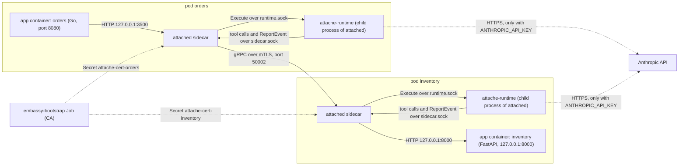
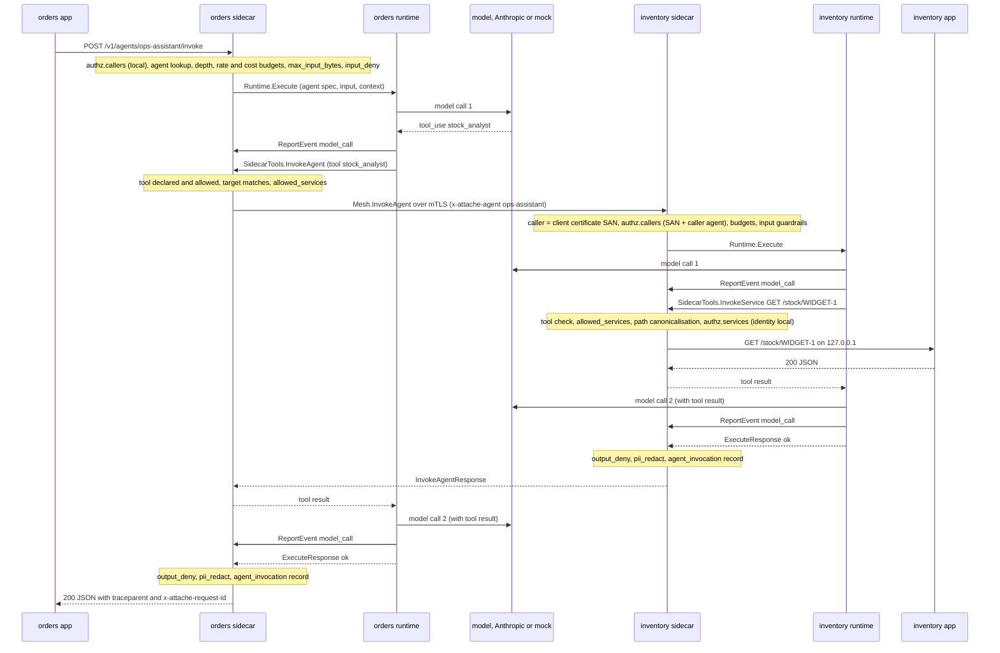
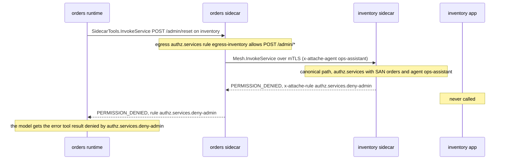
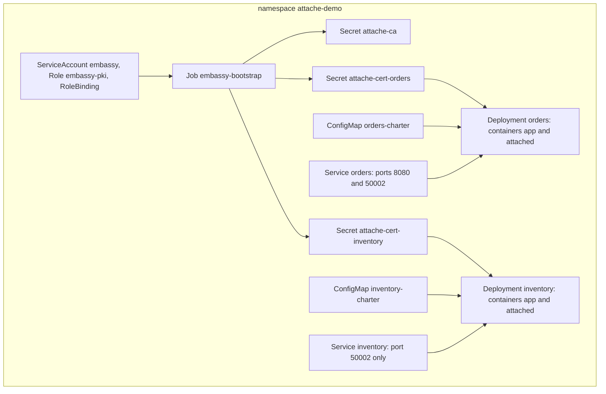

# Architecture

This page explains how agent-sidecar works inside: the components, the ports, one request from start to end, identity, policy checks, audit records, the trust model and the Kubernetes layout. It describes the code as it is today, including what is not built yet.

## Names: agent-sidecar and attache

The project is published as **agent-sidecar**. The code still uses its working name, **attache**. Every command, file, field and code sample uses the attache names. This page uses "agent-sidecar" only in prose.

| Thing | Name in the code | Where it lives |
| --- | --- | --- |
| Sidecar binary | `attached` | `services/attached` |
| CLI | `attache` | `services/attache-cli` |
| Certificate authority (CA) | `embassy` | `services/embassy` |
| Agent runtime (Python) | `attache-runtime` | `runtime/` |
| Policy file | `charter.yaml`, `apiVersion: attache.io/v1alpha1`, `kind: Charter` | one per service |
| Workload identity | `spiffe://attache/ns/<namespace>/svc/<service>` | client certificate URI SAN |
| Labels, headers, env vars | `attache.io/service`, `x-attache-*`, `ATTACHE_*` | manifests, wire protocol |

[CONTRACT.md](../CONTRACT.md) is the full reference for the wire protocol, the charter and the audit record. This page is the overview.

## The idea

**The agent is a sidecar of the service, not a service of its own.** An AI agent runs in the same pod as the service that owns the data. The app asks its sidecar to run an agent. The sidecar runs it and checks everything the agent does.

Five principles shape the design.

1. **Agent as a sidecar.** The agent is deployed, scaled and versioned with its service. You do not run a separate agent platform. Policy is checked next to the data it protects.
2. **Zero SDK.** The app makes one plain HTTP (or gRPC) call to `localhost`. Any language works. The demo apps are Go and FastAPI, and neither imports an agent-sidecar library.
3. **Policy is data.** Agents, tools, budgets, guardrails, authorization (authz) and audit settings live in one `charter.yaml` per service. The sidecar validates it on load. An unknown field anywhere is an error, so a typo cannot be silently ignored. You review the file in a pull request like any other config.
4. **Identity is the certificate.** Every service has an mTLS certificate with the URI SAN `spiffe://attache/ns/<namespace>/svc/<service>`. The receiving sidecar decides from that certificate plus the name of the calling agent. A header alone never proves who is calling, because anyone can write a header.
5. **Default deny.** If no rule lets an identity invoke an agent, the call is denied. If no rule lets an agent reach a path, the call is denied (with `authz.default: deny`, which is the default). Every allowed action is written down in the charter.

Every tool call and every call to another service goes through the sidecar. Model calls are made by the runtime and reported to the sidecar. The sidecar audits all of it: the invocation, each model call, each tool call and each call to another service. Authz, guardrail and budget decisions are recorded too, either as their own record or as the `decision` and `rule` of the record they belong to. Each record is one JSON line on the sidecar's stdout (or in a file, with `audit.sink: file`).

## Components

| Component | Language | Runs as | Job |
| --- | --- | --- | --- |
| `attached` | Rust (tokio, axum, tonic, rustls) | a container in every pod that has agents | Loads the charter. Serves the app on localhost. Starts and supervises the runtime. Checks and performs every tool call. Talks to other sidecars over mTLS. Writes the audit log. |
| `attache-runtime` | Python 3.12+ (grpcio, `anthropic`, pydantic) | a child process of `attached`, in the same container | Runs the agent loop: model call, tool calls, model call, until done. Sends every tool call to its sidecar. Reports every model call to its sidecar for the audit log. |
| `embassy` | Rust | a Kubernetes Job (`embassy-bootstrap`), or a local CLI | Creates the CA. Issues one certificate per service. In the cluster it stores each one in a Kubernetes Secret. Locally it writes files. |
| `attache` | Rust | your laptop, or inside the `attached` image | Validates charters, prints the charter JSON Schema, and reads and filters audit logs. |

### attached (the sidecar)

`attached` makes every authz and guardrail decision and most budget decisions. The runtime enforces only `max_steps` and `max_tokens_per_call`. It also refuses, on its own, a tool name that is not in the spec it received. At startup `attached`:

1. loads and validates the charter from `--charter` (default `/etc/attache/charter/charter.yaml`);
2. opens the audit sink (stdout or a file);
3. loads `ca.crt`, `tls.crt` and `tls.key` from `--tls-dir` (default `/etc/attache/tls`), and stops with an error if the certificate identity is not the charter's own `spiffe://attache/ns/<namespace>/svc/<service>`;
4. starts the `SidecarTools` gRPC server on `<socket-dir>/sidecar.sock`;
5. spawns the runtime (unless `--no-runtime`) and polls its `Health`;
6. starts the app HTTP API and the app gRPC API on localhost;
7. starts the mesh server on `--mesh-addr`, but only if TLS material was found.

If the TLS files are missing, the sidecar still starts, with the mesh off. It never becomes ready in that state, because `/readyz` needs TLS.

The charter and the certificates are read **once**, at startup. A changed ConfigMap or Secret has no effect until the pod restarts.

Sidecar diagnostics go to stderr. Stdout carries only audit JSON lines.

### attache-runtime (the agent loop)

`attached` starts the runtime with the command in `--runtime-cmd` (default `attache-runtime`) and appends `--listen unix:<socket-dir>/runtime.sock --sidecar unix:<socket-dir>/sidecar.sock`. It also sets `ATTACHE_SERVICE` and `ATTACHE_NAMESPACE`. The runtime's own stdout and stderr go to the sidecar's stderr with a `[runtime]` prefix.

If the runtime exits, the sidecar restarts it. The wait starts at 1 second and doubles up to 30 seconds. It goes back to 1 second if the runtime ran for more than 60 seconds. The sidecar checks `Health` every 10 seconds while the runtime is healthy, and every second while it is not.

One `Execute` call is one agent loop:

1. The first user message is the `input`. If a `context` was sent, it is added as a `<context>` JSON block.
2. The runtime calls the model with the agent's `system` prompt and its tools. `max_tokens` is the agent's `budgets.max_tokens_per_call`.
3. If the model asks for tools, the runtime sends each tool call to the sidecar, one after another, and gives the results back to the model. Tool results longer than 20,000 characters are cut before the model sees them.
4. The loop ends when the model stops (`end_turn`), refuses (`model.refusal`), runs out of steps (`budget.max_steps`), is cut off by `max_tokens` (see [Budgets](#budgets)), or the model call fails (`model.error`).

Model selection: if `ANTHROPIC_API_KEY` is set and the agent's `model` is not `mock`, the runtime uses the Anthropic API. Otherwise it uses a deterministic mock model. The mock picks a tool by matching words in the input against tool names and descriptions, so the demo runs offline. `Health` reports `model_provider: "anthropic"` or `"mock"`, based only on whether `ANTHROPIC_API_KEY` is set.

The runtime calls the model API itself. The sidecar does not proxy that call. The runtime reports each model call with `ReportEvent`, and the sidecar writes the record.

### embassy (the CA)

`embassy` has three commands:

| Command | What it does |
| --- | --- |
| `embassy ca-init --out <dir>` | Writes a new self-signed CA (`ca.crt`, `ca.key`). |
| `embassy cert-issue --ca <dir> --namespace <ns> --service <svc> --out <dir> [--ttl-days N]` | Writes `tls.crt`, `tls.key` and `ca.crt` for one service. Used by `make local-demo` and `make dev-certs`. |
| `embassy bootstrap --namespace <ns> --services a,b,c` | In the cluster: reads Secret `attache-ca` in `<ns>` or creates it, then creates or replaces Secret `attache-cert-<svc>` for each listed service. |

`embassy` is not a running server. Nothing requests certificates at runtime. See [Identity and mTLS](#identity-and-mtls).

### attache (the CLI)

```text
attache charter validate <file>     # exit 0 "valid", exit 1 with one error per line
attache charter schema              # JSON Schema of charter.yaml to stdout
attache logs <svc>[,<svc>...] [-n NS] [--context C] [--agent A] [--trace T] [--request R]
             [--kind K] [--denied] [-f] [--raw] [--file F|-] [--tail N]
attache version
```

`attache logs` runs `kubectl logs -c attached` on pods with label `attache.io/service`, keeps only lines that are audit records, and filters them. Without `-f` it also sorts them by time. See [operations.md](operations.md) for examples.

## Ports, sockets and files

Every address below can be changed with a flag or an environment variable. A flag wins over the environment variable.

| Listener | Default | Flag / env | Who calls it | Protocol |
| --- | --- | --- | --- | --- |
| App HTTP API | `127.0.0.1:3500` | `--http-addr` / `ATTACHE_HTTP_ADDR` | the app container | HTTP/1.1, JSON |
| App gRPC API | `127.0.0.1:50001` | `--grpc-addr` / `ATTACHE_GRPC_ADDR` | the app container | gRPC, plaintext |
| Mesh | `0.0.0.0:50002` | `--mesh-addr` / `ATTACHE_MESH_ADDR` | other pods' sidecars | gRPC over mTLS |
| SidecarTools | `unix:/run/attache/sidecar.sock` | `--socket-dir` / `ATTACHE_SOCKET_DIR` | the local runtime | gRPC |
| Runtime | `unix:/run/attache/runtime.sock` | `--socket-dir` / `ATTACHE_SOCKET_DIR` | the local sidecar | gRPC |

Other flags of `attached`:

| Flag | Env | Default |
| --- | --- | --- |
| `--charter` | `ATTACHE_CHARTER` | `/etc/attache/charter/charter.yaml` |
| `--tls-dir` | `ATTACHE_TLS_DIR` | `/etc/attache/tls` (files `ca.crt`, `tls.crt`, `tls.key`) |
| `--runtime-cmd` | `ATTACHE_RUNTIME_CMD` | `attache-runtime` (split like shell words) |
| `--no-runtime` | `ATTACHE_NO_RUNTIME` | off. When on, the sidecar does not spawn the runtime. Something else must serve `runtime.sock`. |
| none | `ANTHROPIC_API_KEY` | unset, so every agent uses the mock model |

**Two different mesh ports.** `--mesh-addr` is where this sidecar listens. The charter field `mesh.port` (default `50002`) is the port this sidecar dials on its peers. A peer's address is `<service>.<own namespace>.svc.cluster.local:<mesh.port>`, unless `mesh.peers.<service>` in the charter gives a `host:port`.

App HTTP API endpoints:

| Method and path | Answer |
| --- | --- |
| `POST /v1/agents/{name}/invoke` | Runs the agent. Body `{"input": string, "context"?: object}`. |
| `GET /v1/agents` | `{"agents": [{"name", "type", "model", "tools"}]}`. `tools` lists only the tools the agent may use. |
| `GET /v1/charter` | The loaded charter as JSON. |
| `GET /healthz` | `200 ok` while the process is up. |
| `GET /readyz` | `200` when TLS is loaded and the runtime answered `Health`, else `503`. Body `{"ready", "runtime", "model_provider", "mesh"}`. |

Invoke status codes:

| HTTP | `status` | When |
| --- | --- | --- |
| 200 | `ok` | the agent finished. Denied tool calls inside the run do not change this. |
| 400 | `error` | bad JSON or no `input` (`request.invalid`) |
| 403 | `denied` | authz or a guardrail denied the invocation, or the model refused (`model.refusal`) |
| 404 | `error` | unknown agent (`agent.unknown`), reported only after `authz.callers` passed |
| 429 | `denied` | a `budget.*` rule: `max_calls_per_minute`, `max_cost_usd_per_day`, or `max_depth` |
| 502 | `error` | runtime unavailable, model error, `budget.max_steps`, or `budget.max_tokens_per_call` |

Every invoke response carries the headers `traceparent` and `x-attache-request-id`. The gRPC API (`attache.v1alpha1.AppApi/InvokeAgent`) maps denials to `PERMISSION_DENIED` or `RESOURCE_EXHAUSTED`, an unknown agent to `NOT_FOUND`, and errors to `UNAVAILABLE`.

Timeouts are fixed in the code:

| Call | Timeout |
| --- | --- |
| Sidecar to runtime (`Execute`) | 300 s |
| Sidecar to peer sidecar: connect / whole call | 5 s / 120 s |
| Sidecar HTTP client (local app, `http` tools) | 30 s |
| Runtime to sidecar: `InvokeService` and `InvokeHttp` | 120 s |
| Runtime to sidecar: `InvokeAgent` | 300 s |
| Runtime to sidecar: `ReportEvent` | 10 s |
| `Health` probe of the runtime | 3 s |

## Two pods and the CA

The demo has two services. `orders` (Go) has an orchestrator agent, `ops-assistant`. `inventory` (FastAPI) has an agent, `stock-analyst`. The inventory app listens on `127.0.0.1` only, so other pods can reach it only through its sidecar.



## One request, end to end

The demo question is "How many WIDGET-1 do we have in stock and should we reorder?". The `orders` app sends it to `ops-assistant`. That agent calls the `stock_analyst` tool, which is an agent in another pod. The `stock-analyst` agent calls its `get_stock` tool, which is an HTTP call to its own app.



Step by step:

1. **The app calls its sidecar.** The caller identity is `local`. The sidecar makes a new `request_id`. It takes the trace id from the app's `traceparent` header, or starts a new trace if there is none.
2. **The orders sidecar runs the invocation pipeline** (next section). If a check fails, the app gets 403, 404 or 429 and no model is called.
3. **The sidecar calls `Runtime.Execute`** over the unix socket. It sends the agent's charter entry with only the tools the agent may use. The model never sees a tool it may not call.
4. **The runtime calls the model** and reports a `model_call` record with `ReportEvent`. The sidecar adds the cost to the agent's daily total.
5. **The model asks for `stock_analyst`.** The runtime sends `SidecarTools.InvokeAgent`. The sidecar checks that `ops-assistant` declares this tool, may use it, and names the same target (`inventory/stock-analyst`).
6. **The orders sidecar calls the inventory sidecar** with `Mesh.InvokeAgent` over mTLS. It sends `traceparent`, `x-attache-request-id` and `x-attache-agent: ops-assistant` as metadata. An agent tool sends only the `input` string. The caller's `context` is not passed on.
7. **The inventory sidecar reads the caller identity from the client certificate**: `spiffe://attache/ns/attache-demo/svc/orders`. It runs the same pipeline with that identity and calling agent `ops-assistant`. The inventory charter allows exactly this pair.
8. **The inventory runtime runs `stock-analyst`.** Its `get_stock` tool is a `service` tool on its own service. The sidecar checks it, makes the path canonical, runs `authz.services` with identity `local`, and calls `http://127.0.0.1:8000/stock/WIDGET-1`. It adds the headers `traceparent`, `x-attache-request-id`, `x-attache-caller: local` and `x-attache-agent: stock-analyst`.
9. **Output checks on inventory.** The final answer goes through `output_deny`, then `pii_redact`. If the answer contains the warehouse email from the stock record, it becomes `[redacted:email]` before it is sent back to orders.
10. **Back on orders**, the answer becomes a tool result. The model writes the final answer. The orders sidecar runs its own output checks and returns the JSON envelope with `status`, `output`, `usage`, `steps`, `request_id` and `trace_id`.

Both sidecars write their records under the same `request_id` and `trace_id`. `attache logs orders,inventory --trace <id>` shows them as one story.

### A denied service call

If you ask `ops-assistant` to "Reset the inventory admin counters", it uses the `inventory_admin_reset` tool, a `service` tool on another service.



The invocation still returns HTTP 200. The denied step is in `steps[]` with `decision: deny` and the rule name. The inventory sidecar writes an inbound `service_call` record with `decision: deny`. The orders sidecar writes a `tool_call` and an outbound `service_call` with the same rule, `request_id` and `trace_id`.

## The invocation pipeline (authz order)

Every agent invocation goes through the same steps in [`pipeline.rs`](../services/attached/src/pipeline.rs). This is true for a call from the app, from a peer sidecar, and from a local agent tool. The first failing step stops the call.

1. **`authz.callers`.** Find the rules whose `identity` equals the caller (`local` or the peer's SAN). The call is allowed if one of them lists the agent (or `"*"`) **and** its `caller_agents` is empty or contains the calling agent. Otherwise it is denied with `authz.callers.default` (no rule for that identity) or `authz.callers.<caller>` (a rule exists but does not cover this agent or calling agent). `<caller>` is the calling service name, for example `authz.callers.orders`, or `local`. `authz.default` does not apply here: no matching rule always means deny.
2. **Agent lookup.** An unknown agent gives `agent.unknown` (404). This runs after step 1, so a peer cannot probe which agent names exist.
3. **Depth.** Each agent-to-agent hop adds 1 to the depth. Depth above 4 is denied with `budget.max_depth`.
4. **Budgets.** `budget.max_calls_per_minute`, then `budget.max_cost_usd_per_day`.
5. **Input guardrails.** `guardrail.max_input_bytes` (size of `input` plus `context` JSON), then `guardrail.input_deny.<name>` (regex on `input` or `context`).
6. **Run.** `Runtime.Execute`. Every tool call is checked as shown below.
7. **Output guardrails.** `guardrail.output_deny.<name>` on the final output denies the invocation. Then `guardrail.pii_redact` rewrites the output. The decision stays `allow`.

A tool call that is denied inside the run does not fail the invocation. The model gets an error tool result (`denied by <rule>: <reason>`), the step shows `decision: deny`, and it is audited.

### Tool-call checks on the caller's sidecar

The runtime is driven by a model, so the sidecar checks every tool call it sends ([`tools.rs`](../services/attached/src/tools.rs)).

| Tool type | Checks, in order | Then |
| --- | --- | --- |
| `service` | The agent declares the tool and may use it (`guardrail.allowed_tools`). The call uses the declared service and method (`guardrail.tool_spec`). The service is allowed (`guardrail.allowed_services`). The path is canonical (`guardrail.path`). `authz.services` with identity `local`, the calling agent, and the target service. | Own service: HTTP to `127.0.0.1:<app_port>`. Other service: `Mesh.InvokeService` on the peer. |
| `agent` | Declared and allowed (`guardrail.allowed_tools`). Same target agent and service as declared (`guardrail.tool_spec`). For a remote agent: `guardrail.allowed_services`. | Local agent: the pipeline again, with caller `local` and `caller_agent` set. Remote agent: `Mesh.InvokeAgent`. |
| `http` | Declared and allowed (`guardrail.allowed_tools`). Same method, and the same origin (`scheme://host:port`) as the declared `url`, with no user or password in the URL (`guardrail.tool_spec`). | HTTP from the sidecar to that URL. |

Notes:

- For a `service` tool, the sidecar compares the service and the method with the declaration, not the path. The path is limited by `authz.services` rules.
- `http` tools are not checked by `authz.services` or `allowed_services`. The declared origin is the only limit.
- The runtime fills `{param}` in paths with percent-encoded values, so a value like `../admin` cannot add path segments.

### Checks on the receiving sidecar

| Mesh call | Checks | Then |
| --- | --- | --- |
| `Mesh.InvokeAgent` | A client certificate with a `spiffe://attache/` URI SAN (`authz.identity.invalid`). Then the full pipeline above, with caller = SAN and calling agent = `x-attache-agent`. | The agent runs in this pod. |
| `Mesh.InvokeService` | Certificate SAN as above. Canonical path (`guardrail.path`). `authz.services` with identity = SAN, agent = `x-attache-agent`, service = this service. | HTTP to `127.0.0.1:<app_port>`. |

An inbound service call does not run `authz.callers`, budgets, or the input and output guardrails. After the certificate and path checks, only `authz.services` decides.

### authz.services matching

A rule applies when its `identity` (if set) equals the caller, its `agent` (if set) equals the calling agent, and its `service` equals the target. Among the rules that apply:

1. If any `deny` pattern matches, the call is denied (`authz.services.<rule-name>`).
2. Else, if any `allow` pattern matches, the call is allowed (`authz.services.<rule-name>`).
3. Else, `authz.default` decides (`authz.default.deny` or `authz.default.allow`). The default of `authz.default` is `deny`.

A pattern is `"<METHOD> <path>"`. `*` as the method matches any method. A trailing `*` on the path makes it a prefix match, and at least one more character must follow: `/stock/*` matches `/stock/x` and `/stock/x/y`, but not `/stock`. Without a slash before the `*`, `/admin*` also matches `/administrator`. A `*` anywhere else is a validation error. The query string is ignored when matching. `identity: local` matches calls made by this pod's own agents.

The same rules run twice for a cross-pod call. The caller's sidecar checks egress (identity `local`, target = the peer). The callee's sidecar checks inbound (identity = caller SAN, target = itself). Both must allow. In the demo, orders allows `POST /admin/*` on purpose, and inventory denies it.

### Path canonicalisation

Before any `authz.services` match, on both sides, the sidecar resolves the path with the same WHATWG URL parser it uses to send the request. `.` and `..` segments, and encoded dot segments like `%2e%2e`, are removed first. So `/stock/../admin/reset` is matched, audited and sent as `/admin/reset`. A path is denied with `guardrail.path` if it does not start with `/`, or contains whitespace, a control character, `\`, `#`, or an encoded `/`, `\` or NUL (`%2f`, `%5c`, `%00`).

## Identity and mTLS

- **Trust domain** `attache`. **Identity** `spiffe://attache/ns/<namespace>/svc/<service>`. The sidecar builds its expected identity from `service.namespace` and `service.name` in its charter.
- **Certificates.** The CA is self-signed, valid 10 years, stored in Secret `attache-ca` (`ca.crt`, `ca.key`). Each service gets Secret `attache-cert-<service>` with `ca.crt`, `tls.crt` and `tls.key`, valid 365 days. The leaf has the SPIFFE ID as URI SAN and these DNS SANs: `<service>`, `<service>.<ns>`, `<service>.<ns>.svc`, `<service>.<ns>.svc.cluster.local`.
- **How embassy issues them.** The `embassy-bootstrap` Job runs `embassy bootstrap --namespace attache-demo --services orders,inventory`. It uses its service account token to call the Kubernetes API. It reads the CA Secret in that namespace, or creates a new CA if the Secret does not exist. Then it issues a new leaf for every listed service and writes the Secrets. Running the Job again keeps the CA and replaces all leaves.
- **Per service, not per pod.** All replicas of a Deployment mount the same Secret and share one key.
- **Mesh server.** rustls requires a client certificate that chains to `ca.crt`. The caller identity is the first URI SAN that parses as a `spiffe://attache/` ID. A certificate without one is refused with `authz.identity.invalid`, audited as kind `authz` with `caller: "unknown"`.
- **Mesh client.** It verifies the peer against `ca.crt` with server name `<peer>.<own namespace>.svc.cluster.local`, and presents its own leaf.
- **How the callee authorizes.** It uses the pair (certificate SAN, `x-attache-agent`). The SAN proves which service is calling. `x-attache-agent` is a claim. The caller's sidecar sets it to the agent that made the tool call. The app and the model cannot set it. The callee cannot see the caller's charter, so it trusts that claim exactly as far as its own `caller_agents` and `authz.services.agent` rules say.

## Guardrails

Guardrails are set once per charter. `allowed_tools` and `allowed_services` are per agent. All other guardrails apply to every agent of the service.

| Field | Default | What it checks | Rule name | Where |
| --- | --- | --- | --- | --- |
| `max_input_bytes` | 16384 | `input` plus `context` JSON, in bytes | `guardrail.max_input_bytes` | sidecar, before the run |
| `input_deny` | none | each regex against `input` and against `context` JSON | `guardrail.input_deny.<name>` | sidecar, before the run |
| `output_deny` | none | each regex against the agent's final output | `guardrail.output_deny.<name>` | sidecar, after the run |
| `pii_redact` | `false` | rewrites emails and phone numbers | `guardrail.pii_redact` (decision `allow`) | sidecar, after the run and in every audit record |
| `allowed_tools` | every declared tool | which tools an agent may use. Other tools are removed before the runtime sees the spec. | `guardrail.allowed_tools` | sidecar, before the run and on every tool call |
| `allowed_services` | every service the agent's tools name | which services an agent may call | `guardrail.allowed_services` | sidecar, on every `service` tool call and remote `agent` tool call |

Regexes use the Rust `regex` syntax. A regex that does not compile makes the charter invalid.

### What pii_redact covers

When `pii_redact: true`, emails become `[redacted:email]` and phone numbers become `[redacted:phone]`. The phone pattern finds common 10-digit formats with an optional country code, such as `555-123-4567`, `(555) 123-4567` or `+1 555 123 4567`. Redaction happens in:

- the agent's **final output** returned to the caller (app or peer sidecar);
- every string in `input` and `output` of **every audit record** this sidecar writes.

It does **not** cover:

- **prompts sent to the model provider.** Tool results and inputs reach the model unchanged. In the demo, the stock record with the warehouse email is part of the `stock-analyst` model prompt. With real Claude, that email is sent to the Anthropic API;
- tool results inside the agent loop;
- the response body of an inbound `Mesh.InvokeService` call, which is returned to the peer as the app sent it (only the audit copy is redacted).

## Budgets

Each agent has four budget fields in `agents[].budgets`. There is also one fixed limit.

| Field | Default | Meaning | Enforced by | Rule | Result |
| --- | --- | --- | --- | --- | --- |
| `max_calls_per_minute` | 60 | invocations of this agent in a sliding 60 s window | sidecar, pipeline step 4 | `budget.max_calls_per_minute` | 429 |
| `max_cost_usd_per_day` | 10.0 | sum of `cost_usd` of this agent's `model_call` records, per UTC day | sidecar, pipeline step 4 | `budget.max_cost_usd_per_day` | 429 |
| `max_tokens_per_call` | 1024 | `max_tokens` of each model call, at most 128000 | runtime | `budget.max_tokens_per_call` | 502 when the cut leaves no usable answer |
| `max_steps` | 8 | model calls in one invocation | runtime | `budget.max_steps` | 502 |
| (fixed) depth 4 | 4 | agent-to-agent nesting | sidecar, pipeline step 3 | `budget.max_depth` | 429 |

Details:

- Budgets are kept **in memory** in each sidecar replica. They are not shared between replicas. They reset when the sidecar restarts.
- The rate counter counts every invocation that passes the rate check, even one that a later check (cost, guardrail) denies. A call refused by the rate check is not counted.
- The cost check runs at the start of an invocation. The cost of a running invocation is added as its model calls are reported. One invocation can go over the limit. The next one is refused.
- The cost of an agent called over the mesh is counted in the callee's sidecar, where its runtime runs.
- Cost comes from the price table in `runtime/src/attache_runtime/pricing.py`, in USD per million tokens. An unknown model id is priced like the most expensive tier. `mock` costs 0.
- If `max_tokens` cuts a turn that has text and no tool call, the result is `ok` with the cut text. If the cut turn has a tool call or no text, the result is an error and the tool call never runs.

## Audit records

Every record is one JSON line, written only by `attached`. The default sink is stdout (`kubectl logs -c attached`). `audit.sink: file` with `audit.file` writes to a file instead. Fields always appear in this order:

`ts`, `kind`, `request_id`, `trace_id`, `span_id`, `parent_span_id`, `service`, `namespace`, `agent`, `caller`, `caller_agent`, `callee`, `direction`, `input`, `output`, `input_sha256`, `output_sha256`, `tokens`, `cost_usd`, `latency_ms`, `decision`, `rule`, `reason`, `error`.

### Kinds

| `kind` | Written when | `direction` |
| --- | --- | --- |
| `agent_invocation` | once per invocation, at its end: allowed, denied or failed. Denials by `authz.callers` and `budget.max_depth` appear only here. | `inbound` |
| `model_call` | each model call, reported by the runtime with `ReportEvent` | `outbound` |
| `tool_call` | each tool call the sidecar receives from the runtime, always exactly one | `internal` |
| `service_call` | a `service` tool call was attempted (caller side), or an inbound `Mesh.InvokeService` (callee side) | `internal` (own app), `outbound` (peer), `inbound` (callee) |
| `agent_call` | an `agent` tool call was attempted | `internal` (local agent), `outbound` (remote) |
| `http_call` | an `http` tool call was attempted | `outbound` |
| `authz` | a peer was refused for its certificate (`authz.identity.invalid`) | `inbound` |
| `guardrail` | an input or output guardrail denied, or `pii_redact` rewrote the output | `internal` |
| `budget` | a rate or cost budget denied | `internal` |

Key fields:

- `caller` is `local` or the caller's SPIFFE ID (`unknown` on an `authz` record). `caller_agent` is the agent that made the call, or `null`.
- `callee` names the target: an agent, a model (`anthropic:<model>` or `mock`), a tool name (on `tool_call`), `inventory/stock-analyst`, `inventory GET /stock/WIDGET-1`, or a method and URL (on `http_call`).
- `decision` is `allow` or `deny`. `rule` names the rule that decided. A call that policy allowed but that failed (peer down, app down) has `decision: allow` and `error` set.
- `tokens` and `cost_usd` appear only on `model_call`, `agent_invocation` and `agent_call` records.

A record is written when its step finishes. So an invocation's own record comes after the records of its children.

### Redaction and size

The sidecar applies these steps to every record, in this order:

1. `input_sha256` and `output_sha256` are computed over the full, original payload. You can later prove what a payload was without the log storing it.
2. `audit.redact` dotted paths inside `input` or `output` are replaced with `"[redacted]"`. Values found there (strings and numbers of 4 or more characters) are remembered for 15 minutes per `request_id`, and scrubbed from every later record of that request in this sidecar.
3. `pii_redact`, if on, rewrites emails and phone numbers.
4. Payloads larger than 8 KiB are cut to 8 KiB plus `…(truncated, N bytes)`.

### Linking records: request_id, trace_id and spans

- **`request_id`** is a UUID made by the sidecar for each call from the app. It travels unchanged across every hop as `x-attache-request-id`.
- **`trace_id`** comes from the W3C `traceparent` header the app sent. If the header is missing or invalid, the sidecar starts a new trace. The same trace id is on every record in every pod.
- **`span_id`** names the step a record belongs to. Most records get a new span. Records of the same step share one: a `budget` or `guardrail` record has the same span as its `agent_invocation`. **`parent_span_id`** points to the span that caused it:
  - an `agent_invocation` has the incoming `traceparent` span (from the app or the peer sidecar) as parent. If the app sent no valid `traceparent`, the parent is `null`;
  - a `model_call` has the invocation span as parent;
  - a `tool_call` has a span made by the runtime for that tool call as parent (that span has no record of its own);
  - a `service_call`, `agent_call` or `http_call` is a child of its `tool_call` span;
  - on the callee, the `agent_invocation` or inbound `service_call` is a child of the caller's `agent_call` or `service_call` span;
  - for a local `agent` tool, the local `agent_invocation` uses the same span as its `agent_call`.
- **`traceparent` format** is `00-<32 hex trace id>-<16 hex span id>-<2 hex flags>`. The sidecar sends a child span to every request it makes (local app, peer sidecar, `http` tool), always with flags `01`. It drops any `traceparent`, `tracestate`, `host`, `content-length` or `x-attache-*` header that the runtime or a peer tries to send, and sets its own.

Example: the denial from the demo, as the inventory sidecar wrote it. The sidecar writes it as one line. It is wrapped here for reading.

```json
{"ts":"2026-10-20T11:42:12.357Z","kind":"service_call","request_id":"505e145b-d157-43a6-a024-940f8749c48b",
 "trace_id":"0c0e1cd43cc0690f33f7641ca8e657ae","span_id":"b2e829e29ba007c4","parent_span_id":"c1184c48e196a83b",
 "service":"inventory","namespace":"attache-demo","agent":"ops-assistant",
 "caller":"spiffe://attache/ns/attache-demo/svc/orders","caller_agent":"ops-assistant",
 "callee":"inventory POST /admin/reset","direction":"inbound",
 "input":{"method":"POST","path":"/admin/reset","body":{}},"output":null,
 "input_sha256":"004b59a790029158af09d1ac3ccd89684b533043e26499e4e20ecdc1f18826e8","output_sha256":null,
 "tokens":null,"cost_usd":null,"latency_ms":0,"decision":"deny","rule":"authz.services.deny-admin",
 "reason":"POST /admin/reset on inventory matches deny pattern \"* /admin/*\"","error":null}
```

## Trust model

### What the sidecar trusts

- **Its charter file.** Whoever can change the ConfigMap controls the policy.
- **Its CA.** Any certificate that chains to `ca.crt` and has a `spiffe://attache/` URI SAN is accepted as that identity.
- **Everything on its loopback.** Any process that reaches `127.0.0.1:3500` or `127.0.0.1:50001` is the caller `local`. All containers in a pod share the loopback, so every container in the pod is `local`.
- **A peer's `x-attache-agent` claim**, as far as its own rules say. A peer with a valid certificate can claim any agent name. `caller_agents` limits which names are accepted, not who sends them.
- **The runtime's reports.** `model_call` records (tokens, cost, prompts) come from the runtime, and the sidecar writes them as reported. The cost budget is based on these reports. Each tool call also carries the calling agent's name and the nesting depth, set by the runtime. The sidecar checks that this agent declares the tool, but it takes the name and the depth as sent.

### What the sidecar does not trust

- **Tool calls from the runtime.** Each must name a tool the agent declared and may use, and match its declaration (service and method, target agent, or HTTP origin). The path is made canonical and then authorized.
- **Headers alone.** Identity comes only from the certificate. Reserved headers from the runtime or a peer are dropped.
- **Paths from peers.** The callee makes the path canonical again before its own check.

### What is not enforced yet

- **The runtime shares the sidecar's container.** It is a child process with the same user, file system and network. It can read the mounted TLS key in `/etc/attache/tls`. It calls the model API directly. Nothing stops it from opening other network connections, including to the local app. The tool checks stop a model that asks for the wrong tool. They do not sandbox the runtime process.
- **No NetworkPolicy is shipped.** An app that listens on all interfaces can be reached by other pods without the sidecar. The demo `orders` app listens on `:8080` and its Service exposes that port, because it is the demo entry point. Only an app bound to `127.0.0.1`, like `inventory`, is reachable only through its sidecar. The `x-attache-caller` and `x-attache-agent` headers the sidecar sends to the app can be trusted only when the app listens on loopback only.
- **Certificates are shared and long-lived.** One key per service for all replicas, valid 365 days, with no rotation and no revocation.

## Kubernetes topology

The `deploy/` folder is a kustomize tree. `make deploy` applies it. See [getting-started.md](getting-started.md) for the commands.



| Object | Details |
| --- | --- |
| Namespace `attache-demo` | `deploy/namespace.yaml` |
| ServiceAccount `embassy`, Role `embassy-pki`, RoleBinding | The Role allows `get`, `create` and `update` on Secrets in the namespace. |
| Job `embassy-bootstrap` | Image `attache/embassy:dev`. Runs `embassy bootstrap --namespace attache-demo --services orders,inventory`. `backoffLimit: 4`, `ttlSecondsAfterFinished: 3600`. |
| Secrets `attache-ca`, `attache-cert-<svc>` | Written by the Job. `attache-ca` holds the CA key and is not mounted in any pod. The cert Secret is mounted read-only at `/etc/attache/tls` in the `attached` container only. |
| ConfigMaps `<svc>-charter` | Key `charter.yaml`. Created by `make charters` from `examples/charters/<svc>.charter.yaml`. Mounted read-only at `/etc/attache/charter`. |
| Deployment per service | Two containers: `app` and `attached` (image `attache/attached:dev`). An `emptyDir` is mounted at `/run/attache` for the unix sockets. Readiness and liveness probes run `attache-ready`, which calls `http://127.0.0.1:3500/readyz` from inside the container. `ANTHROPIC_API_KEY` comes from the optional Secret `attache-anthropic`. Labels `app: <svc>` and `attache.io/service: <svc>`. |
| Service per service | Exposes `mesh` port 50002. `orders` also exposes `http` 8080. `inventory` exposes only `mesh`. |

The `attached` image holds the sidecar binary, the Python runtime, the `attache` CLI and the `attache-ready` script. It runs as user 10001 and exposes 3500, 50001 and 50002.

**Sidecar injection is manual.** The `attached` container, the charter mount and the TLS mount are written into each Deployment by hand. The pod annotation `attache.io/inject: "false"` is only a marker. No mutating webhook reads it. To add a new service you also add it to the Job's `--services` list and run the Job again.

## Code map

| Path | What lives there |
| --- | --- |
| `CONTRACT.md` | The full reference: ports, wire protocol, charter, authz order, audit record, known gaps |
| `proto/attache/v1alpha1/` | `common.proto`, `app.proto` (app to sidecar), `mesh.proto` (sidecar to sidecar), `runtime.proto` (sidecar and runtime) |
| `crates/attache-charter` | Charter types, validation, path patterns, JSON Schema |
| `crates/attache-common` | Audit record and writer with redaction (`audit.rs`), authz (`authz.rs`), budgets (`budget.rs`), guardrails (`guardrails.rs`), SPIFFE IDs (`identity.rs`), W3C trace context (`trace.rs`) |
| `crates/attache-pki` | CA and leaf issuance, SAN parsing, loading TLS material |
| `crates/attache-proto` | Rust gRPC code, generated from `proto/` at build time |
| `services/attached/src/config.rs` | Flags and environment variables |
| `services/attached/src/state.rs` | Loads charter, TLS and audit writer at startup. Mesh clients. |
| `services/attached/src/http_api.rs` | App HTTP API |
| `services/attached/src/grpc_app.rs` | App gRPC API |
| `services/attached/src/pipeline.rs` | The invocation pipeline |
| `services/attached/src/tools.rs` | `SidecarTools`: checks and performs tool calls, receives `ReportEvent` |
| `services/attached/src/mesh.rs` | `Mesh` server: inbound calls from peer sidecars |
| `services/attached/src/runtime.rs` | Spawns and supervises the runtime, health loop |
| `services/attached/src/tls.rs` | rustls server and client config |
| `services/attached/tests/mesh_mtls.rs` | In-process test with two sidecars over mTLS |
| `services/embassy` | The CA: `ca-init`, `cert-issue`, `bootstrap` |
| `services/attache-cli` | The `attache` CLI |
| `runtime/src/attache_runtime/` | `agent.py` (agent loop), `models.py` (Anthropic and mock), `tools.py` (tool dispatch), `sidecar.py` (gRPC client to the sidecar), `server.py` (Runtime gRPC server), `pricing.py`, `spec.py`, `pb/` (generated code) |
| `schemas/charter.schema.json` | JSON Schema of the charter, generated from the Rust types |
| `examples/charters/` | The two demo charters and one invalid one |
| `examples/orders/`, `examples/inventory/` | Demo apps in Go and FastAPI, no SDK |
| `deploy/` | Kustomize tree for minikube |
| `docker/` | `Dockerfile` (images `attached` and `embassy`) and `attache-ready` |
| `scripts/` | `demo.sh` (minikube demo), `local-demo.sh` (same demo without Kubernetes) |
| `Makefile` | Build, test, deploy and demo targets |

## Limitations

These gaps are real in the current code. Plan around them.

- **Sidecar injection is manual.** There is no mutating webhook. You write the `attached` container into each Deployment.
- **Certificates are per service.** A bootstrap Job issues them. There is no rotation, no revocation, and no per-pod certificate. `embassy` is not a running CA server.
- **One CA per namespace.** `embassy bootstrap` looks up the CA Secret in its own namespace. Each namespace gets its own CA. The mesh client also verifies every peer as `<peer>.<own namespace>.svc.cluster.local`, and dials that address unless `mesh.peers` overrides it. Cross-namespace mesh calls do not work out of the box.
- **Budgets are in memory.** They are per sidecar replica and reset on restart.
- **The runtime calls the model API directly.** Model calls are audited through `ReportEvent`, not proxied by the sidecar.
- **The runtime runs in the sidecar's container** as a child process, with the same user, files and network.
- **`pii_redact` does not cover prompts.** It covers the agent's final output and the audit records, not what is sent to the model provider.
- **The charter is loaded once at startup.** A ConfigMap change needs a pod restart. The same is true for new certificates.
- **No NetworkPolicy is shipped.**
- **No UI.** The charter JSON Schema is the interface a UI could be built on.
- **No CI configuration** is in the repository.
- **No refusal fallback.** A model refusal is returned as `model.refusal`.

See also [Operations: known limitations](operations.md#known-limitations) and [CONTRACT.md section 11](../CONTRACT.md#11-known-gaps-mvp).
