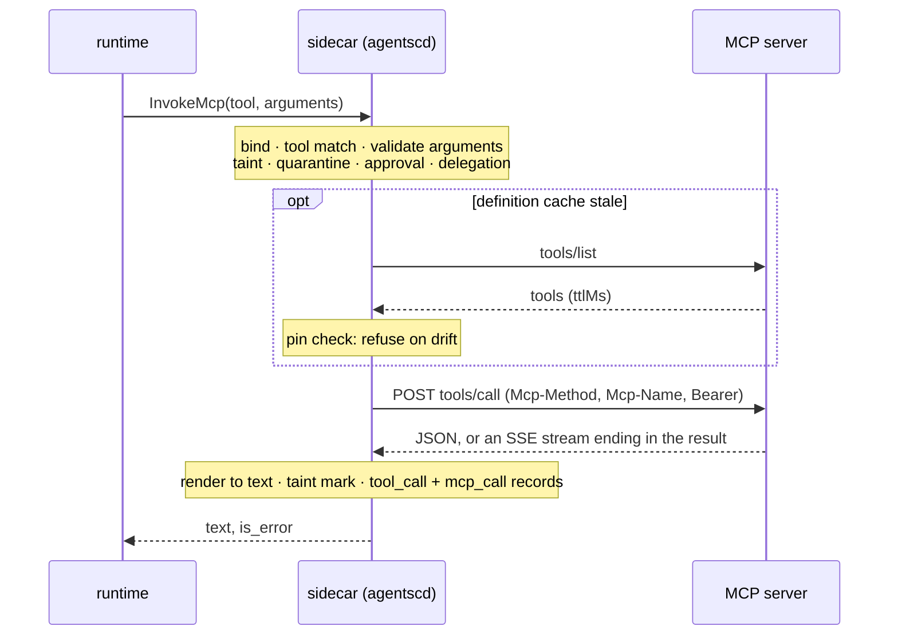

# MCP tools

Status: implemented in v1 ([ADR 0009](../adr/0009-mcp-tools.md); CONTRACT.md §3.1, §3.2,
§3.5, §4.3, §5.2, §5.3, §6, §8, §11). The open questions below were settled as proposed:
2026-07-28 only, static credentials and argument narrowing in v1, `input_required` as a tool
error. Differences from this note, found while building it: `parameters` is required for `mcp`
tools; a cached list that fails a check is listed again once it is 30 s old; an unreadable
credential file is `mcp.credential_unavailable`; the MCP client is shared with the CLI in
`agentsc-common`.

## The problem

Agents can call three kinds of tools today: `service` (an app in the mesh), `agent` (another
agent) and `http` (one fixed URL). Most tools that teams want to give an agent now ship as MCP
servers instead: GitHub, Jira, Slack, databases, internal platforms. With only `http` tools, a
charter author has to rebuild each MCP tool by hand as a REST call, if the server has a REST API
at all.

Hosts that speak MCP directly (IDEs, desktop agents, goose) have the opposite problem. Every tool
a server lists reaches the model, and the server writes its descriptions. A server can change a
description after you started using it (a "rug pull"), and that text goes straight into the
prompt. Nothing checks a call against a policy, nothing tracks what the run has read, and
little is audited.

## The idea

Add a fourth tool type, `mcp`. The sidecar becomes the MCP client. The charter names each MCP
tool the agent may use, pins the definition the server gave when an admin reviewed it, and can
narrow its arguments. Every call goes through the gates an `http` call goes through today: bind,
tool match, taint, quarantine, approval, delegation. It leaves the same two audit records.

MCP's 2026-07-28 revision makes this fit. Sessions and the `initialize` handshake are gone, so a
`tools/call` is one stateless HTTP POST. The sidecar needs no connection state per server, and
one call is one policy decision, the same as for every other tool.



## Charter

```yaml
agents:
  - name: triage
    tools:
      - name: search_issues                  # the name the model sees (the v0.1 tool-name rule)
        type: mcp
        description: Search issues in acme/app. # what the model reads; the author may rewrite it
        url: https://mcp.example.com/mcp      # the MCP endpoint; no {param} anywhere
        mcp_tool: search_issues               # the server's name for it; default: `name`
        pin: sha256:3b0c…                     # the reviewed definition (agentsc mcp import writes it)
        parameters:                           # may be narrower than the server's inputSchema
          type: object
          properties:
            repo:  { type: string, enum: [acme/app] }
            query: { type: string, maxLength: 256 }
          required: [repo, query]
          additionalProperties: false
        effect: read                          # default for mcp: write
        label: untrusted                      # default for mcp: untrusted
        delegation: { audience: github-mcp }  # or credential: { secret: github-pat }, or neither
        approval: { timeout_s: 600 }          # optional, as for any tool
```

## Decisions

1. **Streamable HTTP, protocol 2026-07-28 only.** No stdio servers: the sidecar would have to
   start other programs in its container. A stdio server can run as its own container behind a
   stdio-to-HTTP bridge. A server that only speaks an older revision fails with
   `mcp.unsupported_version`. (Open question 1.)

2. **One charter tool per MCP tool, pinned.** The charter holds the name, description and
   parameters the model sees. Nothing the server says reaches the model until an admin has
   accepted it. `mcp_tool` is the server's name. It is separate because MCP allows 128 characters
   and dots, and the model API's rule (`^[a-zA-Z0-9_-]{1,64}$`) does not. `pin` is required. It is
   `sha256:` plus the hex SHA-256 of the RFC 8785 canonical JSON of the server's
   `{description, inputSchema, outputSchema, annotations}` (absent fields left out). `title` and
   `icons` are left out, so a cosmetic change does not break a pin.

3. **The runtime sends the arguments, nothing else.** New RPC
   `SidecarTools.InvokeMcp(ToolArgumentsRequest{ctx, arguments_json}) returns (ToolTextResponse{text,
   is_error})`. With `InvokeHttp`, the runtime builds a URL and the sidecar checks it against the
   template. For MCP, the sidecar builds the whole request from the charter. The runtime chooses
   no method, URL or header.

4. **Arguments are checked against the charter's `parameters`** (JSON Schema 2020-12) before
   anything is sent. A failure is denied with `guardrail.tool_spec`, a tool error the model sees.
   This is how an author narrows a broad server tool, for example "only repo `acme/app`" or "no
   `force` flag". The server's own `inputSchema` stays the server's business.

5. **Same gates, same order as `invoke_http`:** `audit.gate_tool`, `bind`, `tool_spec` (type
   `mcp`), argument check, `taint_gate`, `quarantine_gate`, `approval_gate`,
   `delegation_gate`. An approval gives MCP's "a human in the loop with the ability to deny tool
   invocations" (spec, Tools) with no new code.

6. **The sidecar builds the request.** `POST <url>` on the existing `egress` client (no
   redirects), with these headers:
   - `content-type: application/json` and `accept: application/json, text/event-stream`
   - `MCP-Protocol-Version: 2026-07-28`, `Mcp-Method: tools/call` and `Mcp-Name: <mcp_tool>`
     (base64 sentinel `=?base64?…?=` when the value is not plain ASCII)
   - `Mcp-Param-<Name>` for each `x-mcp-header` in the server's pinned `inputSchema`, with the
     spec's value encoding. A definition whose `x-mcp-header`s break the spec's rules counts as
     missing (`mcp.tool_missing`).
   - `authorization: Bearer <token>` when the tool has `delegation` or `credential`
   - `traceparent` and `x-agentsc-request-id`

   The body is `tools/call` with `params.name` = `mcp_tool`, `params.arguments` and `params._meta`
   (`io.modelcontextprotocol/protocolVersion`, `io.modelcontextprotocol/clientInfo`
   `{name: "agentscd", version}`, `io.modelcontextprotocol/clientCapabilities: {}`, and
   `traceparent`). Each request has a fresh JSON-RPC id.

7. **The answer comes back as JSON or as an SSE stream.** The sidecar reads the stream up to
   the response with its id and skips notifications. At most `--max-response-bytes` are read
   in all (`http.response_too_large`). The run's deadline closes the stream, which MCP treats as
   cancellation. Then:
   - `resultType: complete`, or no `resultType` at all: the content is rendered to text. Text
     blocks are joined. `structuredContent` becomes JSON when there is no text. Images, audio and
     blobs become a one-line placeholder (`[image image/png, 34 KB, not shown]`). A resource link
     becomes its name and URI. `isError: true` is a tool error. The decision stays `allow`, as
     for an HTTP 4xx.
   - `resultType: input_required` (MCP's elicitation and sampling requests): a tool error that
     quotes the server's message, rule `mcp.input_required`, with no retry. The model can still
     ask its caller with `ask_caller`. (Open question 4.)
   - A JSON-RPC error, a transport error or a non-2xx answer: `mcp.error`, with the code and the
     message.

8. **The pin is checked against a cached `tools/list`.** Before a call, the sidecar needs the
   server's current definition of `mcp_tool`. It keeps one per URL, refreshed after
   `min(ttlMs, 600 s)` (300 s when the server sends no `ttlMs`). It follows `nextCursor` for at
   most 20 pages. The refresh uses the call's own bearer, because a server may list tools by
   authorization. A tool that is not listed is refused with `mcp.tool_missing`. A definition
   whose hash differs from `pin` is refused with `mcp.pin_mismatch`. That record carries both
   hashes, never the new text. An admin reviews the change with `agentsc mcp check` and pins it
   again. The `x-mcp-header`s of decision 6 come from this verified definition.

9. **Taint.** An `mcp` tool defaults to `label: untrusted` and `effect: write`, like an `http`
   tool with a non-GET method. The author lowers them after reading the server's annotations
   (decision 12). `taint.sensitive_egress` covers `mcp` tools as well as `http` tools: once a run
   has read sensitive data, it may not send it to an MCP server. Any answer the model sees marks
   the run, including `isError` and error messages, as for `http`.

10. **Credentials, all optional:**
    - `delegation: {audience}` works as for `http` (ADR 0006): a per-call `agent+jwt` for the
      person who asked.
    - `credential: {secret: <dns-label>}` is a static bearer. The sidecar reads it from
      `/etc/agentsc/tool-secrets/<name>` on every call, so a rotated Secret takes effect without a
      restart. The fixed directory matters: a charter must never be able to make the sidecar send
      `tls.key` to a server it names. The runtime never sees either token, and neither is logged
      or audited.
    - `delegation` and `credential` are mutually exclusive. The interactive OAuth flow of MCP's
      authorization spec has no place in a headless sidecar. Tutela's token exchange or a mounted
      Secret replaces it. (Open question 2.)

11. **Audit and traces.** One `tool_call` record (as today) plus one record of a new kind,
    `mcp_call`, direction outbound, callee `mcp <origin> <mcp_tool>`. Its input is
    `{url, tool, arguments}`. Its output is `{result_type, is_error, text}`, where `text` is what
    the model saw. Payloads follow the existing payload settings. The span `mcp_call` sets
    `gen_ai.operation.name=execute_tool`, `gen_ai.tool.name`, `mcp.method.name=tools/call`,
    `mcp.protocol.version` and `server.address`. (Check the MCP names against the OTel MCP
    semantic conventions when implementing.)

12. **`agentsc mcp import` writes the charter entries.** `agentsc mcp import --url U --tool T
    [--tool …] [--credential-file F]` calls `server/discover` and `tools/list` and prints one
    `type: mcp` entry per tool, with the server's description, its `inputSchema` as
    `parameters`, and the `pin`. It also prints `effect` and `label` suggestions, commented with
    the annotation each came from: `readOnlyHint: true` suggests `effect: read`. MCP says
    annotations are untrusted, so they are used here only as suggestions for a person to read,
    never at runtime. `agentsc mcp check <charter>` compares every pin with the live servers
    and exits non-zero on drift, for CI.

13. **Roles.** A new MCP `url` origin needs admin (it reuses `perm::OPEN_HTTP_ORIGIN`, keyed on
    the origin). So do a changed `pin`, which accepts new text from a server, and adding or
    changing `credential`. `delegation` already needs admin. A widened `parameters` (fields
    removed from `required`, an `enum` removed) is not detected in v1, so any change to an
    `mcp` tool's `parameters` needs admin.

14. **Charter schema level 9.** Sidecars at level 8 hold a charter with `mcp` tools, as they do
    for every level bump (`Hello.charter_schema_level`).

## Rules

| Rule | When | Decision |
| --- | --- | --- |
| `guardrail.tool_spec` | arguments break the charter's `parameters` | deny |
| `mcp.tool_missing` | `mcp_tool` not in `tools/list`, or its `x-mcp-header`s are invalid | deny |
| `mcp.pin_mismatch` | the listed definition's hash is not `pin` | deny |
| `mcp.unsupported_version` | the server does not speak 2026-07-28 | error |
| `mcp.input_required` | the server answered `input_required` | allow, tool error |
| `mcp.error` | JSON-RPC error, transport error, non-2xx | error |
| `mcp.credential_unavailable` | the `credential` file cannot be read | error |
| `http.response_too_large` | more than `--max-response-bytes` | error |
| `taint.sensitive_egress` | an `mcp` call after sensitive data | deny |

## Not in v1

- stdio servers, and protocol revisions before 2026-07-28 (sessions, `initialize`)
- resources, prompts, `subscriptions/listen`, the tasks extension, sampling and roots
- answering `input_required` (mapping an elicitation form to `ask_caller` questions and
  retrying with `inputResponses` and `requestState` across runs)
- images and audio passed to the model
- validating `structuredContent` against `outputSchema`
- the sidecar as an MCP server, so other MCP hosts can call a service's governed agents (a
  separate design)

## Work plan

| Area | Files | Change |
| --- | --- | --- |
| Charter | `crates/agentsc-charter/src/lib.rs`, `diff.rs`, `crd.rs`, `schemas/` | `ToolType::Mcp`, `mcp_tool`, `pin`, `credential`; validation; defaults; roles; level 9; regenerated CRD and schema |
| Wire | `proto/agentsc/v1alpha1/runtime.proto` | `InvokeMcp`, `ToolArgumentsRequest`, `ToolTextResponse` (renamed in ADR 0010) |
| Sidecar | `services/agentscd/src/tools.rs`, new `mcp.rs`, `taint.rs`, `state.rs` | `invoke_mcp`; request, headers, SSE, rendering, definition cache, pin check; egress rule |
| Audit and traces | `crates/agentsc-common/src/audit.rs`, `crates/agentsc-otel` | `Kind::McpCall`; span mapping; golden traces |
| Runtime | `runtime/src/agentsc_runtime/spec.py`, `tools.py`, `sidecar.py` | type `mcp`, kind `mcp_call`, `invoke_mcp` |
| CLI | `services/agentsc-cli` | `mcp import`, `mcp check` |
| Control plane and console | `services/embassy/src/graph.rs`, `api/write.rs`, `tutela/delegation.rs`, `ui/` | port type and colour; role checks; `cap` tool list |
| Tests | `services/agentscd/tests/mcp.rs`, runtime tests | a fake MCP server: JSON and SSE answers, `isError`, `input_required`, drift, missing tool, header encoding, narrowed arguments, taint, approval, delegation, credential directory |
| Docs | CONTRACT.md, this note, an ADR, the agents guide | |

## Open questions

1. **Older MCP servers.** Many servers still speak 2025-11-25, with `initialize` and
   `Mcp-Session-Id`. Supporting them means a session per server in the sidecar, and a session
   is state that outlives one policy decision. Proposed: not in v1, and add a fallback only for a
   server we actually need.
2. **Static credentials in v1**, or `delegation` only? Most hosted servers today want a personal
   token or OAuth, so v1 without `credential` reaches few of them.
3. **Narrowing arguments (decision 4) in v1.** It needs a JSON Schema validator in the sidecar,
   and it is the feature no gateway offers. Proposed: yes.
4. **`input_required`** as a tool error in v1, and mapping it to `ask_caller` later. Proposed:
   yes.
5. **Branch.** Built on `feat/mcp-tools` from `origin/main`, which already holds `attache-b`
   (delegation and approvals).
