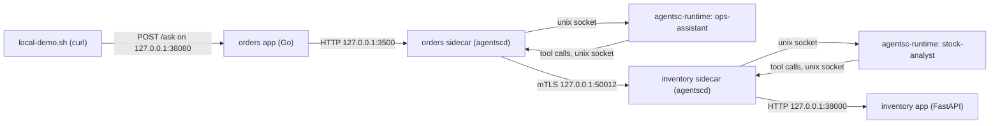
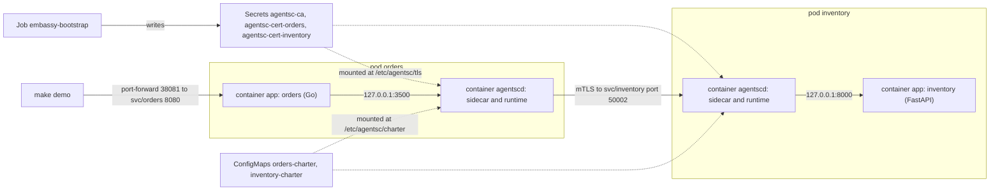

# Getting started

This page shows how to run agent-sidecar on your own machine and on minikube. It also covers the tests, real Claude, the CLI and how to clean up.

Commands on this page use the code names: `agentscd` is the sidecar, `agentsc` is the CLI, `embassy` is the certificate authority and `agentsc-runtime` is the Python agent runtime. [Architecture](architecture.md#names-agent-sidecar-and-agentsc) explains the naming.

## Prerequisites

| Tool | What needs it | Version set in the repo |
| ---- | ------------- | ----------------------- |
| Rust toolchain: `cargo`, `clippy`, `rustfmt` | local demo, tests, lint, the `agentsc` CLI | not pinned on your machine. Use a recent stable Rust: the crates use edition 2024. The Docker image builds with `rust:1.99`. |
| `protoc` (Protocol Buffers compiler) | building the sidecar on your machine. `crates/agentsc-proto/build.rs` compiles the files in `proto/`. | not pinned |
| `uv` | the Python runtime, the inventory app in the local demo, the Python tests | not pinned on your machine. The image uses `uv` 0.10.12. |
| Python | the agent runtime | 3.12 or newer (`runtime/pyproject.toml`) |
| `python3`, `curl` | the demo scripts. They call the apps and read JSON with Python. | not pinned |
| Go | building the `orders` example app | `go 1.23` (`examples/orders/go.mod`) |
| Docker | `make build` on the minikube path | The Dockerfile uses `RUN --mount=type=cache`, so Docker must build with BuildKit. |
| minikube | the minikube path | not pinned. `make minikube-up` starts it with the docker driver, 4 CPUs and 6 GB of memory. |
| `kubectl` | the minikube path and `agentsc logs` | not pinned |

What you need for each path:

- **Local demo, tests and lint:** `cargo`, `protoc`, `uv`, `go`, `python3`, `curl`.
- **minikube:** `minikube`, `docker`, `kubectl`, `python3`, `curl` and `cargo`. `make deploy` validates the charters with the CLI, and `make demo` uses `./target/debug/agentsc`. Both build the CLI on your machine. The CLI does not need `protoc`. The images compile the sidecar inside Docker, and the Dockerfile installs `protoc` there.

The first run needs internet access. It downloads Rust crates, Python packages and Docker base images.

## Clone

```bash
git clone https://github.com/f8fvwgzc/agent-sidecar.git && cd agent-sidecar
```

## Run the local demo

The local demo needs no Kubernetes. It runs two services and two sidecars as normal processes on your machine. The sidecars talk to each other over real mTLS.

```bash
make local-demo
```

The target runs `scripts/local-demo.sh`. The script runs the demo once and then stops. When it exits, its exit trap sends SIGTERM to the four background processes it started: one for each app and one for each sidecar. It does not signal their child processes, such as the Python processes that `uv run` starts. If a port is still in use after a run, see [If something goes wrong](#if-something-goes-wrong). The first run builds everything, so it takes longer than later runs.

### What it starts



Each sidecar starts its own `agentsc-runtime` as a child process. The script passes `--runtime-cmd "uv run --quiet --project <repo>/runtime agentsc-runtime"`.

| Process | Listens on | Notes |
| ------- | ---------- | ----- |
| orders app (Go) | `127.0.0.1:38080` | Set `ORDERS_PORT` to change it. The app finds its sidecar through `AGENTSC_URL=http://127.0.0.1:3500`. |
| inventory app (FastAPI, run by uvicorn) | `127.0.0.1:38000` | Set `INVENTORY_PORT` to change it. `uv` installs `fastapi` and `uvicorn` for this run only. |
| orders sidecar, app HTTP API | `127.0.0.1:3500` | fixed in the script |
| orders sidecar, app gRPC API | `127.0.0.1:50001` | fixed in the script |
| orders sidecar, mesh (mTLS) | `127.0.0.1:50011` | fixed in the script |
| inventory sidecar, app HTTP API | `127.0.0.1:3510` | fixed in the script |
| inventory sidecar, app gRPC API | `127.0.0.1:50003` | fixed in the script |
| inventory sidecar, mesh (mTLS) | `127.0.0.1:50012` | fixed in the script |
| each runtime | `.local/run/<svc>/runtime.sock` | The sidecar's tool API for the runtime is `.local/run/<svc>/sidecar.sock`. |

### What the script does

Each step prints a line that starts with `▶`.

1. **building.** Runs `cargo build` for `agentscd`, `agentsc-cli` and `embassy`. Runs `uv sync` in `runtime/`. Builds the Go app into `.local/orders`.
2. **certificates (embassy).** Creates a local CA in `.local/ca/` if it does not exist yet. Then it issues one certificate for `orders` and one for `inventory`. Their identities are `spiffe://agentsc/ns/agentsc-demo/svc/orders` and `spiffe://agentsc/ns/agentsc-demo/svc/inventory`.
3. **charters with local peer addresses.** Copies `examples/charters/orders.charter.yaml` and `inventory.charter.yaml` into `.local/`. In each copy it adds a `mesh.peers` entry that points at the other sidecar's local mesh port, and it sets `app_port` to the local app port.
4. **apps.** Starts the inventory app and the orders app.
5. **sidecars.** Starts the two `agentscd` processes.
6. **waiting for readiness.** Checks `/readyz` on both sidecars and `/healthz` on both apps, up to 120 times, one second apart. Then it prints the orders sidecar's `/readyz` answer.
7. Runs the three demo calls and prints the audit trail.

### Files in `.local/`

`.local/` is in `.gitignore`. The log files are overwritten on every run.

| Path | Content |
| ---- | ------- |
| `.local/ca/` | `ca.crt` and `ca.key`, the local CA. It is kept between runs. |
| `.local/tls/orders/`, `.local/tls/inventory/` | `ca.crt`, `tls.crt`, `tls.key`. They are issued again on every run. |
| `.local/orders.charter.yaml`, `.local/inventory.charter.yaml` | the charter copies with local addresses |
| `.local/orders` | the built Go app |
| `.local/run/<svc>/` | the unix sockets between the sidecar and its runtime |
| `.local/logs/<svc>-audit.jsonl` | the audit records. This is the sidecar's stdout: one JSON object per line. |
| `.local/logs/<svc>-agentscd.log` | sidecar diagnostics (stderr). Runtime output is in the same file, with the prefix `[runtime]`. |
| `.local/logs/<svc>-app.log` | the app's own output |

### Expected output

Request ids, trace ids, times and latencies change on every run. Without `ANTHROPIC_API_KEY` the output looks like this (shortened):

```text
▶ building
▶ certificates (embassy)
▶ charters with local peer addresses
▶ apps
▶ sidecars (audit JSONL → .local/logs/<svc>-audit.jsonl, logs → .local/logs/<svc>-agentscd.log)
▶ waiting for readiness... ok
{"ready":true,"runtime":true,"model_provider":"mock","mesh":true}

▶ 1. stock question through orders /ask
{
  "status": "ok",
  "request_id": "96129f73-424f-4e33-8385-a80e36590311",
  "trace_id": "49957c8962d780a7af28a677fced6838",
  "agent": "ops-assistant",
  "output": "Based on stock_analyst: Based on get_stock: {\"sku\":\"WIDGET-1\",\"on_hand\":42,\"reorder_point\":50,\"warehouse\":\"north\",\"warehouse_contact\":\"[redacted:email]\"}",
  ...
}

▶ 2. admin reset through orders /ask (must be denied by inventory's charter)
{
  "status": "ok",
  "agent": "ops-assistant",
  "output": "Based on inventory_admin_reset: denied by authz.services.deny-admin: denied by inventory: POST /admin/reset on inventory matches deny pattern \"* /admin/*\"",
  "steps": [
    ...
    {
      "kind": "service_call",
      "name": "inventory POST /admin/reset",
      "decision": "deny",
      "latency_ms": 0,
      "rule": "authz.services.deny-admin"
    },
    ...
  ]
}

▶ 3. guardrail: a secret in the input is refused before any model call
HTTP 403

▶ 4. audit trail, both sidecars, trace 49957c8962d780a7af28a677fced6838
13:05:24.576 orders     ops-assistant  model_call       outbound local                        → mock                               allow                                         1ms tokens=107/39 $0.0000 trace=49957c89
13:05:24.587 inventory  stock-analyst  model_call       outbound svc/orders (ops-assistant)   → mock                               allow                                         0ms tokens=79/12 $0.0000 trace=49957c89
13:05:24.591 inventory  stock-analyst  tool_call        internal local (stock-analyst)        → get_stock                          allow                                         1ms trace=49957c89
13:05:24.591 inventory  stock-analyst  service_call     internal local (stock-analyst)        → inventory GET /stock/WIDGET-1      allow                                         1ms trace=49957c89
...
13:05:24.594 orders     ops-assistant  agent_invocation inbound  local                        → ops-assistant                      allow                                        21ms tokens=319/77 $0.0000 trace=49957c89

▶ 5. the denial, trace e3af314822426057d5ee3179b51461b4
13:05:24.710 inventory  ops-assistant  service_call     inbound  svc/orders (ops-assistant)   → inventory POST /admin/reset        DENY authz.services.deny-admin                0ms trace=e3af3148
13:05:24.711 orders     ops-assistant  tool_call        internal local (ops-assistant)        → inventory_admin_reset              DENY authz.services.deny-admin                0ms trace=e3af3148
13:05:24.711 orders     ops-assistant  service_call     outbound local (ops-assistant)        → inventory POST /admin/reset        DENY authz.services.deny-admin                0ms trace=e3af3148

✓ local demo complete
```

The script checks calls 1 and 2. If one of these checks fails, it prints a line that starts with `✗` and stops. For call 3 it only prints the HTTP code, so check that it says `HTTP 403`.

The check for call 1 is loose. It passes when `status` is `ok` and one step is an `agent_call` with decision `allow`. A failed mesh call is also reported as `allow`, because only policy denials are `deny`. So read the output of call 1 too. It must show the stock record. If it shows `tool failed`, the call did not cross the mesh.

### The three scenarios

1. **An allowed cross-pod call.** The `orders` app gets `POST /ask`. It calls its sidecar with one HTTP request. The sidecar runs `ops-assistant`, an orchestrator agent. The agent picks its `stock_analyst` tool. The `orders` sidecar calls the `inventory` sidecar over mTLS. The `inventory` sidecar checks that `spiffe://agentsc/ns/agentsc-demo/svc/orders` may invoke `stock-analyst`. Then `stock-analyst` calls `GET /stock/WIDGET-1` on its own app. The stock record has a warehouse contact email. The `inventory` charter has `pii_redact: true`, so the email is replaced with `[redacted:email]` in the answer and in the audit records.
2. **A denied call.** The question asks to reset admin counters. `ops-assistant` tries `POST /admin/reset` on `inventory`. The `inventory` sidecar denies it with rule `authz.services.deny-admin`. The agent gets the denial as a tool error and says so in its answer. That is why the HTTP status is still 200 and `status` is `ok`: the agent finished, but one of its steps was denied. Both sidecars log the denial under the same `trace_id`.
3. **An input guardrail.** The question contains `api_key = sk-123`. The sidecar refuses it with HTTP 403 before any model call. The rule is `guardrail.input_deny.no-secrets`.

### Read the audit log again

The script stops the apps and sidecars at the end, but the log files stay. You can read and filter them with the CLI:

```bash
# Every denial in both sidecars
cat .local/logs/orders-audit.jsonl .local/logs/inventory-audit.jsonl | ./target/debug/agentsc logs --file - --denied

# Only model calls of one agent, as raw JSON lines
./target/debug/agentsc logs --file .local/logs/inventory-audit.jsonl --agent stock-analyst --kind model_call --raw
```

### Change a charter and run again

The script reads `examples/charters/orders.charter.yaml` and `examples/charters/inventory.charter.yaml` on every run. Edit a charter, then run `make local-demo` again.

- Validate your change first: `./target/debug/agentsc charter validate examples/charters/inventory.charter.yaml`.
- Do not add a top-level `mesh:` section to these two files. The script adds one. A second `mesh` key makes the copy invalid, and the sidecar will not start.

## Run the tests and lint

```bash
make test        # cargo test --workspace --no-fail-fast, then the runtime's pytest suite
make lint        # cargo clippy --workspace --all-targets -- -D warnings, then ruff check
```

The Rust tests include an in-process mesh test. It starts two sidecars with embassy certificates on localhost and checks allowed calls, denials, identity checks and path traversal. It does not need the Python runtime or a model.

Other developer targets:

| Target | What it does |
| ------ | ------------ |
| `make build-host` | `cargo build --workspace` and `uv sync` in `runtime/` |
| `make all` | `build-host`, then `test` |
| `make fmt` | `cargo fmt --all` and `ruff format` |
| `make validate` | Validates the two demo charters. Then it checks that `invalid-unknown-field.charter.yaml` is rejected. |
| `make schema` | Writes `schemas/charter.schema.json` from the Rust types. A test fails when the file and the types differ. |
| `make proto` | Regenerates the committed Python gRPC stubs from `proto/`. It uses `sed -i ''`, which is the macOS (BSD) form of `sed`. |
| `make dev-certs` | Creates a local CA in `.local/ca` and certificates for `orders` and `inventory` in `.local/tls/`. It writes a new CA every time, even if one exists. The local demo does this by itself and keeps an existing CA. |

## Run on minikube

```bash
make minikube-up build deploy demo
```

| Target             | What it does |
| ------------------ | ------------ |
| `make minikube-up` | Starts minikube with the docker driver, 4 CPUs and 6 GB, if it is not running. |
| `make build`       | Builds `agentsc/agentscd`, `agentsc/embassy`, `agentsc/orders` and `agentsc/inventory` inside minikube's docker. No registry is needed. |
| `make deploy`      | Creates the namespace and charter ConfigMaps, runs the `embassy-bootstrap` Job to create the CA and per-service certificate Secrets, then rolls out both Deployments. |
| `make demo`        | Port-forwards `orders` and runs the two calls below. It stops with a `✗` line if call 1 is not `ok` or has no allowed `agent_call` step to `inventory/stock-analyst`, or if call 2 has no step denied by `authz.services.deny-admin`. The call 1 check is loose in the same way as in the local demo, so read its output too. |
| `make logs`        | Prints the audit lines of both pods sorted by time. Add `TRACE=<id>` or `AGENT=<name>` to filter. |
| `make logs-denied` | Prints only the denials. |
| `make secret-anthropic` | Uses real Claude: puts `$ANTHROPIC_API_KEY` into a Secret and restarts the pods. |

`make demo` runs scenarios 1 and 2 from the local demo. It does not run the guardrail call. It port-forwards `svc/orders` to `localhost:38081`. Set `PORT` to use another local port, for example `PORT=38090 make demo`.

### Profile, context and namespace

| Variable | Default | Used for |
| -------- | ------- | -------- |
| `PROFILE` | `minikube` | the minikube profile |
| `KUBE_CONTEXT` | the value of `PROFILE` | Every Makefile command that talks to the cluster passes `--context $(KUBE_CONTEXT)`. So make does not touch the other clusters in your kubeconfig. |
| `NS` | `agentsc-demo` | the namespace in make commands |

The namespace `agentsc-demo` is also written in `deploy/namespace.yaml`, `deploy/kustomization.yaml`, the `embassy-bootstrap` Job arguments and both charters. Changing `NS` alone does not move the demo to another namespace.

The bootstrap Job keeps its CA Secret in its own namespace. So each namespace gets its own CA. Mesh calls across namespaces are not supported out of the box.

### What `make deploy` creates



`make deploy` runs these steps:

1. Applies `deploy/namespace.yaml`.
2. Runs `make charters`. This validates both charters on your machine and turns them into the ConfigMaps `orders-charter` and `inventory-charter`.
3. Deletes the old `embassy-bootstrap` Job, if there is one, and applies `deploy/` with kustomize.
4. Waits up to 180 seconds for the Job. The Job keeps the CA Secret `agentsc-ca` if it exists. It issues the Secrets `agentsc-cert-orders` and `agentsc-cert-inventory` again. There is one certificate per service, not per pod. It is valid for 365 days. Nothing rotates it: only a new run of the Job (for example `make deploy`) issues a new one.
5. Restarts both Deployments and waits up to 300 seconds for each rollout.
6. Prints the pods, Services and Secrets.

Each pod has two containers: `app` and `agentscd`. The `agentscd` container is written into each Deployment in `deploy/`. The Helm path (`make demo-helm`) injects it instead, through embassy's mutating webhook. The `inventory` app listens on `127.0.0.1` inside its pod, and the `inventory` Service exposes only the mesh port `50002`. So other pods can reach the inventory app only through its sidecar. No NetworkPolicy is shipped. Any pod in the cluster can reach the orders app on port 8080 and the mesh port 50002 of both sidecars. The mesh port accepts only mTLS clients with a certificate from the namespace's CA.

### Ask your own question

Port-forward the orders Service:

```bash
kubectl --context minikube -n agentsc-demo port-forward svc/orders 38081:8080
```

In a second terminal:

```bash
curl -s -X POST http://localhost:38081/ask \
  -H 'content-type: application/json' \
  -d '{"question":"What is the status of order 1001?"}'
```

The mock model picks the tool whose name and description share the most words with the question. Here that is `lookup_order`, so the agent calls `GET /orders/1001` on the orders app. The answer starts with `Based on lookup_order:`.

Try the input guardrail and look at the full 403 body:

```bash
curl -s -X POST http://localhost:38081/ask \
  -H 'content-type: application/json' \
  -d '{"question":"our api_key = sk-123 please"}'
```

The body has `"status": "denied"` and `"rule": "guardrail.input_deny.no-secrets"`.

### See the audit log

```bash
make logs                      # both pods, sorted by time
make logs TRACE=49957c89       # one trace (a prefix of the trace id is enough)
make logs AGENT=stock-analyst  # one agent
make logs-denied               # only denials
```

The raw records are plain container logs:

```bash
kubectl --context minikube -n agentsc-demo logs -l agentsc.io/service=inventory -c agentscd
```

This log also has the sidecar's own diagnostic lines (stderr) and the runtime's lines with the prefix `[runtime]`. Only the JSON lines are audit records. `agentsc logs` skips the other lines.

### Change a charter

The sidecar loads its charter once, at startup. A new ConfigMap does nothing until the pod restarts. After you edit a file in `examples/charters/`, run:

```bash
make deploy
```

`make deploy` validates the charters, updates the ConfigMaps and restarts both Deployments. It also runs the bootstrap Job again, so the certificates are issued again. You can also do only these two steps:

```bash
make charters
kubectl --context minikube -n agentsc-demo rollout restart deployment/orders deployment/inventory
```

## Use real Claude

Without `ANTHROPIC_API_KEY`, the demos run every agent on a deterministic mock model (`runtime/src/agentsc_runtime/models.py`): they set `AGENTSC_MOCK_FALLBACK=1`. Outside the demos a missing key refuses every agent whose `model` is not `mock`. The mock model needs no network and costs nothing. With the key set, every agent whose `model` is not `mock` calls the Anthropic API. The demo charters use `model: claude-opus-5-5`. An agent with `model: mock` always uses the mock model.

### Local demo

The local demo does not pass the key by name. Each sidecar starts its runtime as a child process, and the child gets the sidecar's environment. So export the key in your shell before you start:

```bash
export ANTHROPIC_API_KEY=<your key>
make local-demo
```

The readiness line then shows `"model_provider":"anthropic"`. In the audit trail, model calls show `anthropic:claude-opus-5-5` instead of `mock`. Real answers change from run to run. The checks for calls 1 and 2 still expect the model to choose the `stock_analyst` and `inventory_admin_reset` tools.

To go back to the mock model, run `unset ANTHROPIC_API_KEY`.

### minikube

Run this after `make deploy`, because the namespace must exist:

```bash
export ANTHROPIC_API_KEY=<your key>
make secret-anthropic
```

This creates or updates the Secret `agentsc-anthropic` and restarts both Deployments. The Deployments read the key from that Secret with `optional: true`. Without the Secret, the pods use the mock model.

To go back to the mock model:

```bash
kubectl --context minikube -n agentsc-demo delete secret agentsc-anthropic
kubectl --context minikube -n agentsc-demo rollout restart deployment/orders deployment/inventory
```

### Things to know before you use a real key

- The runtime calls the Anthropic API directly. It runs as a child process of the sidecar, so on minikube the call leaves from the `agentscd` container. Model calls are audited, but the sidecar does not proxy them. The pod needs outbound internet access.
- `pii_redact` cleans the agent's final output and the audit records. It does not clean the prompts that go to the model provider. In scenario 1, the stock record with the warehouse email is sent to the Anthropic API as a tool result.
- Budgets such as `max_cost_usd_per_day` are counted in memory, per sidecar replica. They start again from zero when the sidecar restarts.

## Useful CLI commands

The CLI binary is `./target/debug/agentsc`. `make local-demo` builds it. `make demo` and `make logs` build it when it is missing. You can also build it with `cargo build -p agentsc-cli`, or run it with `cargo run -p agentsc-cli -- <args>`.

Validate a charter:

```bash
./target/debug/agentsc charter validate examples/charters/inventory.charter.yaml
# valid: examples/charters/inventory.charter.yaml (1 agent(s), identity spiffe://agentsc/ns/agentsc-demo/svc/inventory)

./target/debug/agentsc charter validate examples/charters/invalid-unknown-field.charter.yaml
# exit code 1:
# invalid: examples/charters/invalid-unknown-field.charter.yaml
# charter is not valid YAML or has unknown fields: guardrails: unknown field `pii_redaction`, expected one of ...
```

Print the JSON Schema of `charter.yaml`. The output is the same as `schemas/charter.schema.json`:

```bash
./target/debug/agentsc charter schema
```

Print the version:

```bash
./target/debug/agentsc version
```

Read audit logs. `agentsc logs` runs `kubectl logs` on the `agentscd` container of the pods with label `agentsc.io/service`, or reads a file with `--file`:

```bash
./target/debug/agentsc logs orders,inventory -n agentsc-demo --context minikube --trace 49957c89
./target/debug/agentsc logs inventory --context minikube --denied -f
```

| Flag | Meaning |
| ---- | ------- |
| `<service>[,<service>...]` | Services to read, by label `agentsc.io/service`. Ignored with `--file`. |
| `-n`, `--namespace` | Namespace. Default `agentsc-demo`. |
| `--context` | kubeconfig context. Default: kubectl's current context. |
| `--agent` | Only records where `agent` or `caller_agent` is this agent. |
| `--trace` | Only records whose trace id starts with this value. |
| `--request` | Only records whose request id starts with this value. |
| `--kind` | Only one record kind: `agent_invocation`, `model_call`, `tool_call`, `agent_call`, `service_call`, `http_call`, `authz`, `guardrail`, `budget`. |
| `--denied` | Only denials. |
| `-f`, `--follow` | Follow the log, like `kubectl logs -f`. Records are printed as they come, not sorted. |
| `--raw` | Print raw JSON lines instead of the table. |
| `--file <path>` | Read records from a file. Use `-` for stdin. |
| `--tail <n>` | Lines kubectl fetches per container. Default `1000`. |

`embassy` can issue certificates on your machine. `make dev-certs` and the local demo use it like this:

```bash
./target/debug/embassy ca-init --out .local/ca
./target/debug/embassy cert-issue --ca .local/ca --namespace agentsc-demo --service orders --out .local/tls/orders
```

`cert-issue` also takes `--ttl-days`. The default is 365 days. To run `agentscd` by hand, see the flag table in [CONTRACT.md §2](../CONTRACT.md#2-components-and-ports).

## Clean up

The local demo stops the apps and sidecars it started when it ends. If a port is still in use afterwards, see [If something goes wrong](#if-something-goes-wrong).

| Target | What it does |
| ------ | ------------ |
| `make undeploy` | Deletes everything in `deploy/` from the cluster. This includes the namespace `agentsc-demo`, so the charter ConfigMaps and all Secrets in it (CA, certificates, `agentsc-anthropic`) are deleted too. |
| `make minikube-down` | Runs `minikube -p minikube delete`. This deletes the cluster and the images built inside it. |
| `make clean` | Runs `cargo clean` and removes `runtime/.venv` and `.local/`. This deletes the local CA, certificates, charter copies and logs. |

## If something goes wrong

- **The build cannot find `protoc`.** Install the Protocol Buffers compiler. On macOS: `brew install protobuf`. On Debian or Ubuntu: `apt-get install protobuf-compiler`.
- **A port is already in use (local demo).** Move the apps with `ORDERS_PORT=39080 INVENTORY_PORT=39000 make local-demo`. The sidecar ports (3500, 3510, 50001, 50003, 50011, 50012) are fixed in the script. A process left over from an earlier run can also hold a port. Use `lsof -i :<port>` to find the process that holds a port.
- **"orders sidecar not ready" (local demo).** The script prints the last 20 lines of `.local/logs/orders-agentscd.log`. Read the full file for more detail. The same applies to `inventory`.
- **Pods show `ErrImagePull` or `ImagePullBackOff`.** The images are not in minikube's Docker. Run `make build` after `make minikube-up`.
- **Pods stay in `ContainerCreating`.** The certificate Secrets may be missing. Check the Job with `kubectl --context minikube -n agentsc-demo logs job/embassy-bootstrap`. The Job is removed one hour after it finishes.
- **A sidecar is not ready on minikube.** Read its log with `kubectl --context minikube -n agentsc-demo logs deploy/orders -c agentscd`.

[Operations](operations.md) has more troubleshooting and the list of known limitations.

## Where next

- [How it works](architecture.md): the components, the request flow and the trust model.
- [Creating agents](guides/creating-agents.md): write a charter, define agents and tools, and call them from your app.
- [Microservices](guides/microservices.md): adopt agent-sidecar across many services, for a startup or an enterprise.
- [Monolith and monorepo](guides/monolith-and-monorepo.md): many agents in one service, and a monorepo layout.
- [Operations](operations.md): audit logs, the CLI, troubleshooting, a production checklist and limitations.
- [CONTRACT.md](../CONTRACT.md): the full reference for ports, the wire protocol, the charter and the audit record.
