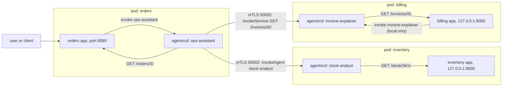
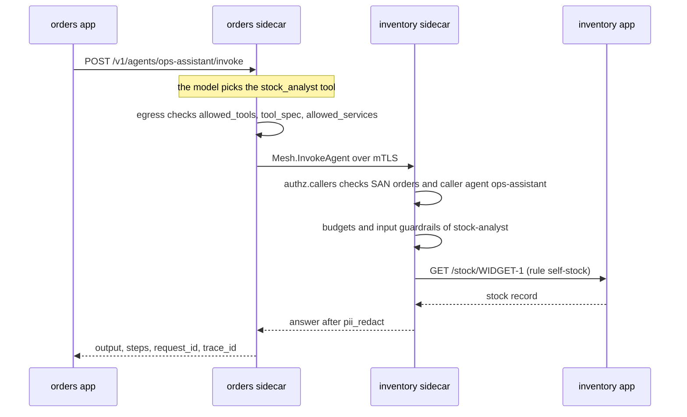

# Using agent-sidecar across microservices

This guide shows how to adopt agent-sidecar in a system with many services. It has a worked example with three services, the steps to add the sidecar to a Deployment, playbooks for a startup and an enterprise, and the gaps to know before production.

Commands and files use the code names: `agentscd` is the sidecar, `agentsc` is the CLI, and `embassy` is the CA. [Architecture](../architecture.md#names-agent-sidecar-and-agentsc) explains the naming. [CONTRACT.md](../../CONTRACT.md) is the full reference.

## The model

Four rules describe how agent-sidecar fits a microservices system.

1. **One charter per service.** Each service has one `charter.yaml`. It lists the service's agents, their tools, budgets, guardrails, who may call them (`authz`) and where the audit goes.
2. **One sidecar per pod.** Every pod of the service runs the `agentscd` container next to the app container. All replicas of a Deployment share the same charter and the same certificate.
3. **Agents live next to the service that owns the data.** The stock agent lives in the inventory pod. It reads stock from its own app on `127.0.0.1`. The inventory team owns the agent, its prompt and its rules.
4. **Cross-service work goes over the mTLS mesh.** A sidecar talks to another sidecar on port `50002` with mutual TLS. There are two kinds of cross-service call:
   - **agent-to-agent:** an agent's `type: agent` tool runs an agent in another service.
   - **agent-to-service:** an agent's `type: service` tool calls an HTTP path of another service's app.

Your app does not need an SDK. It only calls its own sidecar on `localhost`. The app can only invoke agents in its **own** charter. To use another service's agent, declare a local `orchestrator` agent with an `agent` tool that points at it.

### Who decides what

Both sides of a cross-service call check it. The caller's charter decides what its agents may try. The callee's charter decides what it accepts. The callee always has the final word, so the team that owns the data also owns access to it.

| Call | Checked by the caller's sidecar (egress) | Checked by the callee's sidecar (inbound) |
| ---- | ---------------------------------------- | ----------------------------------------- |
| agent-to-agent (`type: agent` tool) | `guardrails.allowed_tools`, the tool declaration (`guardrail.tool_spec`), `guardrails.allowed_services` | `authz.callers` (caller identity and calling agent), then the budgets and input guardrails of the called agent, then its output guardrails |
| agent-to-service (`type: service` tool) | `guardrails.allowed_tools`, `guardrail.tool_spec`, `guardrails.allowed_services`, path check (`guardrail.path`), `authz.services` with identity `local` | path check (`guardrail.path`), `authz.services` with the caller's certificate identity and the calling agent |

The callee learns the caller's identity only from the client certificate. The identity looks like `spiffe://agentsc/ns/<namespace>/svc/<service>`. The calling agent's name comes from the `x-agentsc-agent` metadata. The caller's sidecar sets it, never the app or the model. The callee trusts that pair only as far as its own rules say.

### Agent-to-agent or agent-to-service?

| Use | When |
| --- | ---- |
| agent-to-agent | The callee should decide what leaves its pod. The callee's `pii_redact` and `output_deny` apply to the answer. The callee's budgets limit the work. |
| agent-to-service | The caller only needs a plain read of an API. The response body goes back to the calling agent as it is. The callee's `pii_redact` does **not** rewrite it. The callee's budgets do not apply. |

Two details matter for agent-to-agent calls:

- The calling agent's model writes the `input` for the remote agent. The `context` your app sent is **not** forwarded to the next hop.
- Agent calls can nest. The sidecar refuses a call deeper than 4 hops with rule `budget.max_depth`.

## Worked example: orders, inventory and billing

This example uses three services in one namespace, `shop`. It is not the shipped demo. The repo's demo has only orders and inventory, in namespace `agentsc-demo` (see [`examples/charters/`](../../examples/charters/)). The billing service, the `shop` namespace and the charters below are written for this guide.

| Service | App port | Agent | Who may call the agent | What it does |
| ------- | -------- | ----- | ---------------------- | ------------ |
| `orders` | 8080 | `ops-assistant` (orchestrator) | the orders app (`local`) | Answers operations questions. Reads orders from its own app, asks inventory's agent about stock and reads invoices from billing's API. |
| `inventory` | 8000 | `stock-analyst` | the inventory app, and orders' `ops-assistant` | Reads stock from its own app and gives a reorder recommendation. |
| `billing` | 9000 | `invoice-explainer` | the billing app only | Explains invoices to support staff. Orders may not run this agent, but orders' `ops-assistant` may read `GET /invoices/*` directly. |



The agent-to-agent hop from orders to inventory, step by step:



Every step writes at least one audit line in the sidecar where it happens. All lines of one request share the same `request_id` and `trace_id`, in every pod.

### The orders charter (the caller)

`ops-assistant` has three tools: one for its own app, one agent tool for inventory and one service tool for billing.

```yaml
apiVersion: agentsc.io/v1alpha1
kind: Charter
service:
  name: orders
  namespace: shop
  app_port: 8080
agents:
  - name: ops-assistant
    type: orchestrator                 # orchestrator = may use `agent` tools
    model: claude-opus-5-5
    system: |
      You are the operations assistant of the orders service. Use lookup_order
      for orders, stock_analyst for stock questions and get_invoice for invoices.
    tools:
      - name: lookup_order             # agent-to-service, own app
        description: Look up an order by id in the orders service.
        type: service
        service: orders
        method: GET
        path: /orders/{order_id}
        parameters:
          type: object
          properties:
            order_id: { type: string }
          required: [order_id]
      - name: stock_analyst            # agent-to-agent, other service
        description: Ask the inventory stock analyst about stock levels and reorders.
        type: agent
        agent: stock-analyst
        service: inventory
      - name: get_invoice              # agent-to-service, other service
        description: Read one invoice from the billing service.
        type: service
        service: billing
        method: GET
        path: /invoices/{invoice_id}
        parameters:
          type: object
          properties:
            invoice_id: { type: string }
          required: [invoice_id]
    budgets:
      max_tokens_per_call: 2048
      max_calls_per_minute: 30
      max_cost_usd_per_day: 5.0
      max_steps: 6
guardrails:
  pii_redact: true
  allowed_services:
    ops-assistant: [orders, inventory, billing]
authz:
  default: deny
  callers:
    - identity: local                  # the orders app container
      agents: ["*"]
  services:
    - name: self-orders
      identity: local
      agent: ops-assistant
      service: orders
      allow: ["GET /orders/*"]
    - name: egress-billing             # what ops-assistant may try on billing
      identity: local
      agent: ops-assistant
      service: billing
      allow: ["GET /invoices/*"]
audit:
  sink: stdout
```

Notes:

- The `stock_analyst` tool needs no `authz.services` rule on the caller side. For agent tools the caller checks only `allowed_tools`, the tool declaration and `allowed_services`. The callee's `authz.callers` decides.
- The `get_invoice` tool needs a caller-side rule (`egress-billing`). With `default: deny`, a service call that no rule allows is denied with `authz.default.deny`.
- `allowed_services` is optional. Without it, an agent may call every service its tools name. Writing it out makes reviews easier.

### The inventory charter (callee of an agent-to-agent call)

```yaml
apiVersion: agentsc.io/v1alpha1
kind: Charter
service:
  name: inventory
  namespace: shop
  app_port: 8000
agents:
  - name: stock-analyst
    type: agent
    model: claude-opus-5-5
    system: |
      You are the stock analyst of the inventory service. Use get_stock, then
      answer with on-hand quantity and a reorder recommendation.
    tools:
      - name: get_stock
        description: Get current stock levels for one SKU.
        type: service
        service: inventory
        method: GET
        path: /stock/{sku}
        parameters:
          type: object
          properties:
            sku: { type: string }
    budgets:
      max_tokens_per_call: 1024
      max_calls_per_minute: 60
      max_cost_usd_per_day: 2.0
      max_steps: 4
guardrails:
  pii_redact: true
authz:
  default: deny
  callers:
    - identity: local
      agents: ["*"]
    - identity: spiffe://agentsc/ns/shop/svc/orders
      agents: [stock-analyst]
      caller_agents: [ops-assistant]   # only this agent of orders, not every agent orders adds later
  services:
    - name: self-stock                 # what stock-analyst may do on its own app
      identity: local
      agent: stock-analyst
      service: inventory
      allow: ["GET /stock", "GET /stock/*"]
audit:
  sink: stdout
```

Notes:

- The second `authz.callers` rule lets the orders pod run `stock-analyst`, but only when orders' `ops-assistant` makes the call. If you leave `caller_agents` out, any agent of orders may call it, including agents orders adds later.
- If orders is not allowed, the inventory sidecar denies with rule `authz.callers.default` (no rule for that identity) or `authz.callers.orders` (a rule exists but does not list this agent or calling agent). It checks this before it looks up the agent name, so a peer cannot probe which agents exist.
- `stock-analyst`'s own tool call is an egress call from inventory to itself. The `self-stock` rule allows it. Its `max_calls_per_minute` counts every invocation, local and remote, so inventory protects itself from a busy caller.

### The billing charter (callee of an agent-to-service call)

```yaml
apiVersion: agentsc.io/v1alpha1
kind: Charter
service:
  name: billing
  namespace: shop
  app_port: 9000
agents:
  - name: invoice-explainer
    type: agent
    model: claude-opus-5-5
    system: |
      You explain invoices to support staff in plain words. Use get_invoice.
    tools:
      - name: get_invoice
        description: Read one invoice by id.
        type: service
        service: billing
        method: GET
        path: /invoices/{invoice_id}
        parameters:
          type: object
          properties:
            invoice_id: { type: string }
          required: [invoice_id]
    budgets:
      max_tokens_per_call: 1024
      max_calls_per_minute: 30
      max_cost_usd_per_day: 1.0
      max_steps: 3
guardrails:
  pii_redact: true
authz:
  default: deny
  callers:
    - identity: local                  # only the billing app may run invoice-explainer
      agents: ["*"]
  services:
    - name: self-invoices
      identity: local
      agent: invoice-explainer
      service: billing
      allow: ["GET /invoices/*"]
    - name: orders-reads-invoices      # orders' ops-assistant may read invoices directly
      identity: spiffe://agentsc/ns/shop/svc/orders
      agent: ops-assistant
      service: billing
      allow: ["GET /invoices/*"]
      deny: ["* /refunds", "* /refunds/*", "* /admin", "* /admin/*"]
audit:
  sink: stdout
```

Notes:

- `authz.callers` has no rule for orders. If orders tried to run `invoice-explainer`, billing would deny it with `authz.callers.default`.
- `orders-reads-invoices` applies when the caller certificate is orders **and** the calling agent is `ops-assistant`. Inside the rules that apply, a `deny` match always wins over an `allow` match. Anything not allowed falls to `authz.default` (here `deny`).
- The `deny` list is not needed for safety here, because `default: deny` already blocks it. It gives the denial a clear rule name in the audit log: `authz.services.orders-reads-invoices`.
- Patterns are `"<METHOD or *> <path>"`. Only a trailing `*` is supported. `/invoices/*` matches `/invoices/7` and `/invoices/7/lines`, but not `/invoices`.
- Billing's `pii_redact` does **not** rewrite the invoice body that goes back to orders. It is a raw service response. Billing's `pii_redact` changes only billing's own audit lines. The raw body reaches `ops-assistant` as a tool result, so orders' runtime also sends it to the model provider. If invoices hold personal data, call an agent in billing instead. Turning on `pii_redact` in orders (as above) redacts orders' audit lines and the final answer, but not the prompt.
- When billing's sidecar forwards the call to its app, it adds the headers `x-agentsc-caller` (the caller identity) and `x-agentsc-agent` (the calling agent). Copies of these headers sent by a peer are dropped. Your app can log them or use them for its own checks.

### Validate the charters

The CLI checks one file at a time. Unknown fields are an error.

```bash
./target/debug/agentsc charter validate orders.charter.yaml
./target/debug/agentsc charter validate inventory.charter.yaml
./target/debug/agentsc charter validate billing.charter.yaml
```

```text
valid: orders.charter.yaml (1 agent(s), identity spiffe://agentsc/ns/shop/svc/orders)
valid: inventory.charter.yaml (1 agent(s), identity spiffe://agentsc/ns/shop/svc/inventory)
valid: billing.charter.yaml (1 agent(s), identity spiffe://agentsc/ns/shop/svc/billing)
```

A typo is caught with its path:

```text
invalid: inventory.charter.yaml
charter is not valid YAML or has unknown fields: authz.callers[1]: unknown field `caller_agent`, expected one of `identity`, `agents`, `caller_agents` at line 39 column 7
```

The CLI does **not** check edges between charters. It does not know if `inventory` really has an agent called `stock-analyst`, or if inventory allows orders. Test each cross-service edge in a real environment.

### Peer addresses: `mesh.peers`

By default the sidecar finds a peer at `<service>.<namespace>.svc.cluster.local:50002`. The namespace is the caller's own `service.namespace`. You can change this per peer:

```yaml
# Partial: only the top-level mesh block of a charter.
mesh:
  port: 50002                          # default port of peers when no override is set
  peers:
    billing: billing-v2.shop.svc.cluster.local:50002
```

`mesh.port` only sets the default port of peer addresses. It does not change the port your own sidecar listens on (that is `--mesh-addr` / `AGENTSC_MESH_ADDR`, default `0.0.0.0:50002`). The caller always checks the peer's certificate for the name `<service>.<caller namespace>.svc.cluster.local`, even with an override. So `mesh.peers` cannot be used to reach a service in another namespace: the certificate check fails. `scripts/local-demo.sh` uses `mesh.peers` to run two sidecars on `127.0.0.1` without Kubernetes.

## Add the sidecar to an existing Deployment

These steps add billing to the `shop` namespace. They copy the pattern of [`deploy/inventory/deployment.yaml`](../../deploy/inventory/deployment.yaml). Sidecar injection is manual: you write the `agentscd` container into the Deployment yourself.

### Step 1: choose the names

Use the same service name everywhere. Most steps below depend on it.

| Thing | Value for billing | Why |
| ----- | ----------------- | --- |
| Charter `service.name` | `billing` | It is the `svc/` part of the identity. |
| Charter `service.namespace` | `shop` | It is the `ns/` part of the identity. It must be the namespace the pod runs in. |
| Kubernetes Service name | `billing` | Peers connect to `billing.shop.svc.cluster.local:50002`. |
| Pod label `agentsc.io/service` | `billing` | `agentsc logs` selects pods by this label. |
| Sidecar container name | `agentscd` | `agentsc logs` reads this container. |
| Charter ConfigMap | `billing-charter`, key `charter.yaml` | The example convention. The key must match the file name in `AGENTSC_CHARTER` (`charter.yaml` in step 5). |
| Certificate Secret | `agentsc-cert-billing` | Created by embassy with the prefix `agentsc-cert-`. |
| Identity | `spiffe://agentsc/ns/shop/svc/billing` | Callees write this in their `authz` rules. |

### Step 2: get the images

The manifests in `deploy/` use `agentsc/agentscd:dev` and `agentsc/embassy:dev`. `make build` builds them inside minikube's docker. No images are published. On another cluster, build them from [`docker/Dockerfile`](../../docker/Dockerfile) and push them to your registry:

```bash
docker build -f docker/Dockerfile --target agentscd -t <your-registry>/agentsc/agentscd:<tag> .
docker build -f docker/Dockerfile --target embassy  -t <your-registry>/agentsc/embassy:<tag> .
docker push <your-registry>/agentsc/agentscd:<tag>
docker push <your-registry>/agentsc/embassy:<tag>
```

The `agentscd` image holds the sidecar, the Python agent runtime, the `agentsc` CLI and the `agentsc-ready` probe script.

### Step 3: issue the certificates

The `embassy bootstrap` Job creates a CA Secret `agentsc-ca` if it does not exist yet. Then it issues one Secret `agentsc-cert-<service>` for every name in `--services`. Each Secret has `ca.crt`, `tls.crt` and `tls.key`.

The Job needs the ServiceAccount, Role and RoleBinding from [`deploy/embassy/rbac.yaml`](../../deploy/embassy/rbac.yaml) in the same namespace:

```bash
kubectl create namespace shop
kubectl -n shop apply -f deploy/embassy/rbac.yaml
```

Copy [`deploy/embassy/job.yaml`](../../deploy/embassy/job.yaml) and change only the `args`. `--namespace` must be the namespace the Job runs in. `--services` is a comma-separated list. To add a service, add its name to the list and run the Job again.

```yaml
apiVersion: batch/v1
kind: Job
metadata:
  name: embassy-bootstrap
  labels:
    agentsc.io/component: embassy
spec:
  backoffLimit: 4
  ttlSecondsAfterFinished: 3600
  template:
    metadata:
      labels:
        agentsc.io/component: embassy
    spec:
      serviceAccountName: embassy
      restartPolicy: OnFailure
      containers:
        - name: embassy
          image: agentsc/embassy:dev     # or your registry copy
          imagePullPolicy: IfNotPresent
          args: ["bootstrap", "--namespace", "shop", "--services", "orders,inventory,billing"]
          securityContext:
            allowPrivilegeEscalation: false
            readOnlyRootFilesystem: true
            runAsNonRoot: true
```

A Job cannot be changed after it is created, so delete the old one first:

```bash
kubectl -n shop delete job embassy-bootstrap --ignore-not-found
kubectl -n shop apply -f embassy-job.yaml
kubectl -n shop wait --for=condition=complete job/embassy-bootstrap --timeout=180s
kubectl -n shop get secrets -l app.kubernetes.io/managed-by=embassy
```

Running the Job again keeps the CA and issues **new** certificates for every listed service. Running pods keep their old certificate until they restart. Old and new certificates come from the same CA, so both keep working. A leaf certificate is valid for 365 days. There is no rotation.

### Step 4: create the charter ConfigMap

Keep one committed copy of the charter and create the ConfigMap from it. This is what `make charters` does for the demo.

```bash
./target/debug/agentsc charter validate billing.charter.yaml
kubectl -n shop create configmap billing-charter \
  --from-file=charter.yaml=billing.charter.yaml \
  --dry-run=client -o yaml | kubectl -n shop apply -f -
```

### Step 5: add the sidecar to the Deployment

Add the `agentscd` container, three volumes and the `agentsc.io/service` label. The block below is the inventory pattern with billing's names. Replace the app image and the app probe with your own.

```yaml
apiVersion: apps/v1
kind: Deployment
metadata:
  name: billing
  labels:
    app: billing
    agentsc.io/service: billing
spec:
  replicas: 1
  selector:
    matchLabels:
      app: billing
  template:
    metadata:
      labels:
        app: billing
        agentsc.io/service: billing          # agentsc logs selects on this label
    spec:
      containers:
        - name: app
          image: <your-registry>/billing:<tag>
          # The app listens on 127.0.0.1:9000 only (step 6). A kubelet httpGet probe goes
          # to the pod IP and cannot reach it, so probe from inside the container.
          # This assumes the image has python3, like the inventory example. Use any command your image has.
          readinessProbe:
            exec:
              command: ["python3", "-c", "import urllib.request; urllib.request.urlopen('http://127.0.0.1:9000/healthz', timeout=2)"]
            periodSeconds: 5
        - name: agentscd                       # agentsc logs reads this container
          image: agentsc/agentscd:dev           # or your registry copy
          imagePullPolicy: IfNotPresent
          ports:
            - name: mesh
              containerPort: 50002
          env:
            - name: AGENTSC_CHARTER
              value: /etc/agentsc/charter/charter.yaml
            - name: AGENTSC_TLS_DIR
              value: /etc/agentsc/tls
            - name: RUST_LOG
              value: info
            - name: ANTHROPIC_API_KEY           # unset = every agent runs on the mock model
              valueFrom:
                secretKeyRef:
                  name: agentsc-anthropic
                  key: ANTHROPIC_API_KEY
                  optional: true
          volumeMounts:
            - name: charter
              mountPath: /etc/agentsc/charter
              readOnly: true
            - name: tls
              mountPath: /etc/agentsc/tls
              readOnly: true
            - name: run
              mountPath: /run/agentsc
          readinessProbe:
            exec:
              command: ["agentsc-ready"]
            initialDelaySeconds: 3
            periodSeconds: 5
          livenessProbe:
            exec:
              command: ["agentsc-ready"]
            initialDelaySeconds: 20
            periodSeconds: 20
            failureThreshold: 6
          resources:
            requests: { cpu: 50m, memory: 128Mi }
            limits: { memory: 512Mi }
          securityContext:
            allowPrivilegeEscalation: false
            runAsNonRoot: true
      volumes:
        - name: charter
          configMap:
            name: billing-charter
        - name: tls
          secret:
            secretName: agentsc-cert-billing
        - name: run
          emptyDir: {}
```

What each part does:

| Part | Purpose |
| ---- | ------- |
| `AGENTSC_CHARTER` | Path of the charter file. The sidecar reads it once at start. |
| `AGENTSC_TLS_DIR` | Folder with `ca.crt`, `tls.crt`, `tls.key`. The sidecar refuses to start if the identity in `tls.crt` does not match the charter's `service.name` and `service.namespace`. |
| `ANTHROPIC_API_KEY` | Optional. With the key, agents call Claude. Without it, every agent uses the mock model. |
| `run` (emptyDir) | Unix sockets between the sidecar and the agent runtime. The runtime is a child process in the same container. |
| `agentsc-ready` | Calls `http://127.0.0.1:3500/readyz` from inside the container. Ready means the charter and TLS are loaded and the runtime answers. |
| TLS Secret mounted only in `agentscd` | The app container never sees the private key. Keep it that way. |

Your app calls the sidecar on `http://127.0.0.1:3500` (HTTP) or `127.0.0.1:50001` (gRPC). These ports are bound to the pod's loopback, so only containers in the same pod can reach them. The app should retry if the sidecar is not ready yet.

### Step 6: listen on loopback and expose only the mesh port

Make the app listen on `127.0.0.1` only. Expose only the mesh port on the Kubernetes Service:

```yaml
apiVersion: v1
kind: Service
metadata:
  name: billing
  labels:
    app: billing
    agentsc.io/service: billing
spec:
  selector:
    app: billing
  ports:
    - name: mesh
      port: 50002
      targetPort: mesh
```

Why: the sidecar forwards allowed calls to `127.0.0.1:<app_port>`. If the app also listens on the pod IP, any pod can call it directly. That call skips mTLS, `authz` and the audit log. With loopback only, the sidecar is the only way in. The inventory example does this. Its Dockerfile starts the app with `--host 127.0.0.1`.

**Important:** this works only when every caller of the app is an agent. The sidecar has no API that lets a plain app call another service through the mesh. If other services still call billing with normal HTTP, keep the app port open for them. Those calls do not go through the sidecar, so they are not authorized or audited by it. The orders demo app keeps its port 8080 because it is the entry point for users.

### Step 7: roll out

The sidecar reads the charter and the certificates only at start. Restart after every change to either:

```bash
kubectl -n shop apply -f billing-deployment.yaml -f billing-service.yaml
kubectl -n shop rollout restart deployment/billing
kubectl -n shop rollout status deployment/billing --timeout=300s
```

Roll out the callee before the caller. Then the callee's rules exist when the caller starts to use them. A call that arrives too early is denied and audited. It does not break anything.

### Step 8: verify

Both containers should be ready:

```bash
kubectl -n shop get pods -l agentsc.io/service=billing
```

Ask the sidecar for its state. The body has `ready`, `runtime`, `model_provider` and `mesh`. `GET /v1/charter` shows the charter the sidecar loaded.

```bash
kubectl -n shop exec deploy/billing -c agentscd -- python3 -c \
  'import urllib.request; print(urllib.request.urlopen("http://127.0.0.1:3500/readyz").read().decode())'
```

Run one cross-service call from inside the orders pod. The caller is `local`, as if the orders app made the call:

```bash
kubectl -n shop exec deploy/orders -c agentscd -- python3 -c '
import json, urllib.request
req = urllib.request.Request(
    "http://127.0.0.1:3500/v1/agents/ops-assistant/invoke",
    data=json.dumps({"input": "How many WIDGET-1 are in stock?"}).encode(),
    headers={"content-type": "application/json"})
print(urllib.request.urlopen(req).read().decode())'
```

Copy the `trace_id` from the response. Read the audit trail of all three services under that trace:

```bash
./target/debug/agentsc logs orders,inventory,billing -n shop --trace <trace_id>
./target/debug/agentsc logs orders,inventory,billing -n shop --denied
```

`agentsc logs` uses namespace `agentsc-demo` unless you pass `-n`. Add `--context <name>` to pick a kubeconfig context. The raw lines are normal container logs:

```bash
kubectl -n shop logs -l agentsc.io/service=billing -c agentscd
```

Rules you will see when an edge does not work yet:

| Rule or error | Where | Meaning |
| ------------- | ----- | ------- |
| `authz.callers.default` | callee | The callee has no `authz.callers` rule for the caller's identity. |
| `authz.callers.<caller service>` | callee | A rule for that identity exists, but it does not list the agent, or `caller_agents` does not list the calling agent. |
| `authz.default.deny` | caller or callee | No `allow` pattern matched the service call. Check which pod logged it. |
| `authz.services.<rule name>` with `deny` | caller or callee | A `deny` pattern of that rule matched. |
| `guardrail.allowed_services` | caller | The calling agent may not call that service. |
| `guardrail.tool_spec` | caller | The runtime asked for a call that does not match the tool's declaration. |
| `mesh.unavailable` | caller | Not a denial. Policy allowed the call, but the peer could not be reached. The agent gets a tool result `tool failed: mesh.unavailable: ...`. The audit record has `decision: allow` and an `error`. Causes: wrong Service name, port 50002 not exposed, peer not ready, or the peer's certificate is from another CA. |
| `agent.unknown` | callee | The caller is allowed, but the callee has no agent with that name. Not a denial: the record has an `error`, so `--denied` does not show it. |
| `tls.crt identity ... does not match charter identity` | sidecar start | The certificate was issued for another service or namespace. Fix the charter or re-run embassy. |

[Operations](../operations.md) has more on audit logs and troubleshooting.

## For a startup

A small team wants to move fast and stay safe. These are **recommendations**, not product features.

1. **Use one namespace for all services.** Each namespace gets its own CA, and cross-namespace mesh calls are not supported. One namespace keeps the mesh simple.
2. **Start with one agent in one service.** Let only the local app call it (`identity: local`). Add a cross-service edge only when the first agent is useful.
3. **Use the mock model in dev and CI.** Leave `ANTHROPIC_API_KEY` unset and every agent runs on the deterministic mock model. Or set `model: mock` on one agent to force the mock even when the key is set. The mock costs nothing and needs no network.
4. **Use real Claude through the Secret.** The Deployments read the key from the optional Secret `agentsc-anthropic`. Pods read it only at start, so restart them:

   ```bash
   kubectl -n shop create secret generic agentsc-anthropic \
     --from-literal=ANTHROPIC_API_KEY="$ANTHROPIC_API_KEY" \
     --dry-run=client -o yaml | kubectl -n shop apply -f -
   kubectl -n shop rollout restart deployment/orders deployment/inventory deployment/billing
   ```

   `make secret-anthropic` does the same for the demo namespace.
5. **Set low budgets.** Start small and raise them when the audit log shows real use. The daily cost limit counts per agent and per replica, so two replicas can spend up to twice the limit.

   ```yaml
   # Partial: the budgets block of one agent entry.
   budgets:
     max_tokens_per_call: 1024
     max_calls_per_minute: 10
     max_cost_usd_per_day: 1.0
     max_steps: 4
   ```

6. **Read the audit log with the tools you have.** `kubectl logs -c agentscd` gives the raw JSONL, mixed with the sidecar's own log lines. `agentsc logs <services> -n shop --denied` shows what was blocked. You do not need a log stack on day one.
7. **Keep each charter in its service's repo.** Put it next to the code, for example `deploy/charter.yaml`. Create the ConfigMap from that one file. A change to the agent and a change to the code land in the same pull request.
8. **Validate charters in CI.** The repo ships no CI config, so this is a step you add. Build the CLI once from a clone of agent-sidecar. This needs a Rust toolchain with `cargo`:

   ```bash
   git clone https://github.com/f8fvwgzc/agent-sidecar.git && cd agent-sidecar
   cargo install --path services/agentsc-cli      # installs the `agentsc` binary
   ```

   Then, in each service's CI job:

   ```bash
   agentsc charter validate deploy/charter.yaml
   ```

   If you already pushed the sidecar image, you can use the CLI inside it instead:

   ```bash
   docker run --rm --entrypoint agentsc -v "$PWD/deploy:/work:ro" \
     <your-registry>/agentsc/agentscd:<tag> charter validate /work/charter.yaml
   ```

## For an enterprise

Many teams, many services and a security review. These are **recommendations**, not product features. Things marked "not shipped" are parts you build yourself.

### Split the ownership

| Owner | Owns |
| ----- | ---- |
| Platform team | The `agentscd` and `embassy` images (built from `docker/Dockerfile`, pushed to your registry, pinned by tag or digest). The embassy RBAC and Job in each namespace. The CA Secret `agentsc-ca`. The base Deployment template with the sidecar block. The default-deny policy. |
| Service teams | Their charter: agents, prompts, tools, budgets and `authz` rules. Their app. |
| Security team | Review of `authz` changes, the audit pipeline and the alerts. |

### Platform: the base template and default deny

- **Base Deployment template.** Injection is manual, so every Deployment carries its own copy of the sidecar block from step 5. Keep that block in one place, for example a kustomize component or a Helm library chart. Neither is shipped in this repo.
- **Default deny.** `authz.default` is `deny` when you leave it out. Reject `default: allow` in CI so no team turns it on by accident.
- **Protect the Secrets.** Anyone who can read `agentsc-cert-<service>` can act as that service on the mesh. Anyone who can read `agentsc-ca` can issue new identities. Limit `get` on these Secrets to the embassy ServiceAccount and to the platform team.

### Service teams: charters under code review

Use CODEOWNERS so the right people approve each change. The callee's `authz` section is the most important part. It decides who reaches the team's data.

```text
# CODEOWNERS in the billing repo
/deploy/charter.yaml   @shop/billing-team @shop/platform-security
```

### CI: validate, then add your own policy checks

Run `agentsc charter validate` on every change (see the startup playbook for how to get the CLI). Then add checks for your own rules. A small shell example:

```bash
agentsc charter validate deploy/charter.yaml
# Your own policy: never allow by default.
if grep -Eq '^[[:space:]]*default:[[:space:]]*allow' deploy/charter.yaml; then
  echo "authz.default: allow is not permitted" >&2
  exit 1
fi
```

Other checks worth writing yourself:

- `service.namespace` equals the namespace you deploy to.
- Services that hold personal data set `guardrails.pii_redact: true`.
- Every remote agent tool has a matching `authz.callers` rule in the callee's charter. The CLI cannot check this, because it reads one charter at a time.

### Audit: ship stdout JSONL to your log pipeline or SIEM

- The sidecar writes one JSON audit record per line to **stdout** of the `agentscd` container. Sidecar diagnostics and runtime output (prefixed `[runtime]`) go to **stderr**. Collect stdout of container `agentscd` with your log agent.
- Useful fields to index: `ts`, `service`, `namespace`, `agent`, `caller`, `caller_agent`, `kind`, `callee`, `decision`, `rule`, `request_id`, `trace_id`, `tokens`, `cost_usd`.
- Useful alerts: any `decision: deny` from a mesh caller; `rule: authz.identity.invalid` (a client certificate without a valid identity); any `rule` that starts with `budget.`.
- `input_sha256` and `output_sha256` are computed over the full payload before redaction. You can prove later what was sent without storing the raw payload.
- The sidecar does not export spans to a tracing backend. `trace_id` and `span_id` are only in the audit records. Pass your incoming `traceparent` header to the sidecar, and the audit records join your existing traces by ID.

### Network: add a NetworkPolicy yourself

**No NetworkPolicy is shipped.** [Operations, production checklist item 1](../operations.md#production-checklist-recommendations) has an example that lets only pods with an `agentsc.io/service` label reach a service, and only on the mesh port. For billing, change `inventory` to `billing` and the namespace to `shop`. Your CNI plugin must enforce NetworkPolicy. Not every CNI does.

If you also restrict egress, remember two things. The agent runtime calls the model API directly from the pod. And the pods need DNS to find their peers.

### Budgets per team

There is no team-level budget field. Budgets are set per agent, in each charter, and counted in memory by each sidecar replica. Each team owns the budgets of its own agents. A model call is counted in the sidecar where it runs, so a cross-service request is split across the teams it touches. To plan spend:

- Worst case per agent per day is about `max_cost_usd_per_day` times the number of replicas. The check runs before each invocation, not during it. So runs that are already in progress can go over the limit.
- Use `cost_usd` on `model_call` audit records in your log pipeline for per-team reports. The cost is an estimate from the price table in `runtime/src/agentsc_runtime/pricing.py`.

### Naming conventions

| Thing | Convention | Example |
| ----- | ---------- | ------- |
| Service | One name for charter `service.name`, Kubernetes Service, label `agentsc.io/service` and the certificate. DNS-1123 label. | `billing` |
| Agent | `<role>` in lowercase with dashes, unique in the charter. DNS-1123 label. | `invoice-explainer` |
| Tool | `snake_case` verb and noun. The model sees this name. Must match `^[a-zA-Z0-9_-]{1,64}$`. | `get_invoice` |
| `authz.services` rule | `<who>-<verb>-<what>` or `self-<what>`. It appears in audit records as `authz.services.<name>`, so it should read well in a SIEM. | `orders-reads-invoices` |
| ConfigMap | `<service>-charter` with key `charter.yaml` | `billing-charter` |

### Staged rollout

1. **Platform first.** Push the images. Apply the embassy RBAC and Job in a staging namespace. Publish the base template.
2. **One pilot service.** One agent, `identity: local` only, mock model.
3. **Real model in staging.** Add the `agentsc-anthropic` Secret. Keep budgets low. Watch the audit records arrive in your SIEM.
4. **First cross-service edge.** Change the callee's charter first, then the caller's. Watch `agentsc logs <services> -n <namespace> --denied`.
5. **Lock down.** If all callers of an app are agents, move it to loopback and expose only the mesh port. Add the NetworkPolicy.
6. **Production.** Run embassy in the production namespace. It creates a separate CA there.
7. **More services.** Add one service at a time. Put a calendar reminder to re-issue certificates before the 365 days run out.

## Things to know before production

These gaps are real in the current code. Plan around them.

- **Sidecar injection is manual.** There is no mutating webhook. The `agentscd` container, the charter mount and the TLS mount are written into each Deployment.
- **Certificates are per service, with no rotation.** A bootstrap Job issues them. Every replica of a Deployment shares one certificate. A leaf certificate is valid for 365 days. To renew, re-run the Job and restart the pods.
- **One CA per namespace.** The embassy bootstrap looks up the CA Secret in its own namespace. Each namespace gets its own CA. The caller also checks the peer certificate for `<service>.<caller namespace>.svc.cluster.local`. So cross-namespace mesh calls are not supported out of the box, and copying the CA Secret is not enough.
- **Budgets are in memory, per sidecar replica.** They are not shared between replicas. They reset when the pod restarts. With N replicas, the real limit is up to N times the charter value.
- **Charter changes need a restart.** The sidecar loads the charter once at start. A ConfigMap change does nothing until you restart the pod. The same is true for certificates and the API key Secret.
- **The runtime shares the sidecar container.** The Python agent runtime is a child process of `agentscd`, in the same container, with the same resource limits. If it crashes, the sidecar restarts it with backoff and the pod is not ready until it answers again.
- **The runtime calls the model API directly.** Model calls are audited, not proxied. The pod needs network access to the model provider, and the API key is in the sidecar container's environment.
- **`pii_redact` does not cover prompts.** It rewrites emails and phone numbers in the agent's final output and in the audit records. It does not change what the runtime sends to the model provider. It does not change raw service responses returned to a remote agent-to-service caller.
- **Plain app-to-app traffic is not covered.** Only agent calls go through the sidecar. Normal HTTP calls between apps skip it.
- **Cross-charter edges are not validated.** The CLI checks one charter at a time.
- **Mesh call limits.** A mesh call fails if it cannot connect within 5 seconds or does not finish within 120 seconds. Agent calls can nest at most 4 deep.
- **Not shipped:** NetworkPolicy, published images, a Helm chart, a UI and CI config.

See [creating agents](creating-agents.md) for charter details, [monolith and monorepo](monolith-and-monorepo.md) for many agents in one service, and [operations](../operations.md#known-limitations) for the full list of limitations and the production checklist.
