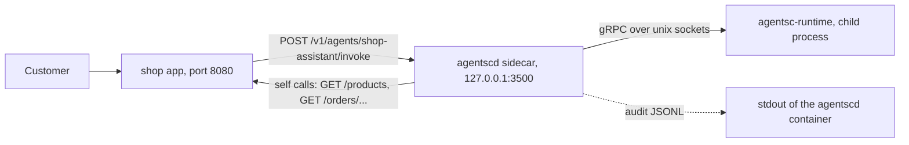
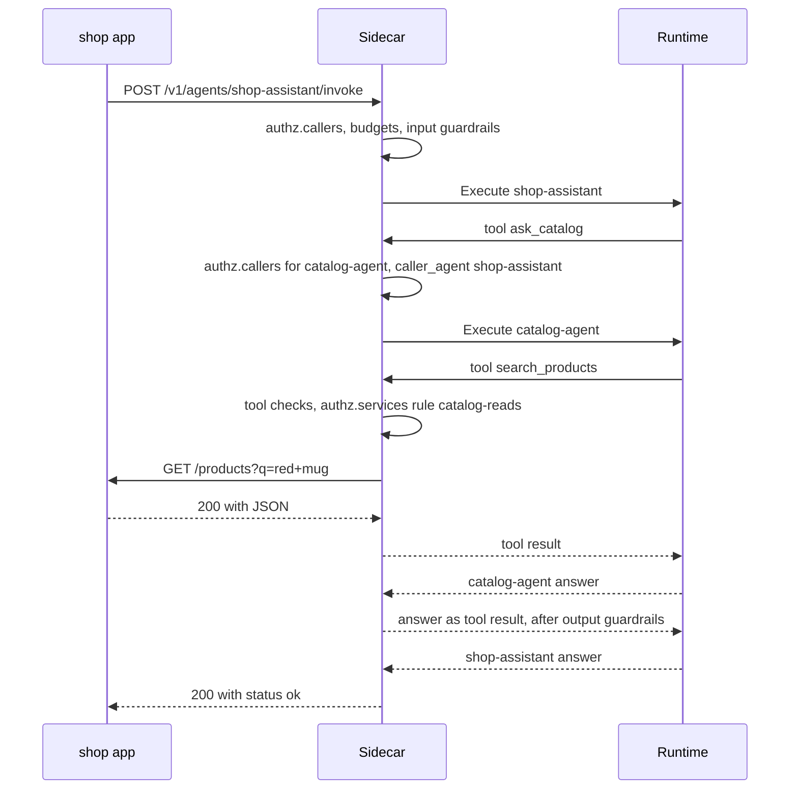
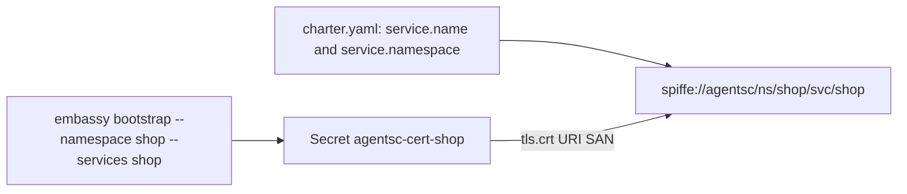

# One service, a monorepo, or many repos

This guide shows how to run many agents next to one service (a monolith). It also shows how to keep many charters in one repository (a monorepo) or across many repositories (a polyrepo).

Commands and files use the code names: `agentscd` is the sidecar, `agentsc` is the CLI, and `embassy` is the CA. [Architecture](../architecture.md#names-agent-sidecar-and-agentsc) explains the naming.

## Part 1: One service (monolith)

You do not need many services to use agent-sidecar. One app with one sidecar can host many agents. All of them live in one charter.



The app calls the sidecar on localhost. The sidecar runs the agents through the runtime. When an agent needs data, it calls a tool. The sidecar checks the tool call against the charter. Then it calls your own app on `127.0.0.1:<app_port>`. Every step is one audit line.

### Example: a "shop" monolith

The shop app has these endpoints:

| Endpoint | What it does |
| --- | --- |
| `GET /products?q=...` | Search products |
| `GET /products/{sku}` | One product, with price and stock |
| `GET /orders/{order_id}` | One order, with status and items |
| `POST /returns` | Open a return. JSON body: `order_id`, `reason` |
| `POST /admin/reindex` | Admin task. No agent may call it |

The charter has three agents:

| Agent | Type | Tools |
| --- | --- | --- |
| `catalog-agent` | `agent` | `search_products`, `get_product` (service tools on the shop app) |
| `order-agent` | `agent` | `get_order`, `open_return` (service tools on the shop app) |
| `shop-assistant` | `orchestrator` | `ask_catalog`, `ask_orders` (local agent tools) |

Save this as `services/shop/charter.yaml`:

```yaml
# yaml-language-server: $schema=../../schemas/charter.schema.json
apiVersion: agentsc.io/v1alpha1
kind: Charter
service:
  name: shop
  namespace: shop
  app_port: 8080
agents:
  - name: catalog-agent
    type: agent
    model: claude-opus-5-5
    system: |
      You answer questions about products in the shop catalog.
      Use search_products to find products and get_product for details.
      Answer in at most three sentences.
    tools:
      - name: search_products
        description: Search the product catalog with free-text words.
        type: service
        service: shop                 # this service: the call goes to the local app
        method: GET
        path: /products               # `q` is not in the path, so it becomes ?q=...
        parameters:
          type: object
          properties:
            q: { type: string, description: "Search words, such as red mug" }
          required: [q]
      - name: get_product
        description: Get one product, with price and stock, by its SKU.
        type: service
        service: shop
        method: GET
        path: /products/{sku}
        parameters:
          type: object
          properties:
            sku: { type: string, description: "SKU such as MUG-1" }
          required: [sku]
    budgets:
      max_tokens_per_call: 1024
      max_calls_per_minute: 60
      max_cost_usd_per_day: 2.0
      max_steps: 4

  - name: order-agent
    type: agent
    model: claude-opus-5-5
    system: |
      You help customers with their orders. Use get_order to read an order.
      Use open_return only when the customer clearly asks for a return.
    tools:
      - name: get_order
        description: Get one order by its id, with status and items.
        type: service
        service: shop
        method: GET
        path: /orders/{order_id}
        parameters:
          type: object
          properties:
            order_id: { type: string, description: "Order id such as 1001" }
          required: [order_id]
      - name: open_return
        description: Open a return request for an order.
        type: service
        service: shop
        method: POST
        path: /returns                # order_id and reason go in the JSON body
        parameters:
          type: object
          properties:
            order_id: { type: string }
            reason: { type: string }
          required: [order_id, reason]
    budgets:
      max_tokens_per_call: 1024
      max_calls_per_minute: 30
      max_cost_usd_per_day: 2.0
      max_steps: 4

  - name: shop-assistant
    type: orchestrator
    model: claude-opus-5-5
    system: |
      You are the shop assistant. Send product questions to ask_catalog and
      order or return questions to ask_orders. Combine the answers in one reply.
    tools:
      - name: ask_catalog
        description: Ask the catalog agent about products, prices and stock.
        type: agent
        agent: catalog-agent          # no `service`: a local agent in this charter
      - name: ask_orders
        description: Ask the order agent about an order, its status or a return.
        type: agent
        agent: order-agent
    budgets:
      max_tokens_per_call: 2048
      max_calls_per_minute: 30
      max_cost_usd_per_day: 5.0
      max_steps: 6

guardrails:
  max_input_bytes: 8192
  pii_redact: true
  input_deny:
    - name: no-secrets
      regex: "(?i)(api[_-]?key|password|secret)\\s*[:=]"

authz:
  default: deny
  callers:
    # The app may call only the orchestrator.
    - identity: local
      agents: [shop-assistant]
    # The specialists may be called only by the orchestrator.
    - identity: local
      agents: [catalog-agent, order-agent]
      caller_agents: [shop-assistant]
  services:
    - name: no-admin                  # no identity, no agent: applies to every caller
      service: shop
      deny: ["* /admin", "* /admin/*"]
    - name: catalog-reads
      agent: catalog-agent
      service: shop
      allow: ["GET /products", "GET /products/*"]
    - name: order-reads-and-returns
      agent: order-agent
      service: shop
      allow: ["GET /orders/*", "POST /returns"]

audit:
  sink: stdout
```

Validate it with the CLI. In an agent-sidecar checkout the CLI is `./target/debug/agentsc` after `cargo build -p agentsc-cli`:

```bash
agentsc charter validate services/shop/charter.yaml
```

```text
valid: services/shop/charter.yaml (3 agent(s), identity spiffe://agentsc/ns/shop/svc/shop)
```

The [creating agents guide](creating-agents.md) explains every field. The sections below explain the parts that matter for a monolith.

### Self calls: tools on your own app

A `service` tool always needs a `service` name. The sidecar compares that name with `service.name` in the charter:

| Tool `service` | Where the call goes | Audit `direction` |
| --- | --- | --- |
| Same as `service.name` (here `shop`) | `http://127.0.0.1:<app_port>`, your own app | `internal` |
| Any other name | The peer sidecar over the mesh, with mTLS | `outbound` |

For `agent` tools the rule is similar. No `service`, or `service` equal to `service.name`, means a local agent in the same charter. The call does not leave the pod. It runs the full invocation pipeline again, with caller `local` and `caller_agent` set to the calling agent.

Before a self call reaches your app, the sidecar runs these checks in order:

1. `guardrail.allowed_tools`: the agent declared this tool and may use it.
2. `guardrail.tool_spec`: the call has the tool's type, `service` and `method`.
3. `guardrail.allowed_services`: the agent may call this service.
4. `guardrail.path`: the path is made canonical. `..` and `%2e%2e` segments are removed. Encoded slashes are refused.
5. `authz.services`: the rules for `service: shop`, with identity `local` and the calling agent.

[CONTRACT.md](../../CONTRACT.md) section 5.1 has the full evaluation order.

Note: the sidecar does not compare the path with the tool's `path` template. The `authz.services` patterns are what limit the paths an agent can reach. Write them for every agent.

Your app receives these headers on a self call:

| Header | Value |
| --- | --- |
| `x-agentsc-caller` | `local` |
| `x-agentsc-agent` | The calling agent, for example `catalog-agent` |
| `x-agentsc-request-id` | The request id, the same in every audit line of this request |
| `traceparent` | A child span of the request's trace |

The sidecar drops these headers if the runtime or a peer tries to set them. But the sidecar does not sit in front of your users' traffic. If your app port is reachable by other clients, they can send these headers too. Use them for logging, not for security decisions on that port.

### `authz.callers` with identity `local`

`identity: local` means "a caller inside this pod". That is the app container, or one of this pod's own agents calling another one.

The example uses two rules:

- The first rule lets the app call `shop-assistant`. The app calls with no calling agent.
- The second rule lets `catalog-agent` and `order-agent` be called only when the calling agent is `shop-assistant` (`caller_agents`).

So when the app calls `catalog-agent` directly, the sidecar returns HTTP 403 with rule `authz.callers.local`. If you want the app to call the specialists directly too, use one rule: `{ identity: local, agents: ["*"] }`. The demo charters in `examples/charters/` do this.

Agent calls can nest. The sidecar refuses a nesting depth over 4 (rule `budget.max_depth`).

### `authz.services` to protect your own admin paths

Rule `no-admin` has no `identity` and no `agent`. So it applies to every caller of service `shop`. That means this pod's own agents, and any peer sidecar that later calls a `shop` path over the mesh. A `deny` match wins over any `allow` match.

With `default: deny`, an agent could not reach `/admin` anyway, because no `allow` pattern matches. The explicit rule still helps in two ways:

- The audit line names the rule: `authz.services.no-admin`, not `authz.default.deny`.
- It keeps working if someone later adds a broad pattern such as `GET /*`.

Patterns are `"<METHOD|*> <path>"`. Only a trailing `*` is supported. `/admin/*` matches `/admin/x` and `/admin/x/y`, but not `/admin`. That is why the rule lists both `* /admin` and `* /admin/*`.

These rules govern agents only. Your users' requests to `/admin` do not pass through the sidecar. Protect them with your app's own authentication.

### One request, step by step



### Run it on Kubernetes

Use the same pattern as `deploy/inventory/`: one Deployment with two containers, `app` and `agentscd`. Sidecar injection is manual. There is no mutating webhook yet, so you write the `agentscd` container into the Deployment yourself.

You need four things in namespace `shop`:

| Object | Name | Made by |
| --- | --- | --- |
| ConfigMap | `shop-charter` (key `charter.yaml`) | `kubectl create configmap` |
| ServiceAccount, Role, RoleBinding | `embassy`, `embassy-pki` | copy `deploy/embassy/rbac.yaml` |
| Job | `embassy-bootstrap` | copy `deploy/embassy/job.yaml` |
| Deployment and Service | `shop` | below |

In the Job, change the arguments. On a real cluster, also set `image` to your own build of `docker/Dockerfile --target embassy` (the file uses `agentsc/embassy:dev`, which `make build` builds inside minikube only):

```yaml
          args: ["bootstrap", "--namespace", "shop", "--services", "shop"]
```

The Job creates Secret `agentsc-ca` (the CA) and Secret `agentsc-cert-shop` (the certificate for `spiffe://agentsc/ns/shop/svc/shop`).

The Deployment, `deploy/shop/deployment.yaml`, has the same `agentscd` container, volumes and probes as the billing Deployment in [Microservices, step 5](microservices.md#step-5-add-the-sidecar-to-the-deployment). Both copy [`deploy/inventory/deployment.yaml`](../../deploy/inventory/deployment.yaml). Copy that block and change these values:

| Field | Value for shop |
| --- | --- |
| `metadata.name`, labels `app` and `agentsc.io/service` (on the Deployment and the pod template) | `shop` |
| `charter` volume, `configMap.name` | `shop-charter` |
| `tls` volume, `secret.secretName` | `agentsc-cert-shop` |
| `agentscd` image | your build of `docker/Dockerfile --target agentscd`, for example `registry.example.com/agentsc/agentscd:1.0.0` |

Two parts differ from billing, because your users call the shop app directly and no other service calls into `shop`:

- The `app` container listens on port 8080 on the pod IP, not only on loopback. Declare the port, and use any readiness probe your app supports (an `httpGet` probe works here):

  ```yaml
  # Partial: only the app container of the shop Deployment.
  - name: app
    image: registry.example.com/shop:1.0.0
    ports:
      - name: http
        containerPort: 8080
    env:
      - name: AGENTSC_URL       # your app's own setting; the orders example reads this name
        value: http://127.0.0.1:3500
  ```

- The `agentscd` container needs no `mesh` port, so you can leave out its `ports` block.

The Service, `deploy/shop/service.yaml`. It exposes only the app port for your users. No other service calls into `shop`, so it does not expose the mesh port `50002`:

```yaml
apiVersion: v1
kind: Service
metadata:
  name: shop
  labels:
    app: shop
    agentsc.io/service: shop
spec:
  selector:
    app: shop
  ports:
    - name: http
      port: 8080
      targetPort: http
```

`deploy/kustomization.yaml` lists the files. `deploy/namespace.yaml` creates namespace `shop`:

```yaml
apiVersion: kustomize.config.k8s.io/v1beta1
kind: Kustomization
namespace: shop
resources:
  - namespace.yaml
  - embassy/rbac.yaml
  - embassy/job.yaml
  - shop/deployment.yaml
  - shop/service.yaml
```

Deploy it in the same order as `make deploy`:

```bash
kubectl apply -f deploy/namespace.yaml
agentsc charter validate services/shop/charter.yaml
kubectl -n shop create configmap shop-charter \
  --from-file=charter.yaml=services/shop/charter.yaml \
  --dry-run=client -o yaml | kubectl apply -f -
kubectl -n shop delete job embassy-bootstrap --ignore-not-found
kubectl apply -k deploy/
kubectl -n shop wait --for=condition=complete job/embassy-bootstrap --timeout=180s
kubectl -n shop rollout restart deployment/shop
kubectl -n shop rollout status deployment/shop --timeout=300s
```

Kubernetes does not let you update a Job's pod template in place. That is why the steps delete the Job first. Running it again keeps the CA and issues new leaf certificates.

The certificate is per service: every replica of `shop` shares the one Secret. Certificates are not rotated. A leaf certificate is valid for 365 days, so run these steps again before it expires.

Read the audit log:

```bash
kubectl -n shop logs deploy/shop -c agentscd
agentsc logs shop -n shop --denied
```

The sidecar loads the charter once, at startup. After you change the ConfigMap, restart the pods:

```bash
kubectl -n shop rollout restart deployment/shop
```

### Run it without Kubernetes

The repo has no Docker Compose file. The tested way to run outside Kubernetes is plain processes, as in [`scripts/local-demo.sh`](../../scripts/local-demo.sh). Run these steps from your agent-sidecar checkout. You need `cargo`, `protoc`, `uv` and `curl`.

**Do you need certificates with no peers?** The sidecar starts without them. It logs a warning, turns the mesh off, and still runs agents. But `/readyz` stays at HTTP 503, because readiness needs a loaded TLS identity. On Kubernetes the readiness probe would never pass, and the liveness probe (the same check) would restart the container. So issue a certificate even for a single service.

1. Build the sidecar, the CLI, embassy and the runtime. Point `CHARTER` at your charter file:

   ```bash
   cargo build -p agentscd -p agentsc-cli -p embassy
   (cd runtime && uv sync)
   CHARTER=/path/to/your-repo/services/shop/charter.yaml
   ./target/debug/agentsc charter validate "$CHARTER"
   ```

2. Create a CA once, then a certificate for `shop`. `ca-init` writes a new CA each time, so the first line skips it when one exists. `make dev-certs` runs the same two commands, but only for the demo services `orders` and `inventory`, and it runs `ca-init` every time.

   ```bash
   [ -f .local/ca/ca.crt ] || ./target/debug/embassy ca-init --out .local/ca
   ./target/debug/embassy cert-issue --ca .local/ca --namespace shop --service shop --out .local/tls/shop
   ```

   The `--namespace` and `--service` values must match `service.namespace` and `service.name` in the charter.

3. Start your app so it listens on `127.0.0.1:8080`, the charter's `app_port`. If that port is taken, change `app_port` in the charter. The sidecar always calls `127.0.0.1:<app_port>`.

4. Start the sidecar. Stdout is the audit log and stderr is the sidecar's own log, so send them to two files:

   ```bash
   mkdir -p .local/run/shop .local/logs
   ./target/debug/agentscd \
     --charter "$CHARTER" \
     --tls-dir .local/tls/shop \
     --mesh-addr 127.0.0.1:50002 \
     --socket-dir .local/run/shop \
     --runtime-cmd "uv run --quiet --project $PWD/runtime agentsc-runtime" \
     > .local/logs/shop-audit.jsonl 2> .local/logs/shop-agentscd.log
   ```

   | Flag | Why |
   | --- | --- |
   | `--mesh-addr 127.0.0.1:50002` | The default is `0.0.0.0:50002`. On a laptop, keep the mesh on loopback. |
   | `--socket-dir` | The default `/run/agentsc` is often not writable on a laptop. |
   | `--runtime-cmd` | Runs the runtime from the `uv` project. The sidecar appends `--listen` and `--sidecar`. |

   The app API keeps its defaults: HTTP on `127.0.0.1:3500` and gRPC on `127.0.0.1:50001`. Set `ANTHROPIC_API_KEY` in this shell to use Claude. Without it, set `AGENTSC_MOCK_FALLBACK=1` to run every agent on the mock model; otherwise Claude agents are refused.

5. Check readiness, call the orchestrator, and try a denied call:

   ```bash
   curl -s localhost:3500/readyz
   # {"ready":true,"runtime":true,"model_provider":"mock","mesh":true}

   curl -s localhost:3500/v1/agents/shop-assistant/invoke \
     -H 'content-type: application/json' \
     -d '{"input": "Do you have a red mug, and what is the status of order 1001?"}'

   # The app may not call a specialist directly: 403, rule authz.callers.local
   curl -s -o /dev/null -w '%{http_code}\n' localhost:3500/v1/agents/catalog-agent/invoke \
     -H 'content-type: application/json' -d '{"input": "red mug"}'
   ```

6. Read the audit trail:

   ```bash
   ./target/debug/agentsc logs --file .local/logs/shop-audit.jsonl
   ./target/debug/agentsc logs --file .local/logs/shop-audit.jsonl --denied
   ```

The [operations guide](../operations.md) explains the audit fields and the CLI filters.

### Limits that matter for a monolith

- **One runtime for all agents.** The runtime is a child process inside the `agentscd` container. All agents of the pod share it and that container's CPU and memory. Size the container for all of them.
- **Guardrails are per charter.** `max_input_bytes`, `pii_redact`, `input_deny` and `output_deny` apply to every agent in the charter. Only `allowed_tools`, `allowed_services` and `budgets` are per agent.
- **What `pii_redact` covers.** It redacts each agent's final output, including a specialist's answer to the orchestrator, and every audit record. It does not redact prompts sent to the model provider. Tool results, such as an order with a customer email, go to the model unchanged.
- **Budgets are in memory, per replica.** With `replicas: 3`, each replica counts its own `max_calls_per_minute` and `max_cost_usd_per_day`. A restart resets them.
- **The runtime calls the model API directly.** Model calls are audited, not proxied.
- **The charter is loaded once.** A change needs a pod restart.
- **No NetworkPolicy is shipped.** Write your own if you need one. Allow egress to the model API.

### When to split into several services

Start with one service. Split when one of these becomes true:

- **Different owners or release cycles.** One charter means one review and one restart for every agent.
- **Different guardrails.** One agent must use `pii_redact` or an `output_deny` rule, and another must not.
- **Different scaling or resources.** One agent is busy and the others are not. All agents in a pod scale together and share one runtime.
- **A smaller blast radius.** Peers authorize a pod by its certificate identity plus the agent name. All agents in one pod share one identity.

To move `catalog-agent` into its own service `catalog`:

1. Move the endpoints and the agent into the new service, with its own charter (`service.name: catalog`). In that charter, the agent's tools and its `authz.services` rule use `service: catalog`.
2. In the shop charter, turn the local tool into a remote one. Add `service: catalog` to `ask_catalog`. Remove `catalog-agent` from `agents` and from the `authz.callers` rule. Otherwise validation fails with `unknown agent "catalog-agent"`.
3. In the catalog charter, add an `authz.callers` rule for `spiffe://agentsc/ns/shop/svc/shop` with `agents: [catalog-agent]` and `caller_agents: [shop-assistant]`.
4. Add `catalog` to the embassy `--services` list. On the catalog Deployment, give the `agentscd` container a port `50002` named `mesh`, as in `deploy/inventory/`. Expose that port on the catalog Service.
5. Keep both services in the same namespace. Each namespace gets its own CA, so cross-namespace mesh calls do not work out of the box.

The [microservices guide](microservices.md) covers this setup in full.

## Part 2: Monorepo layout

In a monorepo, many services live in one repository. Keep one rule: **each service keeps its charter next to its code.**

A recommended layout for your repository:

```text
your-repo/
├── services/
│   ├── shop/
│   │   ├── src/
│   │   ├── Dockerfile
│   │   └── charter.yaml          # service.name: shop
│   ├── catalog/
│   │   ├── src/
│   │   ├── Dockerfile
│   │   └── charter.yaml          # service.name: catalog
│   └── payments/
│       ├── src/
│       ├── Dockerfile
│       └── charter.yaml          # service.name: payments
├── schemas/
│   └── charter.schema.json       # copied from the agent-sidecar version you run
├── scripts/
│   └── validate-charters.sh
└── deploy/                       # one kustomize tree
    ├── kustomization.yaml
    ├── namespace.yaml
    ├── embassy/
    │   ├── rbac.yaml
    │   └── job.yaml              # --services shop,catalog,payments
    ├── shop/
    │   ├── deployment.yaml
    │   └── service.yaml
    ├── catalog/
    └── payments/
```

This is a layout for your own repository. In the agent-sidecar repository itself, `services/` holds the sidecar, the CLI and embassy.

Guidelines:

- **The directory name is the service name.** `services/shop/` holds the charter with `service.name: shop`. The check below enforces it.
- **One sidecar image.** Build `agentscd` once from `docker/Dockerfile` (`--target agentscd`). Push it to your registry with a fixed tag. Every Deployment uses the same image and tag.
- **One kustomize tree.** `deploy/<svc>/` holds each Deployment and Service. `deploy/embassy/` holds one bootstrap Job per namespace. Its `--services` list names every service in that namespace.
- **ConfigMaps come from the committed charters.** Do not keep a second copy of a charter in `deploy/`. Create the ConfigMaps from `services/*/charter.yaml` in your deploy step, as `make charters` does here:

  ```bash
  NS=shop
  for f in services/*/charter.yaml; do
    svc=$(basename "$(dirname "$f")")
    kubectl -n "$NS" create configmap "$svc-charter" --from-file=charter.yaml="$f" \
      --dry-run=client -o yaml | kubectl apply -f -
  done
  ```

  The sidecar loads the charter only at startup. Restart a Deployment after its charter changes.

To run several services of the monorepo on one machine, copy the pattern of `scripts/local-demo.sh`. It starts one sidecar per service. Each sidecar gets its own `--http-addr`, `--grpc-addr`, `--mesh-addr` and `--socket-dir`. Each charter gets a `mesh.peers` entry that points the other services at their `127.0.0.1` mesh ports.

### Validate every charter in one CI step

This is a recommendation. agent-sidecar does not ship this script, and the repo has no CI config. It is one shell loop over the CLI, so it works in any CI system.

`scripts/validate-charters.sh`:

```bash
#!/usr/bin/env bash
# Validate every charter in the repo and check that each one names its own directory.
set -euo pipefail
NS=${NS:-shop}
AGENTSC=${AGENTSC:-agentsc}
status=0
for f in services/*/charter.yaml; do
  svc=$(basename "$(dirname "$f")")
  if ! out=$("$AGENTSC" charter validate "$f" 2>&1); then
    echo "$out"; status=1; continue
  fi
  echo "$out"
  case "$out" in
    *"identity spiffe://agentsc/ns/$NS/svc/$svc)") ;;
    *) echo "  error: $f must declare service.name: $svc and service.namespace: $NS"; status=1 ;;
  esac
done
exit $status
```

`agentsc charter validate` exits 1 and prints one error per line when a charter is invalid. When it is valid, it prints the identity, for example `valid: services/shop/charter.yaml (3 agent(s), identity spiffe://agentsc/ns/shop/svc/shop)`. The loop uses that identity to check the directory name and the namespace. The script checks every file before it fails, so one CI run shows all errors.

Example output with one wrong namespace:

```text
valid: services/catalog/charter.yaml (1 agent(s), identity spiffe://agentsc/ns/shop/svc/catalog)
valid: services/payments/charter.yaml (2 agent(s), identity spiffe://agentsc/ns/other/svc/payments)
  error: services/payments/charter.yaml must declare service.name: payments and service.namespace: shop
valid: services/shop/charter.yaml (3 agent(s), identity spiffe://agentsc/ns/shop/svc/shop)
```

Two ways to get the `agentsc` CLI in CI:

```bash
# 1. Build it from an agent-sidecar checkout
cargo build -p agentsc-cli            # binary: target/debug/agentsc

# 2. Use the copy inside the sidecar image (it is at /usr/local/bin/agentsc)
docker run --rm -v "$PWD:/work" -w /work --entrypoint agentsc \
  registry.example.com/agentsc/agentscd:1.0.0 charter validate services/shop/charter.yaml
```

Option 2 uses the same version as the sidecar you deploy. The image runs as user `10001`, so the mounted files must be readable by that user.

You can add more checks to the same loop. For example, check that `deploy/$svc/deployment.yaml` exists for every service directory.

### Editor autocompletion with the JSON Schema

[`schemas/charter.schema.json`](../../schemas/charter.schema.json) is generated from the Rust charter types. It has `additionalProperties: false`, so an editor marks unknown fields and wrong types as you type.

Copy the schema from the agent-sidecar version you run. Or generate it with the same CLI version:

```bash
agentsc charter schema > schemas/charter.schema.json
```

Then connect it to your editor. These are editor features, not part of agent-sidecar:

- **VS Code with the Red Hat YAML extension.** Put a comment on the first line of each charter. The path is relative to the charter file. The charter loader ignores comments.

  ```yaml
  # yaml-language-server: $schema=../../schemas/charter.schema.json
  ```

  Or map all charters at once in `.vscode/settings.json`:

  ```json
  {
    "yaml.schemas": {
      "./schemas/charter.schema.json": "services/*/charter.yaml"
    }
  }
  ```

- **JetBrains IDEs.** Add a mapping under Settings, Languages & Frameworks, Schemas and DTDs, JSON Schema Mappings.

The schema checks structure only. Rules such as "only an orchestrator may declare `agent` tools" or "`allowed_tools` must name declared tools" are checked by `agentsc charter validate`. Keep the CI step.

### Keep identity names consistent

One service has one identity: `spiffe://agentsc/ns/<service.namespace>/svc/<service.name>`. The same names appear in several places.



What the sidecar checks at startup:

| Situation | Result |
| --- | --- |
| The charter is invalid | The sidecar exits with the validation errors. |
| `tls.crt` has no `spiffe://agentsc/` URI SAN | The sidecar exits. |
| The certificate's identity is not the charter's identity | The sidecar exits: `tls.crt identity ... does not match charter identity ...`. On Kubernetes the pod restarts in a loop. |
| No certificate files in `--tls-dir` | The sidecar starts with the mesh off. `/readyz` stays at 503. |

What the sidecar does not check: the real namespace of the pod, the name of the Kubernetes Service, and the pod labels. Keep them equal to the charter by convention, or other parts stop lining up:

| Name | Where it appears | Why it must match |
| --- | --- | --- |
| `service.name` | charter | Embassy `--services` entry, so the certificate matches. |
| `service.name` | Kubernetes Service name | Peers find a service at `<service>.<namespace>.svc.cluster.local:50002`, unless `mesh.peers` in their charter overrides the address. |
| `service.name` | label `agentsc.io/service` | `agentsc logs <svc>` selects pods by this label. |
| `service.name` | other charters | The `service` field of their tools, and the identity in their `authz` rules. |
| `service.namespace` | charter | Embassy `--namespace`, the namespace the pod runs in, and the identity in other charters. |
| `agentsc-cert-<svc>` | Deployment `tls` volume | The Secret name embassy writes (prefix `agentsc-cert-`). |
| `<svc>-charter` | Deployment `charter` volume | The ConfigMap name your deploy step creates. This is a convention from `deploy/`. |

Renaming a service is a change in several files. Search the whole repo for the old name, including the SPIFFE ids in other charters.

### This repository already follows the pattern

The agent-sidecar repository is a small monorepo with two demo services:

| Pattern | In this repository |
| --- | --- |
| App code per service | `examples/orders/` (Go), `examples/inventory/` (FastAPI) |
| One committed charter per service | `examples/charters/orders.charter.yaml`, `examples/charters/inventory.charter.yaml` |
| One shared sidecar image | `agentsc/agentscd:dev` from `docker/Dockerfile`, used by both Deployments |
| One kustomize tree | `deploy/kustomization.yaml`, `deploy/orders/`, `deploy/inventory/`, `deploy/embassy/` |
| One bootstrap Job for the namespace | `embassy bootstrap --namespace agentsc-demo --services orders,inventory` |
| ConfigMaps from the committed charters | `make charters`, which runs `make validate` first |
| Local run with plain processes | `scripts/local-demo.sh` |

Two differences from the recommended layout. The charters live in `examples/charters/`, not next to the app code. And the Makefile names each charter file, instead of looping over a directory. In your own repository, keep each charter next to its code and use a loop.

## Part 3: Polyrepo

In a polyrepo, each service has its own repository. The rule is the same: **the charter lives next to the code**, in each service's repository. The parts every service shares become artifacts with a version.

| Shared part | How to share it |
| --- | --- |
| Sidecar image | Build `agentscd` from agent-sidecar's `docker/Dockerfile`. Push it to your registry with a fixed tag. Each service repo uses that tag. |
| CLI | Use the copy inside the same image: `docker run --rm --entrypoint agentsc <image> charter validate ...`. |
| JSON Schema | Generate it from the same image: `docker run --rm --entrypoint agentsc <image> charter schema > charter.schema.json`. Or copy it from the agent-sidecar commit you built the image from. |
| Embassy Job, RBAC, namespace | Keep them in one platform repository. There is one Job per namespace, and its `--services` list names every service in it. |

When you upgrade the sidecar, upgrade the image tag and the schema together.

Changes that cross repositories need coordination:

- A new service needs a pull request to the platform repository, to add its name to the embassy `--services` list.
- The callee's charter names the caller's SPIFFE id in `authz.callers`. The caller's charter names the callee's service and agent in its tools. Renaming a service needs changes in both repositories.
- Services that call each other must share a namespace, because each namespace has its own CA.
