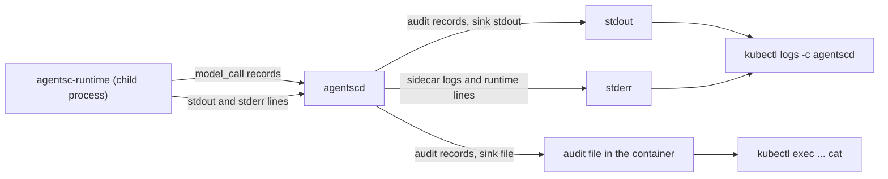
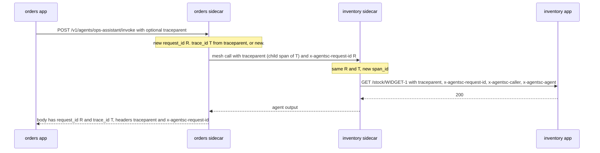

# Operations

This page explains how to run agent-sidecar day to day: where logs go, how to read the audit trail, how to fix common problems, and how to change charters and certificates. It ends with a production checklist and the full list of known limitations.

Commands on this page use the names in the code: the sidecar is `agentscd`, the CLI is `agentsc`, and the CA is `embassy`. [Architecture](architecture.md#names-agent-sidecar-and-agentsc) explains the naming. The examples use the demo namespace `agentsc-demo` and the kubectl context `minikube`. Change them for your cluster.

- [Where logs go](#where-logs-go)
- [The audit record](#the-audit-record)
- [Reading logs](#reading-logs)
- [Troubleshooting](#troubleshooting)
- [Changing a charter](#changing-a-charter)
- [Rotating certificates](#rotating-certificates)
- [Budgets on restart and with replicas](#budgets-on-restart-and-with-replicas)
- [Production checklist (recommendations)](#production-checklist-recommendations)
- [Known limitations](#known-limitations)

## Where logs go

The `agentscd` container writes three kinds of lines.

| Stream | Written by | Goes to | How to recognise a line |
| --- | --- | --- | --- |
| Audit records | `agentscd` | stdout when `audit.sink: stdout` (the default), or a file when `audit.sink: file` | One JSON object per line. It always starts with `{"ts":`. |
| Sidecar logs | `agentscd` | stderr | A timestamp, a level such as `INFO` or `WARN`, then a message. These lines can contain ANSI colour codes. |
| Runtime logs | `agentsc-runtime`, forwarded by `agentscd` | stderr of `agentscd` | Every line starts with `[runtime] `. |

The runtime is a child process of the sidecar. The sidecar reads the runtime's stdout and stderr. It writes every line to its own stderr with the prefix `[runtime] `. So stdout carries audit records only.

In pods injected by the Helm chart the runtime is a container of its own, `agentsc-runtime` (so that it cannot read the sidecar's API key). Its lines are in `kubectl logs -c agentsc-runtime`, without the prefix, and `-c agentscd` has the audit records and sidecar logs only.

Kubernetes keeps stdout and stderr of a container in one log. So `kubectl logs -c agentscd` shows all three streams mixed together. `agentsc logs` keeps only the lines that parse as audit records.



### Log level

The sidecar log level comes from the `RUST_LOG` environment variable. The image and the demo Deployments set `RUST_LOG=info`. Set `RUST_LOG=debug` on the `agentscd` container for more detail. The runtime always logs at `INFO`. It has no setting for this.

### Audit sink: stdout or file

There are two sinks: `stdout` and `file`. `stdout` is the default. You set the sink in the charter. This snippet is partial: it shows only the `audit` block of a charter.

```yaml
audit:
  sink: file
  file: /var/log/agentsc/audit.jsonl
  redact: []
```

What you need to know about the `file` sink:

- `audit.sink: file` needs `audit.file`. Without it the charter is invalid (`audit.sink: file requires audit.file`).
- The sidecar creates the parent directory and appends to the file. It opens the file at startup. If it cannot, it exits with `open audit file`.
- The image makes `/var/log/agentsc` writable for its user (uid 10001).
- The demo Deployments mount no volume at `/var/log/agentsc`. The file lives in the container's writable layer. It is lost when the container restarts. Mount a volume there if you use the file sink.
- With the file sink, stdout has no audit records. `kubectl logs` and `agentsc logs <service>` show no records. Read the file with `kubectl exec` (see [Reading logs](#reading-logs)).
- The sidecar does not rotate the file.
- A write error (a full disk, a closed pipe) is never ignored. See [Audit sink failures](#audit-sink-failures).

### Audit sink failures

When the sink refuses a write or a flush, the sidecar:

- **keeps the record.** The bytes the sink did not take wait in memory, up to 4 MiB, and are written first by the next attempt. It resumes at the first byte the sink did not take, so a record is never written twice or cut in half. When the 4 MiB are full, new records are not kept. They are counted as `dropped`.
- **retries.** Every later record, every `GET /readyz` and a timer once a second try again. When the backlog is written and flushed, the sink is healthy again.
- **logs it** on stderr. The first failure at once, then at most one summary every 10 seconds (`audit sink write failed; unwritten records are kept and retried`, with the counts and the error), and `audit sink recovered` when it is over.
- **reports it** in the `/readyz` body:

```json
"audit": {"healthy": false, "fail_closed": true, "write_errors": 3, "dropped": 0, "pending_bytes": 2741, "last_error": "No space left on device (os error 28)"}
```

The control-plane export and the OpenTelemetry exporter still get every record, also one the sink did not take.

**Fail-closed mode.** By default the sidecar goes on working while the sink fails: an audit outage is visible, but agents keep running. Start `agentscd` with `--audit-fail-closed` (or `AGENTSC_AUDIT_FAIL_CLOSED=true`; Helm: `injection.auditFailClosed: true` for every injected sidecar) when no work may happen without a local audit record. Then, from the first failed write or flush until a write succeeds again:

| What | Answer |
| --- | --- |
| `POST /v1/agents/{name}/invoke` | `503`, `status: denied`, rule `audit.unavailable` |
| gRPC `AppApi.InvokeAgent`, mesh `InvokeAgent` / `InvokeService` | `UNAVAILABLE`, metadata `x-agentsc-rule: audit.unavailable` |
| The runtime's `InvokeService`, `InvokeAgent`, `InvokeHttp`, `ProposeLesson` | `UNAVAILABLE`, rule `audit.unavailable` |
| `GET /readyz` | `503`: the pod leaves its Service's endpoints (the injected `agentscd` has a readiness probe on it; give a hand-written sidecar one too) |

Every refusal writes its own record (`agent_invocation`, inbound `service_call` or `tool_call`, `decision: deny`, rule `audit.unavailable`, the error in `reason`), except a refused `ProposeLesson`. That write is also an attempt, as are the probes and the timer. The first attempt that writes the backlog ends the refusals, so the sidecar recovers by itself once the disk has room again, without a restart. Work that started before the failure finishes, and its records are written or kept. `ReportEvent` is never refused: the model call it reports already ran and was paid for.

A closed stdout pipe does not recover. With fail-closed the pod then stays not ready until it is restarted.

### Local runs

`make local-demo` runs the sidecars on your machine. It writes these files:

| File | Content |
| --- | --- |
| `.local/logs/<svc>-audit.jsonl` | stdout of the sidecar: audit records only |
| `.local/logs/<svc>-agentscd.log` | stderr of the sidecar: sidecar logs and `[runtime]` lines |
| `.local/logs/<svc>-app.log` | output of the demo app |

```bash
cat .local/logs/orders-audit.jsonl .local/logs/inventory-audit.jsonl | ./target/debug/agentsc logs --file -
```

## The audit record

Each record is one JSON object on one line. Only `agentscd` writes records. The runtime reports its `model_call` records to the sidecar over the `ReportEvent` call, and the sidecar writes them. The field order is fixed, so `grep` and people see the same layout. The full reference is [CONTRACT.md section 6](../CONTRACT.md#6-audit-record).

### Fields

| Field | Type | Meaning |
| --- | --- | --- |
| `ts` | string | When the record was made, normally when the step finished. UTC, RFC 3339 with milliseconds, for example `2026-10-20T13:05:24.710Z`. |
| `kind` | string | One of nine kinds. See [Record kinds](#record-kinds). |
| `request_id` | string | A UUID. One per top-level invocation. It is the same on every hop. |
| `trace_id` | string | W3C trace id, 32 hex characters. |
| `span_id` | string | The span of this hop, 16 hex characters. |
| `parent_span_id` | string or null | The span that called this one. `null` for a root span. |
| `service` | string | The service of the sidecar that wrote the record. |
| `namespace` | string | The namespace of that service. |
| `agent` | string or null | The agent this record belongs to. On a callee's inbound `service_call`, this is the calling agent from the other pod. `null` when no agent is known. |
| `caller` | string | `local` (this pod: the app or a local agent), a SPIFFE id such as `spiffe://agentsc/ns/agentsc-demo/svc/orders`, or `unknown` (the certificate was refused). |
| `caller_agent` | string or null | The agent that made the call, when an agent made it. |
| `callee` | string | What was called. The format depends on the kind. |
| `direction` | string | `inbound`, `outbound` or `internal`. |
| `input` | JSON or string | What went in, after redaction and truncation. |
| `output` | JSON, string or null | What came out, after redaction and truncation. `null` when the step was denied or failed. |
| `input_sha256` | string or null | SHA-256 (hex) of the full original input. `null` when the input is `null`. |
| `output_sha256` | string or null | The same for the output. |
| `tokens` | object or null | `{"input": n, "output": n}` for model calls, agent calls and invocations. |
| `cost_usd` | number or null | Cost from the runtime's price table. The `mock` model costs 0. |
| `latency_ms` | integer | How long the step took. |
| `decision` | string | `allow` or `deny`. |
| `rule` | string or null | The rule that decided, for example `authz.services.deny-admin`. |
| `reason` | string or null | A human-readable reason. Mostly set for denials. |
| `error` | string or null | Set when the step was allowed but failed. |

### Record kinds

| `kind` | `direction` | Written when | `callee` example |
| --- | --- | --- | --- |
| `agent_invocation` | inbound | An agent is invoked: by the app, by a peer sidecar, or by a local agent tool. Exactly one per invocation. It is written last, after the records of its steps. | `ops-assistant` |
| `model_call` | outbound | Each model request in the agent loop. The runtime reports it. The sidecar writes it. | `anthropic:claude-opus-5-5` or `mock` |
| `tool_call` | internal | Each tool call from the runtime: allowed, denied or failed. | `get_stock` (the tool name) |
| `service_call` | internal (own app), outbound (to a peer), inbound (on the callee) | A `service` tool request was sent to the app or to a peer. The callee writes its own inbound record, also for denials. | `inventory GET /stock/WIDGET-1` |
| `agent_call` | outbound (remote agent), internal (local agent) | An `agent` tool call was sent. | `inventory/stock-analyst` or `order-triage` |
| `http_call` | outbound | An `http` tool request was sent. | `GET https://example.com/items/1` |
| `guardrail` | internal | An input or output guardrail denied the invocation, or `pii_redact` rewrote the output (then `decision: allow` and `rule: guardrail.pii_redact`). | the agent name |
| `budget` | internal | `max_calls_per_minute` or `max_cost_usd_per_day` denied an invocation. | the agent name |
| `authz` | inbound | A mesh call was refused because the client certificate has no `spiffe://<trust domain>/` workload URI SAN (the callee's `--trust-domain`, `agentsc` by default). The rule is `authz.identity.invalid` and `caller` is `unknown`. | the agent, or `<service> <METHOD> <path>` |

Some details:

- A denial by `authz.callers` is written as kind `agent_invocation` with `decision: deny`. It is not kind `authz`.
- A `guardrail` or `budget` denial writes two records: the `guardrail` or `budget` record and the `agent_invocation` record with `decision: deny`.
- A tool call that is denied on this sidecar, before anything is sent, writes only a `tool_call` record.
- `budget.max_depth` writes only the `agent_invocation` record.

### decision, rule, reason and error

Read the four fields together:

| `decision` | `error` | Meaning |
| --- | --- | --- |
| `deny` | `null` | Policy stopped the step. `rule` names the policy and `reason` says why. |
| `allow` | set | Policy let the step through, but it failed. Examples: peer down, app down, model error, unknown agent. |
| `allow` | `null` | The step was allowed and worked. `rule` may name the rule that allowed it, for example `authz.services.self-stock`, or be `null`. |

Rule names come in families:

| Rule | Comes from |
| --- | --- |
| `authz.callers.default` | No `authz.callers` rule exists for the caller's identity. |
| `authz.callers.<service>` | A rule exists for the identity, but it does not list the agent, or its `caller_agents` does not include the calling agent. For calls from the app the suffix is `local`, for example `authz.callers.local`. |
| `authz.services.<name>` | The named `authz.services` rule. With `deny`, one of its deny patterns matched. With `allow`, one of its allow patterns matched. |
| `authz.default.deny`, `authz.default.allow` | `authz.default`, because no `authz.services` pattern matched. |
| `authz.identity.invalid` | A mesh client certificate without a valid SPIFFE URI SAN. |
| `guardrail.<check>` | `max_input_bytes`, `input_deny.<name>`, `output_deny.<name>`, `pii_redact`, `allowed_tools`, `allowed_services`, `tool_spec`, `path`. |
| `budget.<limit>` | `max_calls_per_minute`, `max_cost_usd_per_day`, `max_depth`. |
| `model.refusal` | The model refused the request. |
| `agent.unknown` | The agent is not in the charter. The record has `decision: allow` and `error` set. |
| `audit.unavailable` | `--audit-fail-closed` refused new work while the audit sink was failing. See [Audit sink failures](#audit-sink-failures). |
| `clarify.asked` | The agent stopped to ask its caller for decisions (`ask_caller`). The `agent_invocation` record has `decision: allow` and the questions, as text, in its `output`. The sidecar writes that `output` from the questions it kept after the output guardrails, so it is exactly what the caller got. `agentsc logs --rule clarify.asked` finds these records, and its table shows them as `allow clarify.asked`. |

Some failures name a rule only in the HTTP response: `runtime.unavailable`, `model.error`, `budget.max_steps` and `budget.max_tokens_per_call`. Their `agent_invocation` record has `decision: allow`, `rule: null` and the reason in `error`.

### Linking records across pods

Two ids join the records of one call, across all pods:

- **`request_id`** is a UUID. The first sidecar makes a new one for every request from its app. The app cannot set it. The sidecar sends it unchanged on every hop: as `x-agentsc-request-id` mesh metadata to peers, and as the `x-agentsc-request-id` header to apps. One top-level invocation has one `request_id`.
- **`trace_id`** is a W3C trace id. The sidecar takes it from the app's `traceparent` header when the header is valid. Otherwise it makes a new one. Every hop makes a new `span_id`. Its `parent_span_id` is the span of the hop before it.

If your gateway sends the same `traceparent` for many requests, they share one `trace_id`. Each still has its own `request_id`. Use `--request` to separate them.



Tips:

- The app gets both ids in the response body (`request_id`, `trace_id`) and in the response headers (`x-agentsc-request-id`, `traceparent`). Log them in your app.
- When an agent calls your app, the request carries `traceparent`, `x-agentsc-request-id`, `x-agentsc-caller` and `x-agentsc-agent`. Log them too. Then you can join your app logs with the audit log.
- Records are written when each step finishes. So step records come before the record of the step that started them. `agentsc logs` sorts by `ts`, except when it follows.

### Payload redaction and hashes

The sidecar does these steps, in this order, for every record it writes:

1. **Hash.** `input_sha256` and `output_sha256` are computed over the full original payload, before any redaction or truncation. For a string payload, the hash is SHA-256 of its UTF-8 bytes. For any other JSON value, it is SHA-256 of its compact JSON text. A `null` payload has a `null` hash. So you can prove later that a payload you hold is the one that passed, without the log storing it.
2. **`audit.redact` paths.** Each path is a dotted path that starts with `input.` or `output.`, for example `output.body.warehouse_contact`. The value there becomes `"[redacted]"`. Arrays are walked. The path `input` or `output` alone redacts the whole payload. The charter validator does not check these paths. A path with another start does nothing.
3. **Scrub repeated values.** The values found at those paths (strings and numbers of 4 or more characters) are remembered for that `request_id` for 15 minutes. They are replaced with `[redacted]` wherever they appear as text in later records of the same request in that sidecar, for example inside a model prompt. This covers `input`, `output`, `callee`, `reason` and `error`: a value can come back in a URL (`GET https://api.example.com/x?ssn=…`) or in an error message that echoes the input. A payload a content guardrail withheld (step 1) is scrubbed the same way.
4. **PII.** With `guardrails.pii_redact: true`, emails become `[redacted:email]` and phone numbers become `[redacted:phone]`. This applies to every string in `input` and `output`, and to `callee`, `reason` and `error`. Steps 3 and 4 also apply to the callee of the span starts a managed sidecar sends the control plane for its trace views (an http tool's URL with its query), which leave the pod before the record is written.
5. **Truncate.** A payload larger than 8 KiB is cut to 8 KiB plus `…(truncated, N bytes)`. Truncation comes after redaction, so a cut never shows part of a redacted value.

This snippet is partial: it shows only the `audit` block of a charter.

```yaml
audit:
  sink: stdout
  redact:
    - input.context.customer_email     # agent_invocation input with a context; also a calling agent's tool_call and agent_call input
    - output.body.warehouse_contact    # service_call output: {"status": 200, "body": {...}}
```

Each sidecar applies the charter of its own service. A value that the inventory charter redacts can still appear in the orders log if the orders charter does not redact it.

What redaction does **not** cover:

- The prompt and the tool results sent to the model provider. The runtime sends them as they are.
- Tool results returned to the runtime. The model sees them as they are.
- Requests the sidecar forwards to apps and peers.

`pii_redact` changes the agent's final output and the audit records. Nothing else.

### Example record

This is the denial written by the inventory sidecar in the local demo. It is one line in the log. It is shown here formatted.

```json
{
  "ts": "2026-10-20T13:05:24.710Z",
  "kind": "service_call",
  "request_id": "b7e5832a-ad31-4f78-9215-8d103cc9ed07",
  "trace_id": "e3af314822426057d5ee3179b51461b4",
  "span_id": "2e77fa4388933dfb",
  "parent_span_id": "d4ab404d3c0097b1",
  "service": "inventory",
  "namespace": "agentsc-demo",
  "agent": "ops-assistant",
  "caller": "spiffe://agentsc/ns/agentsc-demo/svc/orders",
  "caller_agent": "ops-assistant",
  "callee": "inventory POST /admin/reset",
  "direction": "inbound",
  "input": { "method": "POST", "path": "/admin/reset", "body": {} },
  "output": null,
  "input_sha256": "004b59a790029158af09d1ac3ccd89684b533043e26499e4e20ecdc1f18826e8",
  "output_sha256": null,
  "tokens": null,
  "cost_usd": null,
  "latency_ms": 0,
  "decision": "deny",
  "rule": "authz.services.deny-admin",
  "reason": "POST /admin/reset on inventory matches deny pattern \"* /admin/*\"",
  "error": null
}
```

The orders sidecar wrote a `tool_call` and a `service_call` record for the same call. They have the same `request_id`, the same `trace_id` and the same rule.

You can check the hash. The input is a JSON object, so the hash is over its compact JSON text:

```bash
printf '%s' '{"method":"POST","path":"/admin/reset","body":{}}' | shasum -a 256
# 004b59a790029158af09d1ac3ccd89684b533043e26499e4e20ecdc1f18826e8  -
```

On Linux, use `sha256sum` instead of `shasum -a 256`.

## Reading logs

### With kubectl

```bash
# Everything the sidecar wrote: audit records, sidecar logs and runtime lines
kubectl --context minikube -n agentsc-demo logs -l agentsc.io/service=inventory -c agentscd --tail=-1

# Only audit records
kubectl --context minikube -n agentsc-demo logs -l agentsc.io/service=inventory -c agentscd --tail=-1 \
  | grep '^{"ts"'

# Only runtime lines (deploy/<name> picks one pod)
kubectl --context minikube -n agentsc-demo logs deploy/inventory -c agentscd | grep '^\[runtime\]'

# The previous run of the container, after a crash
kubectl --context minikube -n agentsc-demo logs deploy/inventory -c agentscd --previous
```

With `-l`, kubectl prints only the last 10 lines of each container unless you pass `--tail`. `--tail=-1` prints everything.

If you have `jq`, you can filter the JSON:

```bash
kubectl --context minikube -n agentsc-demo logs -l agentsc.io/service=inventory -c agentscd --tail=-1 \
  | grep '^{"ts"' | jq -c 'select(.decision == "deny") | {ts, service, kind, rule, reason}'
```

With the file sink, read the file inside the container:

```bash
kubectl --context minikube -n agentsc-demo exec deploy/inventory -c agentscd -- \
  cat /var/log/agentsc/audit.jsonl | ./target/debug/agentsc logs --file - --denied
```

### With the agentsc CLI

Build the CLI once with `cargo build -p agentsc-cli`. The binary is `./target/debug/agentsc`. `make logs` builds it for you if it is missing.

```bash
./target/debug/agentsc logs orders,inventory -n agentsc-demo --context minikube
```

What it does:

1. It runs `kubectl [--context C] logs -n NS -l <selector> -c agentscd --tail N --prefix=false`, with `-f` when you follow. The selector is `agentsc.io/service=<svc>` for one service, or `agentsc.io/service in (<svc>,<svc>)` for several.
2. It keeps only lines that parse as audit records. Sidecar logs and `[runtime]` lines are skipped.
3. It applies your filters.
4. It sorts by `ts`, unless you follow.
5. It prints one line per record.

Your pods need the label `agentsc.io/service: <svc>`, and the sidecar container must be named `agentscd`. Otherwise `agentsc logs` finds nothing.

| Flag | Default | What it does |
| --- | --- | --- |
| `<service>[,<service>...]` | none | Services to read, by the label `agentsc.io/service`. Required unless you use `--file`. |
| `-n`, `--namespace` | `agentsc-demo` | The namespace. |
| `--context` | kubectl's current context | The kubeconfig context. |
| `--agent A` | none | Only records whose `agent` or `caller_agent` is exactly `A`. |
| `--trace T` | none | Only records whose `trace_id` starts with `T`. |
| `--request R` | none | Only records whose `request_id` starts with `R`. |
| `--kind K` | none | Only records of one kind, for example `service_call`. |
| `--rule R` | none | Only records whose `rule` starts with `R`, for example `taint.would_deny` or `clarify.asked`. |
| `--denied` | off | Only records with `decision: deny`. |
| `-f`, `--follow` | off | Follow new records (`kubectl logs -f`). Records print as they arrive, not sorted. |
| `--raw` | off | Print the JSON lines instead of the table. |
| `--file F` | none | Read records from file `F`, or from stdin with `-`, instead of kubectl. The service argument is ignored. |
| `--tail N` | `1000` | How many lines kubectl fetches per container. |

Exit status: `agentsc logs` exits 1 if kubectl fails. It prints `kubectl logs failed (...); no audit records were read`. An empty table always means "no matching records". It never hides a kubectl failure.

The table columns are: time (UTC, `HH:MM:SS.mmm`), service, agent, kind, direction, caller, `→` callee, decision, latency. Then, when present: `tokens=<in>/<out> $<cost>`, `error=<text>`, and always `trace=<first 8 characters>`. A SPIFFE caller is shortened to `svc/<name>`. The calling agent is shown in parentheses, except on an `agent_invocation` record whose caller is `local`. A denial shows `DENY <rule>`. A `pii_redact` record shows `allow guardrail.pii_redact`. An allowed record shows its rule only when the rule is `guardrail.pii_redact`, a `taint.*` rule or `clarify.asked` (a run that asked its caller), or the record is of a newer kind such as `config` or `learning`.

This is real output for the denied call of the local demo:

```bash
cat .local/logs/orders-audit.jsonl .local/logs/inventory-audit.jsonl \
  | ./target/debug/agentsc logs --file - --trace e3af3148
```

```text
13:05:24.709 orders     ops-assistant  model_call       outbound local                        → mock                               allow                                         0ms tokens=101/9 $0.0000 trace=e3af3148
13:05:24.710 inventory  ops-assistant  service_call     inbound  svc/orders (ops-assistant)   → inventory POST /admin/reset        DENY authz.services.deny-admin                0ms trace=e3af3148
13:05:24.711 orders     ops-assistant  tool_call        internal local (ops-assistant)        → inventory_admin_reset              DENY authz.services.deny-admin                0ms trace=e3af3148
13:05:24.711 orders     ops-assistant  service_call     outbound local (ops-assistant)        → inventory POST /admin/reset        DENY authz.services.deny-admin                0ms trace=e3af3148
13:05:24.711 orders     ops-assistant  model_call       outbound local                        → mock                               allow                                         0ms tokens=175/38 $0.0000 trace=e3af3148
13:05:24.711 orders     ops-assistant  agent_invocation inbound  local                        → ops-assistant                      allow                                         3ms tokens=276/47 $0.0000 trace=e3af3148
```

The invocation itself is `allow`. The denied tool call did not fail it. The model got the denial as a tool error and answered.

More examples:

```bash
# One call across both pods
./target/debug/agentsc logs orders,inventory --context minikube --trace e3af3148

# One top-level invocation
./target/debug/agentsc logs orders,inventory --context minikube --request b7e5832a

# Every denial in the last 1000 lines of each pod
./target/debug/agentsc logs orders,inventory --context minikube --denied

# Follow one agent live
./target/debug/agentsc logs inventory --context minikube --agent stock-analyst -f

# Only model calls, as raw JSON
./target/debug/agentsc logs orders --context minikube --kind model_call --raw
```

### Make shortcuts

| Target | Runs |
| --- | --- |
| `make logs` | `agentsc logs orders,inventory -n $(NS) --context $(KUBE_CONTEXT)`. Add `TRACE=<prefix>` for `--trace` and `AGENT=<name>` for `--agent`. |
| `make logs-denied` | The same with `--denied`. |

`NS` defaults to `agentsc-demo`. `KUBE_CONTEXT` defaults to the value of `PROFILE`, which is `minikube`. Both targets read only the two demo services.

```bash
make logs TRACE=e3af3148
make logs AGENT=stock-analyst
make logs-denied
```

## Troubleshooting

Start with the response. Note its `status`, `rule`, `reason` and `request_id`. Then read the audit records of that request in every pod it touched:

```bash
./target/debug/agentsc logs orders,inventory --context minikube --request <request_id>
```

### HTTP errors from an invocation

These come from `POST /v1/agents/{name}/invoke`.

| Symptom | Likely cause | What to check |
| --- | --- | --- |
| `400`, rule `request.invalid` | The body is not JSON, or it has no `input` string. | Send `{"input": "...", "context": {...}}`. No audit record is written. |
| `403`, rule `authz.callers.default` | The charter has no `authz.callers` rule for this identity. | For calls from the app, add a rule with `identity: local`. For a peer, add its SPIFFE id. |
| `403`, rule `authz.callers.<service>` | A rule for the identity exists, but it does not list this agent, or its `caller_agents` does not include the calling agent. A misspelled agent name also gives this error when the rule lists agents by name instead of `"*"`, because `authz.callers` is checked before the agent lookup. | `agents` and `caller_agents` of that rule. The agent name. |
| `403`, rule `guardrail.max_input_bytes` | `input` plus `context` is larger than `guardrails.max_input_bytes` (default 16384). | The size of input and context. |
| `403`, rule `guardrail.input_deny.<name>` | The named regex matched the input or the context. | The regex. The `guardrail` record shows the input (redacted). |
| `403`, rule `guardrail.output_deny.<name>` | The named regex matched the agent's final output. | The regex. The `guardrail` record shows the output (redacted). |
| `403`, rule `model.refusal` | The model refused the request. | The last `model_call` record. |
| `404`, rule `agent.unknown` | The agent name is not in the loaded charter, and the caller's `authz.callers` rule allows `"*"`. | `GET /v1/agents` on the sidecar (see below). Did you restart the pod after the charter change? |
| `429`, rule `budget.max_calls_per_minute` | Too many invocations of this agent in 60 seconds on this replica. | [Budgets](#budgets-on-restart-and-with-replicas). |
| `429`, rule `budget.max_cost_usd_per_day` | The agent's model cost today (UTC) on this replica reached the limit. | `cost_usd` in the agent's `model_call` records. |
| `429`, rule `budget.max_depth` | Agent calls are nested more than 4 levels deep. | Orchestrators that call each other in a loop. |
| `502`, rule `runtime.unavailable` | The sidecar cannot reach the runtime. | `/readyz` shows `runtime: false`. Look for `[runtime]` lines and `agent runtime exited` warnings. |
| `502`, rule `model.error` | The model API call failed: wrong key, unknown model id, or no network egress. | `error` in the `model_call` record. |
| `502`, rule `budget.max_steps` | The agent did not finish within `max_steps` model calls. | Raise `max_steps`, or make the task or tools simpler. |
| `502`, rule `budget.max_tokens_per_call` | The model hit `max_tokens` in the middle of a tool call, or with no text. | Raise `max_tokens_per_call` (at most 128000). |
| `503`, rule `audit.unavailable` | `--audit-fail-closed` is on and the audit sink is failing (a full disk). | `audit` in the `/readyz` body, and the `audit sink write failed` log line. See [Audit sink failures](#audit-sink-failures). |

The gRPC app API on `127.0.0.1:50001` maps the same cases to status codes. A denial is `PERMISSION_DENIED`, or `RESOURCE_EXHAUSTED` for `budget.*`. An unknown agent is `NOT_FOUND`. Everything else, `audit.unavailable` included, is `UNAVAILABLE`. The rule is in the `x-agentsc-rule` metadata.

### A tool call was denied or failed, but the invocation returned 200

A denied tool call does not fail the invocation. The model gets an error tool result and goes on. Look at `steps[]` in the response and at the `tool_call` records. A denial can come from the caller's sidecar or from the callee's sidecar. Read both pods' logs to see which one denied it.

| Rule or text | Likely cause | What to check |
| --- | --- | --- |
| `guardrail.allowed_tools` | The model called a tool that the agent may not use, or did not declare. | `guardrails.allowed_tools` and the agent's `tools`. The runtime only gets the allowed tools. If the model names another tool, the runtime refuses it itself: you see the step in `steps[]` (summary `not declared`), but no `tool_call` record. |
| `guardrail.tool_spec` | The call does not match the tool's declaration: other service, method, agent or URL origin. | The tool entry in the charter. |
| `guardrail.allowed_services` | The target service is not in `guardrails.allowed_services` for this agent. | That list. |
| `guardrail.path` | The path does not start with `/`, or it has whitespace, a control character, `\`, `#`, `%2f`, `%5c` or `%00`. | The tool input in the `tool_call` record. |
| `authz.services.<name>` with `DENY` | A deny pattern of that rule matched. | Which pod wrote the first deny record. |
| `authz.default.deny` | No allow pattern matched, and `authz.default` is `deny`. | On the caller, rules for the target service that apply to `identity: local` and this agent. On the callee, rules for itself that apply to the caller's SPIFFE id and agent. |
| `tool failed: mesh.unavailable: ...` | The peer sidecar could not be reached. | [Mesh and TLS](#mesh-and-tls). |
| `tool failed: app.unavailable: ...` | The target app did not answer on `127.0.0.1:<app_port>`. | `service.app_port` in the target's charter, and the app container. |
| `tool failed: http.error: ...` | The `http` tool request failed. | Network egress from the pod. |

The `tool failed: <rule>: ...` text is the tool result that the model gets. You find it in the `input` of the next `model_call` record. For these cases, the `tool_call` record has `decision: allow` and `error` set. Its `error` text does not always name the rule. For a `service` tool it is the gRPC status text, for example `The service is currently unavailable: app unreachable at http://127.0.0.1:8000/...`.

### Pod and startup problems

| Symptom | Likely cause | What to check |
| --- | --- | --- |
| The pod stays in `ContainerCreating`. | The Secret `agentsc-cert-<svc>` or the ConfigMap `<svc>-charter` does not exist. | `kubectl describe pod`. Run the embassy Job, or `make charters`. |
| `agentscd` is in `CrashLoopBackOff`. The log starts with `Error: load charter`. | The charter is invalid. The sidecar exits at startup. | `kubectl logs --previous -c agentscd`. Run `agentsc charter validate` on the file. |
| The log says `tls.crt identity ... does not match charter identity ...`. | `service.name` or `service.namespace` in the charter differ from the certificate. | The mounted Secret. The Job's `--namespace` and `--services`. |
| The log says `open audit file`. | `audit.sink: file`, but the path is not writable. | The volume at the file's directory, and `readOnlyRootFilesystem`. |
| The pod is `Running`, but `agentscd` is not ready (for example `1/2`). | `/readyz` returns 503. | Read the `/readyz` body (below). |
| `agentscd` restarts every few minutes. | The liveness probe runs the same `agentsc-ready` check. In the demo Deployments it starts after 20 seconds, runs every 20 seconds, and restarts the container after 6 failures. | Fix the readiness cause. |

A charter error at startup looks like this:

```text
Error: load charter /etc/agentsc/charter/charter.yaml

Caused by:
    charter is invalid:
      - audit.sink: file requires audit.file
```

**What `agentsc-ready` checks.** `agentsc-ready` is a small script in the image. It calls `http://127.0.0.1:3500/readyz` and exits 0 only on HTTP 200. `/readyz` returns 200 when both are true:

- the TLS material is loaded (`mesh: true`),
- the runtime answered its last `Health` call (`runtime: true`), and
- with `--audit-fail-closed` only: the audit sink takes writes (`audit.healthy: true`).

The charter is always loaded while the sidecar runs, because the sidecar exits when it cannot load it. The script uses port 3500. If you change `--http-addr`, change the probe too.

Read the `/readyz` body from inside the pod. The image has `python3`:

```bash
kubectl --context minikube -n agentsc-demo exec deploy/orders -c agentscd -- python3 -c '
import urllib.request, urllib.error
try:
    print(urllib.request.urlopen("http://127.0.0.1:3500/readyz").read().decode())
except urllib.error.HTTPError as e:
    print(e.code, e.read().decode())'
```

A sidecar that has no TLS files and no runtime answers:

```text
503 {"ready":false,"runtime":false,"model_provider":"unknown","mesh":false}
```

| Field | Meaning |
| --- | --- |
| `ready` | `true` only when `mesh` and `runtime` are both `true` (and, with `--audit-fail-closed`, `audit.healthy`). |
| `mesh` | `false`: no TLS files in `--tls-dir`. The mesh is off and remote calls fail. The sidecar log says `no TLS material in ...: mesh disabled, remote calls will fail`. |
| `runtime` | `false`: the runtime is not running, or did not answer `Health` within 3 seconds. |
| `model_provider` | `anthropic` or `mock`, as the runtime reports it. `unknown` until the runtime has answered once. |
| `audit` | The audit sink: `healthy`, `fail_closed`, `write_errors`, `dropped`, `pending_bytes` and `last_error`. See [Audit sink failures](#audit-sink-failures). |

The same `python3` command works for `/v1/agents` (the agents and the tools each may use) and `/v1/charter` (the loaded charter as JSON).

### Runtime crashes

The sidecar supervises the runtime:

- It starts the runtime with `--runtime-cmd` (default `agentsc-runtime`). It appends `--listen unix:<socket-dir>/runtime.sock --sidecar unix:<socket-dir>/sidecar.sock`.
- When the runtime exits, the sidecar marks it not ready and starts it again. The wait starts at 1 second and doubles each time, up to 30 seconds. If the runtime ran for more than 60 seconds, the wait goes back to 1 second.
- If the command cannot start (for example, not found), the sidecar retries with the same growing wait.
- If `--runtime-cmd` is empty or cannot be split into words, the sidecar logs `invalid --runtime-cmd` and never starts a runtime. The pod never becomes ready.
- The sidecar checks `Health` every 10 seconds while the runtime is healthy, and every second while it is not.
- While the runtime is down, `/readyz` returns 503 and invocations fail with `502 runtime.unavailable`.
- With `--no-runtime` (or `AGENTSC_NO_RUNTIME=1`), the sidecar starts no runtime. Something else must serve `runtime.sock`. Readiness still follows its `Health` answer. Pods injected by the Helm chart run this way: the runtime is the native sidecar container `agentsc-runtime`, and the kubelet restarts it (`kubectl describe pod` shows its restarts, `kubectl logs -c agentsc-runtime --previous` its last run).

Log lines to look for:

| Line | Meaning |
| --- | --- |
| `starting agent runtime` | The sidecar starts the runtime process. |
| `agent runtime is ready` | The runtime answered `Health`. The line shows the provider (`anthropic` or `mock`). |
| `agent runtime exited; restarting in ...` | The runtime stopped. Look at the `[runtime]` lines just before it. |
| `cannot spawn runtime; retrying in ...` | The command could not start. |
| `[runtime] report_event failed: ...` | A `model_call` record did not reach the sidecar. It is missing from the audit log, and its cost is not counted in the budget. |

### Mesh and TLS

| Symptom | Likely cause | What to check |
| --- | --- | --- |
| A tool fails with `mesh.unavailable`, and the callee has no record of the call. | The connection or the TLS handshake failed before the callee handled the call. The peer is down, the name `<svc>.<ns>.svc.cluster.local` does not resolve, the Service has no port `mesh` (50002), or the two certificates come from different CAs. | The peer pod is ready. `kubectl get svc <svc>` shows port 50002. Both Secrets hold the same `ca.crt` (command below). |
| The callee writes kind `authz`, rule `authz.identity.invalid`, caller `unknown`. | The client certificate is signed by the trusted CA, but has no `spiffe://<trust domain>/ns/<ns>/svc/<svc>` URI SAN in the callee's trust domain. The reason names the trust domain the callee expects. | How that certificate was made, and that both sidecars run with the same `--trust-domain` (`AGENTSC_TRUST_DOMAIN`). Leaf certificates issued by `embassy` carry the SAN in embassy's `--trust-domain`. |
| Managed sidecars log `cert.issue_failed` with a certificate error, or never connect, after the trust domain was changed. | The sidecar checks the control plane for `spiffe://<its --trust-domain>/control-plane`; embassy signs its serving certificate in its own `--trust-domain`. | Both get the same value: with the chart, `trustDomain` sets embassy's flag and the injector hands it to every sidecar it injects (pods injected before the change keep the old value until they are recreated). |
| Calls to a service in another namespace fail. | Not supported out of the box. Each namespace gets its own CA, because the Job looks up `agentsc-ca` in its own namespace. The sidecar also checks the peer certificate for `<svc>.<own namespace>.svc.cluster.local`. | Keep services that call each other in one namespace. |
| All mesh calls fail after about one year. | Leaf certificates expire after 365 days. | The expiry date (command in [Rotating certificates](#rotating-certificates)). |
| A tool error says `mesh disabled: no TLS material loaded`. | This sidecar started without TLS files. | `--tls-dir` and the Secret mount. |

Check that two services share one CA:

```bash
for s in orders inventory; do
  kubectl --context minikube -n agentsc-demo get secret agentsc-cert-$s \
    -o jsonpath='{.data.ca\.crt}' | shasum -a 256
done
```

The two hashes must be equal.

### Model and provider

| Symptom | Likely cause | What to check |
| --- | --- | --- |
| Answers look like `Mock answer for: ...` or `Based on <tool>: ...`. | No `ANTHROPIC_API_KEY` and `AGENTSC_MOCK_FALLBACK=1` (the demos set it), so the runtime uses the mock model. An agent with `model: mock` always uses the mock. Without the fallback the call fails with `FAILED_PRECONDITION` and `model_provider` is `none`. | `model_provider` in `/readyz`. Create the Secret `agentsc-anthropic` and restart the pods. `make secret-anthropic` does both. |
| `502 model.error` | The API rejected the call or could not be reached. | `error` in the `model_call` record. The key. The model id. Egress to the API. |

### Logs

| Symptom | Likely cause | What to check |
| --- | --- | --- |
| `agentsc logs` prints nothing. | Wrong namespace (default `agentsc-demo`) or context. The pods lack the label `agentsc.io/service`. The sink is `file`. The records are older than the last `--tail` lines. The filter is too narrow (`--agent` is an exact match). | Run the same `kubectl logs` command by hand. |
| `error: kubectl logs failed (...)` | kubectl could not read the logs: context, permissions, or no pods match. | kubectl's own message, printed above it. |
| `error: usage: agentsc logs <service> ...` | No service and no `--file`. | Add the service name. |
| Lines with odd characters such as `[2m` or `[0m`. | ANSI colour codes in sidecar log lines. | These are not audit records. `agentsc logs` skips them. |
| A `model_call` record is missing. | The runtime could not report it. | `[runtime] report_event failed` lines. |

## Changing a charter

The sidecar reads the charter once, at startup. Kubernetes updates the files of a mounted ConfigMap in a running pod after a while, but the sidecar does not read the file again. A change takes effect only when the pod restarts.

1. Edit the charter and validate it.
2. Update the ConfigMap.
3. Restart every pod of the service.
4. Check the loaded charter.

```bash
./target/debug/agentsc charter validate examples/charters/inventory.charter.yaml

kubectl -n agentsc-demo create configmap inventory-charter \
  --from-file=charter.yaml=examples/charters/inventory.charter.yaml \
  --dry-run=client -o yaml | kubectl --context minikube apply -f -

kubectl --context minikube -n agentsc-demo rollout restart deployment/inventory
kubectl --context minikube -n agentsc-demo rollout status deployment/inventory --timeout=300s
```

For the two demo services, `make charters` validates both demo charters and updates both ConfigMaps. It does not restart the pods. `make deploy` updates the ConfigMaps and restarts both Deployments.

Check what a pod runs now:

```bash
kubectl --context minikube -n agentsc-demo exec deploy/inventory -c agentscd -- \
  python3 -c 'import urllib.request; print(urllib.request.urlopen("http://127.0.0.1:3500/v1/charter").read().decode())'
```

Things to know:

- **Restart all pods of the service.** Until you do, a pod that restarts on its own (crash, liveness probe, eviction) loads the new charter. The other pods still run the old one.
- **An invalid charter does not load.** The new pod's `agentscd` exits at startup and goes into `CrashLoopBackOff`. With the default rolling update and one replica, the old pod keeps serving, and `rollout status` times out. `kubectl rollout undo` does not help, because the ConfigMap still holds the bad charter. Fix the ConfigMap, then restart again. Always validate before you apply.
- **Budgets reset** on the restart. See [Budgets](#budgets-on-restart-and-with-replicas).
- **Changing `service.name` or `service.namespace` changes the SPIFFE id.** The certificate must match it, or the sidecar does not start. Issue a new certificate, and update the `authz` rules in other charters that name the old id.

See [Creating agents](guides/creating-agents.md) for what to put in a charter.

## Upgrade notes

### Agent practices (charter schema level 6)

This build gives every agent the practices: a plan before its first tool call, questions to its caller when a decision blocks the task, and terse answers ([the design note](design/agent-practices.md)). They are on by default, so they need no charter change. Read these points before you roll it out:

- **Rename a tool named `ask_caller` first.** This build rejects a tool with that name at every schema level, because the runtime offers its own `ask_caller` tool for questions to the caller. A charter with such a tool doesn't validate, so an upgraded `agentscd` won't load it. Rename the tool, and every `guardrails.allowed_tools` and skill `tools` entry that names it, before you upgrade.
- **Upgraded pods run the defaults at once.** In a mixed rollout the same agent plans, asks and answers tersely on new pods, and doesn't on old ones.
- **The opt-out waits for the last old pod.** Turning a practice off takes a `practices` block, which is schema level 6. While an older sidecar (level 5 or below) of the service is connected, the control plane refuses any write with that block (HTTP 400, `version_skew`, naming the old pods). An older sidecar that reads its charter from a ConfigMap rejects the block as an unknown field, so an old pod that restarts with it doesn't start (see [Changing a charter](#changing-a-charter)). So write the opt-out only after the last old pod is gone. Until then the upgraded pods run the defaults.
- **Apps must expect questions.** A run that asked returns `200` with `status: ok` and a `questions` list. During the rollout, an app that runs unattended should treat a response with `questions` as not final. For an agent with a `taint` block, it must not send the recommended answers back on its own ([Creating agents](guides/creating-agents.md#when-the-agent-asks)).
- **Agents answer agents in `context`.** An orchestrator answers a callee's questions with the optional `context` argument of its agent tool. The callee gets it as its `context`, locally or over the mesh, and checks it with its input guardrails. The calling agent's `tool_call` and `agent_call` records then have `input` `{"input": ..., "context": {...}}`, so an `audit.redact` path such as `input.context.customer_email` applies to them too. The answering run carries the calling run's taint labels, so these answers never arrive as trusted.
- **Find the runs that asked** with `agentsc logs <service> --rule clarify.asked`.

## Rotating certificates

Certificate rotation is not automatic. These facts matter:

- The Job `embassy-bootstrap` issues the certificates. It runs `embassy bootstrap --namespace agentsc-demo --services orders,inventory`.
- A leaf certificate is valid for 365 days. The CA is valid for 10 years.
- There is one leaf certificate per service. All replicas share the Secret `agentsc-cert-<svc>`.
- The sidecar reads the TLS files once, at startup.
- When the Job runs again, it reuses the CA in the Secret `agentsc-ca` (its log says `reusing existing CA`). It issues a new leaf for every service in `--services` and updates `agentsc-cert-<svc>`.
- The Job issues certificates only for the services in `--services`. List every service.

Check when a certificate expires:

```bash
kubectl --context minikube -n agentsc-demo get secret agentsc-cert-orders \
  -o jsonpath='{.data.tls\.crt}' | base64 -d | openssl x509 -noout -enddate
```

### New leaf certificates, same CA

```bash
kubectl --context minikube -n agentsc-demo delete job embassy-bootstrap --ignore-not-found
kubectl --context minikube apply -k deploy/
kubectl --context minikube -n agentsc-demo wait --for=condition=complete job/embassy-bootstrap --timeout=180s
kubectl --context minikube -n agentsc-demo logs job/embassy-bootstrap
kubectl --context minikube -n agentsc-demo rollout restart deployment/orders deployment/inventory
```

You delete the Job first because a finished Job does not run again. The Job also deletes itself one hour after it finishes (`ttlSecondsAfterFinished: 3600`). `make deploy` runs the same steps, except reading the Job log. It also updates the charter ConfigMaps.

Old and new leaf certificates chain to the same CA. So pods keep talking to each other during the rollout.

### A new CA

Do this only when you must, for example when the CA key leaked.

```bash
kubectl --context minikube -n agentsc-demo delete secret agentsc-ca
# then run the same five commands as above
```

The Job creates a new CA (its log says `created new CA`) and new leaves. Restart every Deployment in the namespace. Until every pod has restarted, pods with the old CA and pods with the new CA cannot talk over the mesh.

### Without Kubernetes

`make dev-certs` creates a new CA in `.local/ca` every time it runs (it replaces the old one), and leaf certificates in `.local/tls/<svc>`. `make local-demo` issues new leaves on every run and keeps the CA in `.local/ca`. For one service:

```bash
./target/debug/embassy cert-issue --ca .local/ca --namespace agentsc-demo --service orders --out .local/tls/orders
```

### Trust domain and cluster domain

Every identity is `spiffe://<trust domain>/ns/<ns>/svc/<svc>`, and the control plane is `spiffe://<trust domain>/control-plane`. The trust domain is `agentsc` unless you set it. Set the same value everywhere:

| Where | Setting |
| --- | --- |
| `agentscd` | `--trust-domain` / `AGENTSC_TRUST_DOMAIN` |
| `embassy serve` (both Deployments), `embassy cert-issue`, `embassy bootstrap` | `--trust-domain` / `AGENTSC_TRUST_DOMAIN` |
| Helm chart | `trustDomain` (embassy's flag; the injector puts the same value into `AGENTSC_TRUST_DOMAIN` of every sidecar it injects) |

The value is a SPIFFE trust domain name: `a-z`, `0-9`, `.`, `-` and `_`. Charters name peers in it, for example `identity: spiffe://prod.example/ns/shop/svc/orders`. Changing it on a running install is a CA-level change: sidecars refuse certificates of the old domain and get new ones, peers with the old identity are refused (`authz.identity.invalid`), and charter rules that name the old domain stop matching. Change the charters and recreate every injected pod in the same rollout.

The cluster DNS domain (`cluster.local` unless set) is the last part of the `<svc>.<ns>.svc.<cluster domain>` DNS SAN of workload certificates (embassy `--cluster-domain` / `AGENTSC_CLUSTER_DOMAIN`) and of the sidecar's default peer address `{service}.{namespace}.svc.{cluster_domain}:{port}` (agentscd `--cluster-domain`). The chart sets both from `clusterDomain`.

## Control-plane rate limits

`embassy serve` limits two surfaces with token buckets, per process:

| Surface | Key | Flags (env) | Default | Refusal |
| --- | --- | --- | --- | --- |
| `IssueCertificate` | the peer address, and a digest of the credential (each its own bucket; both must have a token) | `--issuance-rate-limit` (`AGENTSC_ISSUANCE_RATE_LIMIT`), `--issuance-burst` (`AGENTSC_ISSUANCE_BURST`) | 12 a minute, burst 20 | `RESOURCE_EXHAUSTED` with `retry-after` metadata; the first refusal of a run is a `cert_denied` control-plane audit record |
| REST API (`/api/v1`) | the client's token name (or the remote address for the anonymous viewer) | `--api-rate-limit` (`AGENTSC_API_RATE_LIMIT`), `--api-burst` (`AGENTSC_API_BURST`) | 1200 a minute, burst 300 | HTTP 429 `rate_limited` with `Retry-After`; the first refusal of a run is logged as a warning |

`0` turns a surface's limit off. The limit is checked before any other work, so a flood of bad
credentials costs no TokenReview calls. With several embassy replicas each keeps its own buckets.

## Budgets on restart and with replicas

Budgets live in the memory of each `agentscd` process. They are counted per agent name.

| Budget | How it is counted |
| --- | --- |
| `max_calls_per_minute` | A sliding 60-second window. It counts invocations of the agent on this replica that passed `authz.callers`, the agent lookup and the depth check. A call that a guardrail denies later still counts. Calls from a local orchestrator's `agent` tool count too. |
| `max_cost_usd_per_day` | The cost of the agent's model calls on this replica, per UTC day, as the model gateway measured it from the provider's usage. It is checked at the start of an invocation and before every model call, which holds the most it can cost until it ends, so the limit is not passed. The `mock` model costs 0, so this budget never triggers with the mock. |
| `max_steps` | Model calls per invocation. The runtime enforces it. No state is kept. |
| `max_tokens_per_call` | `max_tokens` of each model call. The runtime enforces it. No state is kept. |
| Agent-call depth | More than 4 nested agent calls are denied with `budget.max_depth`. Fixed, not configurable. |

**On restart**, all counters go back to zero. This happens on any container restart, pod restart or rollout, including the restart after a charter change.

**With replicas**, each replica has its own counters. With N replicas, an agent can get up to N times the charter limit in total. Calls from the app go to the sidecar in the same pod. For mesh calls, each sidecar keeps one connection per peer service and reuses it. The Kubernetes Service balances connections, not single calls. So the calls from one pod usually all go to the same replica of the peer, and the load is often not even. To get a total limit, divide it by the number of replicas, and expect some error.

A call to an agent in another pod counts against that agent's budget in the replica that ran it, not against the caller.

## Production checklist (recommendations)

These are recommendations. The repository does not set them up for you, except where a line says "shipped".

**1. Add a NetworkPolicy.** No NetworkPolicy is shipped.

- Allow ingress to port 50002 only from pods that run the sidecar.
- Allow the app port only from where it is needed, for example your ingress controller.
- Let apps listen on `127.0.0.1` so that only the sidecar can reach them. The inventory example does this. The orders example keeps its port open because it is the demo's entry point.
- Limit egress to DNS, peer pods on 50002, the model API and the hosts of your `http` tools. NetworkPolicy works with IP addresses, not host names. For host names you need an egress gateway or a CNI with DNS-based policy.
- A NetworkPolicy applies to the whole pod. The runtime runs inside the `agentscd` container, so it has the same network access as the pod.
- Your CNI must enforce NetworkPolicy.

An example for the inventory service:

```yaml
apiVersion: networking.k8s.io/v1
kind: NetworkPolicy
metadata:
  name: inventory-mesh-only
  namespace: agentsc-demo
spec:
  podSelector:
    matchLabels:
      agentsc.io/service: inventory
  policyTypes: [Ingress]
  ingress:
    - from:
        - podSelector:
            matchExpressions:
              - { key: agentsc.io/service, operator: Exists }
      ports:
        - { port: 50002, protocol: TCP }
```

**2. Set resource requests and limits.** Shipped: the `agentscd` container requests 50m CPU and 128Mi memory, with a 512Mi memory limit. The app containers have requests only. The sidecar and the Python runtime share the `agentscd` container's limits. If that container is killed for memory, both stop. Measure under real load, then set requests and limits for every container.

**3. Harden the securityContext.** Shipped on `agentscd` only: `allowPrivilegeEscalation: false` and `runAsNonRoot: true`. The app containers have none. Consider this for every container:

```yaml
securityContext:
  runAsNonRoot: true
  runAsUser: 10001
  allowPrivilegeEscalation: false
  readOnlyRootFilesystem: true
  capabilities: { drop: [ALL] }
  seccompProfile: { type: RuntimeDefault }
```

With `readOnlyRootFilesystem: true`, `/run/agentsc` is already an `emptyDir` in the demo Deployments. Mount another one at `/var/log/agentsc` if you use the file sink. Test the runtime with these settings before production. The sidecar does not call the Kubernetes API. If your app does not call it either, set `automountServiceAccountToken: false` on the pod.

**4. Ship the audit log.** The sidecar writes records. It does not ship them.

- Use your cluster's log agent (for example Fluent Bit, Vector or Fluentd) to collect the `agentscd` container.
- Keep the lines that start with `{"ts"` and parse them as JSON.
- Store them append-only, with the retention your rules need. Keep the `*_sha256` fields.
- Records of one call are spread over several pods. Join them by `request_id` or `trace_id` in your log store.
- The file sink has no rotation. Prefer the stdout sink with a log agent. A failing sink is logged and reported on `/readyz`; turn on `--audit-fail-closed` if no work may run without a local record ([Audit sink failures](#audit-sink-failures)).

**5. Manage `ANTHROPIC_API_KEY` as a secret.** Shipped: the Secret `agentsc-anthropic` is referenced with `optional: true`. If it is missing, an agent whose `model` is not `mock` is refused with `FAILED_PRECONDITION`; only the demos set `AGENTSC_MOCK_FALLBACK=1` to run on the mock instead.

- Create the Secret from a secret manager, for example External Secrets Operator, Vault, Sealed Secrets or your cloud's secret store.
- Set `optional: false`, so that with a missing Secret the `agentscd` container does not start, instead of falling back to the mock.
- The key is an environment variable of the `agentscd` container. In the explicit-sidecar manifests the sidecar and the runtime can read it (the runtime is its child process). In pods injected by the Helm chart the runtime runs in its own container, `agentsc-runtime`, without the key. The app container cannot read it either way.
- To rotate the key, update the Secret and restart the pods. Environment variables are read at start.
- Protect the CA too. The CA private key is in the Secret `agentsc-ca`, in the same namespace. Anyone who can read it can issue identities. Limit who can `get` Secrets. The shipped `embassy` Role can get, create and update every Secret in its namespace. You can narrow `get` and `update` with `resourceNames`. Kubernetes cannot narrow `create` that way.

**6. Pin image tags.** Shipped: the images are `agentsc/agentscd:dev`, `agentsc/embassy:dev`, `agentsc/orders:dev` and `agentsc/inventory:dev`. They are built locally into minikube's Docker, with `imagePullPolicy: IfNotPresent`. No images are published. For production, build in CI, push to your registry, and use a unique tag or a digest for each build. `docker/Dockerfile` pins its base images by tag (`rust:1.99-bookworm`, `python:3.12-slim-bookworm`, `ghcr.io/astral-sh/uv:0.10.12`, `debian:bookworm-slim`). Pin them by digest for repeatable builds.

With the Helm chart, **turn the sidecar image allow-list on**: set `images.agentscd.digest` to the digest of the release's `agentscd` image (the release asset `IMAGE_DIGESTS`, or the `Digest:` line of `docker buildx imagetools inspect ghcr.io/f8fvwgzc/agent-sidecar/agentscd:<version>`). Without a digest the list (`sidecar_images.allowed_digests` in the ControlPlaneConfig) is empty and not enforced: any image may run as the sidecar, and embassy-ca logs `SIDECAR IMAGE ALLOW-LIST IS OFF` at start-up. With it, the injector injects only allowed digests, IssueCertificate refuses certificates (first ones and renewals) to pods whose running sidecar image is not allowed, and the chart's ValidatingAdmissionPolicy `agentsc-sidecar-integrity` refuses such pods. During an upgrade keep the previous digest in `injection.allowedImageDigests` until every pod has been replaced. The chart README's "Sidecar integrity" section has the details.

**7. Review charters in CI.** There is no CI config in the repo. Validate every charter in every pull request. `agentsc charter validate` exits 1 and prints the errors:

```bash
# for every charter your repository holds
for f in path/to/charters/*.charter.yaml; do
  agentsc charter validate "$f" || exit 1
done
```

Require a review for changes to `authz` and `guardrails`, for example with a CODEOWNERS file. Keep one committed copy of each charter and create the ConfigMap from it, as `make charters` does.

**8. Alert on denials.** There is no metrics endpoint. Build alerts from the audit records in your log store.

| Alert on | Why |
| --- | --- |
| `rule: authz.identity.invalid` | A client presented a certificate without a valid identity. |
| A rise in `decision: deny` with `authz.callers.*` or `authz.services.*` | An agent or a peer tries things it may not do. This can be a prompt injection or a wrong charter. |
| `guardrail.input_deny.*` | Secrets or banned content arrive in inputs. |
| `budget.max_cost_usd_per_day` | An agent reached its spending limit. |
| `model_call` records with `error` set | The model API has problems. |
| The sidecar log line `agent runtime exited` | The runtime crashes. |
| The sidecar log line `audit sink write failed`, or `audit.healthy: false` on `/readyz` | Audit records are not reaching the sink (a full disk). They are kept for a while, then dropped. |
| Container restarts and not-ready pods | Use your normal Kubernetes monitoring. |

**9. Other points.**

- Every container in the pod counts as `local`. Anything in the pod's network namespace can call `127.0.0.1:3500` with the identity `local`. Do not add untrusted containers to the pod, and limit `pods/exec` permissions.
- Set budgets per replica (see [Budgets](#budgets-on-restart-and-with-replicas)).
- Use your own namespace and service names. The Job arguments and `deploy/kustomization.yaml` hard-code `agentsc-demo` and the two demo services.

See [Microservices](guides/microservices.md) for rollout plans for a whole system.

## Known limitations

These are true for the current code. "Not built yet" means there is no code for it. [CONTRACT.md section 11](../CONTRACT.md#11-known-gaps-mvp) has the short list.

1. **Sidecar injection is manual.** There is no mutating webhook. The `agentscd` container, the charter mount and the TLS mount are written into each Deployment. The `agentsc.io/inject` annotation in the demo Deployments has no effect.
2. **Certificates are per service, not per pod.** All replicas share one Secret. A one-shot bootstrap Job issues them. There is no rotation. Per-pod certificates and `embassy` as a running CA server are not built yet.
3. **One CA per namespace.** The bootstrap Job looks up the CA Secret `agentsc-ca` in its own namespace (the one in `--namespace`, where it also writes the certificates). So each namespace gets its own CA. Mesh calls across namespaces are not supported out of the box.
4. **Budgets are in memory per replica.** They are not shared between replicas, and they reset on restart.
5. **Model calls go through the sidecar's gateway** (CONTRACT.md §4.4). The sidecar holds `ANTHROPIC_API_KEY`, binds each call to a run, enforces `max_tokens_per_call`, `max_steps` and the daily cost budget itself, and counts the usage the provider reports. The runtime's own figures are never used. The `mock` model runs inside the runtime and costs nothing.
6. **The runtime runs in the sidecar's container** in these explicit-sidecar manifests. It is a child process of `agentscd`, started without the provider key (`ANTHROPIC_API_KEY`, `ANTHROPIC_AUTH_TOKEN`, `OPENAI_API_KEY`, `AGENTSC_APP_TOKEN` are removed from its environment). It still shares the container's user, filesystem, resource limits and network, so a compromised runtime process could read the sidecar's memory or `/proc/<pid>/environ`. The Helm chart's injector instead runs it as its own native sidecar, `agentsc-runtime`, which shares only the socket directory and the pod's network with `agentscd` and has no key; its model calls reach the provider through the gateway's socket in that directory.
7. **`pii_redact` has a narrow scope.** It applies to the agent's final output and to audit records. It does not apply to prompts and tool results sent to the model provider. With a real model, data such as the demo's warehouse email reaches the provider. It finds only emails and phone numbers.
8. **Configuration is read once.** The charter, the TLS files and `ANTHROPIC_API_KEY` are read at startup. A ConfigMap or Secret change needs a pod restart.
9. **Refusal fallbacks are not enabled.** A model refusal is returned as `model.refusal`.
10. **No NetworkPolicy is shipped.**
11. **No UI.** The charter schema (`schemas/charter.schema.json`) is the API.
12. **No CI config in the repo.**
13. **Audit output is basic.** There are two sinks (stdout and file). There is no shipping and no file rotation. A failing sink keeps at most 4 MiB of records in memory ([Audit sink failures](#audit-sink-failures)).
14. **No metrics and no trace export.** There is no metrics endpoint. Trace ids are propagated, but spans are not exported to a tracing backend. They exist only in the audit records.
15. **The manifests are a demo.** The namespace `agentsc-demo` and the services `orders,inventory` are hard-coded in the Job and the kustomization. The images are `:dev` tags built inside minikube. No images are published.
16. **The readiness probe uses a fixed address.** `agentsc-ready` always calls `127.0.0.1:3500`.

Fixed limits and timeouts in the code:

| Limit | Value |
| --- | --- |
| Audit payload size (`input` and `output`, each) | 8 KiB, then truncated |
| Values remembered from `audit.redact` paths | 15 minutes per request, values of 4 or more characters |
| Agent-call nesting | 4 levels (`budget.max_depth`) |
| `max_tokens_per_call` | 1 to 128000 |
| `guardrails.max_input_bytes` default | 16384 |
| Sidecar to runtime request timeout | 300 seconds |
| Mesh connect timeout and request timeout | 5 seconds and 120 seconds |
| Sidecar HTTP client (app and `http` tools) timeout | 30 seconds |
| Runtime restart wait | 1 second, doubling up to 30 seconds |
| Leaf certificate and CA lifetime | 365 days and 10 years |

## Transport, caches and the control-plane store

Three later additions, each with a decision record under [`docs/adr/`](adr/README.md).

### HTTP/3 for the console

`embassy serve --http-tls --http3` serves `--http-addr` over HTTP/3 as well: QUIC on the same port over UDP, advertised to browsers with `Alt-Svc` on every TCP response. The Helm value is `embassy.http3` (it opens UDP 8080 on the Service and the NetworkPolicy). Whatever sits in front of embassy must pass UDP through, or browsers simply stay on HTTP/1.1 or HTTP/2 and nothing is lost. Check it with:

```bash
curl --http3-only -sS -o /dev/null -w '%{http_version}\n' https://<host>:8080/api/v1/healthz
```

Only the console's hop is affected. `Connect`, `IssueCertificate` and the mesh stay gRPC over HTTP/2 with mTLS, and the app's loopback hop to its sidecar stays plain HTTP/1.1 ([ADR 0001](adr/0001-http3-for-the-console.md)).

### Caches

Two caches, both revalidating, neither ever serving something the origin would not ([ADR 0002](adr/0002-response-caching.md)):

- **Console ↔ control plane.** Every API `GET` carries an `ETag` and answers `304 Not Modified` to a matching `If-None-Match`; the console keeps the last body per URL and revalidates. An unchanged graph or trace list costs a round trip and no payload. Console files are `no-cache` (revalidated on every load); `vendor/` files, versioned in their names, are immutable for a year.
- **Service to service.** A `GET`/`HEAD` the app answers with `Cache-Control: max-age=N` is kept for `N` seconds (at most `--mesh-cache-max-age`, default 300) by the sidecars on both ends of the call, keyed by service, caller, agent, method, path and the response's `Vary` headers. A hit carries `Age` and `x-agentsc-cache: hit` and still writes its `service_call` record. A write through a sidecar empties that service's entries in it. Nothing is kept without `Cache-Control`, with `no-store`, `no-cache` or `private`, or for anything but a `200`. `--mesh-cache-bytes 0` turns it off. `InvokeAgent` and `http` tools are never cached.

### Control-plane audit in the stores

Every store keeps the control-plane audit (who changed which charter, approvals, issuance, connections; design §8.5) as well as writing it to embassy's stdout:

| Store | Where | Read it |
| --- | --- | --- |
| `file:<dir>` | `<dir>/.audit.jsonl` | `tail <dir>/.audit.jsonl` |
| `sqlite:<path>` | table `cp_audit` (append-only) | `sqlite3 -readonly` (below) |
| `postgres` | table `cp_audit` (append-only: triggers refuse `UPDATE`, `DELETE` and `TRUNCATE`) | `psql` (below) |
| `kubernetes` | ConfigMaps `agentsc-cp-audit-0` … `agentsc-cp-audit-15` in the control-plane namespace, JSON lines in `records.jsonl`, about 256 KiB each; the newest ~4 MiB are kept, the oldest segment is reused | `kubectl -n agentsc-system get cm -l agentsc.io/cp-audit -o jsonpath='{range .items[*]}{.data.records\.jsonl}{end}' \| jq -c -s 'sort_by(.ts)[]'` (the segments come in name order, so sort by `ts`) |

The kubernetes store needs the chart's Role `agentsc-embassy-cp-audit` (`get`/`update` on those 16 names, `create`). If a record cannot be stored (RBAC, quota, the API server), the action still happens and its line is still on stdout; embassy logs `persisting a control-plane audit record failed` and counts it: `GET /api/v1/readyz` answers `"cp_audit": {"persisted": true, "append_failures": 1, "last_error": "..."}`. Alert on `append_failures` above 0. The ring is bounded: ship embassy's stdout to append-only storage for longer retention.

The kubernetes store writes the ring in the background: a write replaces a whole segment (up to 256 KiB), so records are queued and written together, one second after the previous write (or as soon as a segment's worth is queued), and no request waits for the API server. That is at most one segment write per second per embassy process however many records arrive, plus one per full segment of records, each an etcd revision until the API server compacts. A record queued but not yet written at a crash is on stdout only; `embassy serve` writes the queue before it exits. While the API server refuses the writes, the queue holds at most 4 MiB; beyond that, records are counted in `append_failures`.

Refusals that anyone can cause cheaply (a login while rate limited; an `IssueCertificate` refused, whether before its token was checked or after, since any pod can mount a token for audience `agentsc`) go to stdout every time, but to the store and the console's `cp_audit` events only once per kind per minute. A kind is the refusal's code, and for a verified token also its pod (or join token name). The kept record's `reason` ends with the number held back since the one before (`... more refusals like this one since the last recorded are on stdout only`). So a flood of them cannot push the ring's other records out.

### The SQLite store

`embassy serve --store sqlite:<path>` keeps charters, their history, memory, proposals and the control-plane audit in one database file (WAL mode; the schema is `services/embassy/src/store/schema.sql`). Compared with `file:<dir>` it adds integrity the file layout cannot: foreign keys with cascades, unique and partial indexes on every query path, and triggers that keep versions monotonic, refuse a second decision on a proposal and refuse `UPDATE`/`DELETE` on the audit ([ADR 0003](adr/0003-sqlite-store-schema.md)). There is no external editor for it (edit charters through the API, the console or `kubectl`), so there is no poll. Back it up by copying the file while embassy is stopped, or with `sqlite3 <path> ".backup <copy>"` while it runs; query it read-only with `sqlite3 -readonly <path>`, for example:

```bash
sqlite3 -readonly /var/lib/agentsc/embassy.db "SELECT ts, actor, action, namespace, service, result FROM cp_audit ORDER BY seq DESC LIMIT 20"
```

### The PostgreSQL store

`embassy serve --store postgres` keeps what the SQLite store keeps in PostgreSQL, for one or many embassy replicas on one database (docs/design/agentsecops-merge.md §7). SQLite stays the store for one process and development.

- **Connection.** The connection string comes from `--postgres-url-file` (a mounted Secret, e.g. `postgres://embassy:...@db:5432/agentsc?sslmode=require`) or env `AGENTSC_POSTGRES_URL`, never a flag value: it holds a password. TLS is required: a string without `sslmode` gets `require`, and the server's certificate chain and name are verified (like libpq's `verify-full`) against the system roots, or only against `--postgres-ca-file`'s certificates (a private CA, your cloud provider's bundle). SCRAM's channel binding (`tls-server-end-point`) works. `sslmode=prefer` or `disable` may fall back to plaintext, where a man in the middle reads the password: embassy refuses them unless every host is loopback or a Unix socket (`sslmode=disable` for a local development server), or you pass `--postgres-allow-plaintext` (env `AGENTSC_POSTGRES_ALLOW_PLAINTEXT`) for a network you trust. `--postgres-ca-file` needs `sslmode=require`. `--postgres-pool-size` (8) bounds the connections of each replica, plus one for listening.
- **Migrations** run on start, each in a transaction, under an advisory lock, so replicas starting together apply each once; `agentsc_schema_migrations` lists them. A database migrated by a newer embassy is refused at start-up. Grant the role `CREATE` on its schema for the first start.
- **Replicas.** Every write locks its service's row and checks its precondition inside one transaction: two replicas writing one charter serialize, and the second gets the usual `409`. Each replica sends what changed with `NOTIFY agentsc_store` and listens on a connection of its own (application name `agentsc-embassy-listen`). Sidecars connected to any replica get a change made through any other. A replica whose listen connection breaks reconnects (backoff up to 10 s) and then pushes every service's charter and memory again. Pending adoptions are a table, so any replica can approve one.

```bash
psql "$AGENTSC_POSTGRES_URL" -c "SELECT ts, actor, action, namespace, service, result FROM cp_audit ORDER BY seq DESC LIMIT 20"
```

